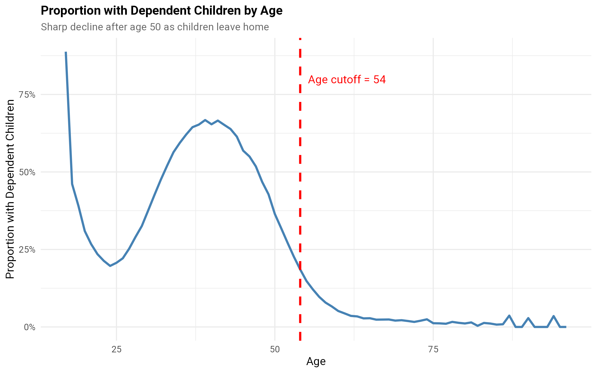

<!--
INPUT FILES (paths relative to the project directory; wage_file_outputs <- "./processing_files/"):
  processing_files/X_ordered_numeric_1061763_industry_269.Rdata   made by Supplementary_1
        objects used: X_ordered_numeric (13 numeric covariates), Y (log hourly wage), W (1 for male), weights_supplied, weights_dummy
  processing_files/Xtrain_500000_20.Rdata                         made by Supplementary_1
        objects used: Xtrain (8 factors, 5 numeric), Y, W, weights_supplied, weights_dummy. Only needed to make the age-truncated
        copy that Supplementary_5 loads.
  wageinequality.bib                                              bibliography

OUTPUT FILES:
  processing_files/capped_weights_segregated_workforce.Rdata      the low / middle / high propensity segments (input to Supplementary_3 and 4)
  processing_files/numeric_age_truncated_data.Rdata               the age-restricted numeric data (input to Supplementary_5)
  processing_files/X_age_truncated_data.Rdata                     the age-restricted Xtrain sample (input to Supplementary_5)
  Supplementary_2_results.Rdata                                   the list res: every number in the text and tables
  Supplementary_2_tests.txt, Supplementary_2_session.txt          test results and session information
  Supplementary_2_figs/parent_by_age.png, Supplementary_2_figs/capped_weighted_age_truncted_propensities_hstogram.png

FLAGS (set in the setup chunk):
  eval_flag      TRUE runs the analysis chunks (needs processing_files/ and a lot of memory: the forests are fitted on 659,436 rows).
                 FALSE knits the text and tables from Supplementary_2_results.Rdata and the saved figures.
  fig_eval_flag  TRUE runs the figure chunks (the ones with png()/ggsave()); they need the objects made by the analysis chunks.
  n_trees, tune_parameters, n_threads   settings of the causal forests.

UNIT TESTS: chunks named tests_* call run_test("description", { testthat::expect_...() }). The results are listed by the last chunk
  and written to Supplementary_2_tests.txt. A failing test is a statement in the text, or an assumption of the analysis, that no longer holds.

Earlier versions of this file also compared the direct, IPW and AIPW estimators on the 500,000 row sample Xtrain and compared AIPW with ranger
and with grf. That is done properly, on the final sample, in Supplementary_3, and was removed from here.

HPC: salloc --account=<ACCOUNT> --mem=200GB --nodes=1 --ntasks=1 --cpus-per-task=32 -J interactive -t 6:00:00 srun --cpus-per-task=32 --pty /bin/bash -l
     module load pandoc texlive
-->

```{r setup, include=FALSE}
knitr::opts_chunk$set(fig.width=6, fig.height=6, dpi=300,echo = FALSE)
knitr::opts_chunk$set(fig.pos = "H", out.extra = "")

# eval_flag: TRUE runs the analysis chunks. FALSE knits the text, the tables (from the saved results) and the saved figures.
# fig_eval_flag: TRUE runs the chunks that write the figures; they need the objects made by the analysis chunks.
eval_flag <- TRUE
fig_eval_flag <- TRUE
if (!eval_flag) fig_eval_flag <- FALSE

# settings of the causal forests
n_trees <- 2000
tune_parameters <- "all"
n_threads <- NULL        # NULL: grf uses all of the cores

# Defaults for every later chunk: run only if eval_flag, and keep output out of the PDF. Chunks that differ say so in their header.
knitr::opts_chunk$set(eval = eval_flag, results = 'hide', fig.show = 'hide', warning = FALSE, message = FALSE)

test_log <- "Supplementary_2_tests.txt"
results_file <- "Supplementary_2_results.Rdata"   # saved at the end of the analysis; loaded when eval_flag is FALSE
test_results <- data.frame(test = character(), result = character(), detail = character(), stringsAsFactors = FALSE)
run_test <- function(description, code) {
  detail <- tryCatch({ force(code); "" }, error = function(e) conditionMessage(e))
  result <- if (identical(detail, "")) "PASS" else "FAIL"
  test_results[nrow(test_results) + 1, ] <<- c(description, result, detail)
  cat(sprintf("[%s] %s\n", result, description))
  if (result == "FAIL") cat("       ", detail, "\n")
  invisible(result == "PASS")
}

```

```{r libraries, echo=FALSE, eval=TRUE, include=FALSE}
# This chunk always runs: loading kableExtra adds the LaTeX packages that the tables need.
options(width=160)
library(grf)
library(ggplot2)
library(tidyverse)
library(lmtest)
library(sandwich)
library(testthat)
library(knitr)
library(kableExtra)

# helpers for the inline numbers in the text
f <- function(x, d = 2) formatC(x, format = "f", digits = d, big.mark = ",")
pct <- function(x, d = 1) formatC(100 * x, format = "f", digits = d)
if (!eval_flag) load(results_file)   # res: the numbers behind the text and the tables

```

```{r}
#set the path for the outputs
# (wage_data_dir is not needed in this file: the raw data is read only in Supplementary 1)
# PATHS (must be set): run this file from the project directory. wage_file_outputs is where the intermediate .Rdata files are
# read from and written to; change it here if they are somewhere else.
wage_file_outputs <- "./processing_files/"
res <- list()   # every number used in the text and the tables is stored here and saved at the end

```

\clearpage
# Discussion

This file establishes the analysis sample and two things about it.

1. The propensity score $\he(x) = P(W=1 \mid X=x)$ has extreme values: the data are strongly segregated by gender. We therefore split the sample into three
   segments, with $\he < 0.1$, $0.1 \le \he \le 0.9$ and $\he > 0.9$. See figure \@ref(fig:propensitieshistogram).
2. The variable `children` means *dependent* children and so it needs an adjustment. We restrict the ages to 26--53, which keeps most people whose
   dependent children have not yet left home.

The segments are saved in `capped_weights_segregated_workforce.Rdata`, which is the input to Supplementary 3 and 4.

# Data

```{r data}
load(paste(wage_file_outputs ,"X_ordered_numeric_1061763_industry_269.Rdata",sep="")) # X_ordered_numeric, W, Y, weights_supplied, weights_dummy
X_ordered_numeric_269 <- X_ordered_numeric
W.ordered_numeric <- W
Y.ordered_numeric <- Y
weights_dummy.X_ordered_numeric_269 <- weights_dummy

# the Census weights, capped at the 95th percentile
weight_cap    <- quantile(weights_supplied, 0.95, na.rm = TRUE)
weights_supplied.X_ordered_numeric_269 <- pmin(weights_supplied, weight_cap)
rm(W, Y, X_ordered_numeric, weights_dummy, weights_supplied)

res$n_all      <- nrow(X_ordered_numeric_269)
res$weight_cap <- unname(weight_cap)
res$n_capped   <- sum(weights_supplied.X_ordered_numeric_269 == weight_cap)

```

```{r tests_data, echo=FALSE, eval=eval_flag, include=FALSE}
run_test("data: 1,061,763 people and 13 numeric covariates", {
  expect_equal(dim(X_ordered_numeric_269), c(1061763, 13))
  expect_true(all(sapply(X_ordered_numeric_269, is.numeric)))
})
run_test("data: W is 0/1, Y is finite and the weights are positive and finite", {
  expect_true(all(W.ordered_numeric %in% c(0, 1)))
  expect_true(all(is.finite(Y.ordered_numeric)))
  expect_true(all(is.finite(weights_supplied.X_ordered_numeric_269) & weights_supplied.X_ordered_numeric_269 > 0))
})
run_test("data: the capped weights do not exceed the cap, and about 5 percent of people are capped", {
  expect_lte(max(weights_supplied.X_ordered_numeric_269), res$weight_cap)
  expect_lt(abs(res$n_capped / res$n_all - 0.05), 0.02)
})

```

The cleaned sample (Supplementary 1) has `r f(res$n_all, 0)` people and 13 numeric covariates. `Y` is the log hourly wage and `W` is 1 for men.
The Census person weights are capped at their 95th percentile (`r f(res$weight_cap, 1)`) "to prevent numerical instability" (the largest weights
belong to a few groups, such as non-English speakers, and a few people would otherwise dominate the weighted estimates; see `Discussion.Rmd`). The capped
weights are the ones used in every later analysis.

# The dependent children issue

The `children` variable in the PUMS data does not measure lifetime parenthood. Instead, it counts **dependent children** as defined by the American Community Survey (ACS):

- Children under 15 years of age
- Dependent students aged 15-24 years
- People aged 16 to 18 years who are in full-time education and live with their parent(s) or grandparent(s)

This definition creates a systematic data quality problem: parents whose children have grown up and left home are incorrectly coded as non-parents (`children = 0`).

## Evidence of the problem

```{r parent_by_age}
# Proportion of people with dependent children, by age group (all ages, before the restriction)
age_breaks <- c(17, 22, 27, 32, 37, 42, 47, 52, 57, 62, 67, 72, 100)
age_labels <- c("17-22", "23-27", "28-32", "33-37", "38-42", "43-47", "48-52", "53-57", "58-62", "63-67", "68-72", "73+")
res$parent_by_age <- X_ordered_numeric_269 %>%
  mutate(age_group = cut(age, breaks = age_breaks, labels = age_labels, include.lowest = TRUE),
         is_parent = children > 0) %>%
  group_by(age_group) %>%
  summarize(n = n(), n_parents = sum(is_parent), prop_parent = mean(is_parent) * 100, .groups = "drop") %>%
  mutate(age_group = as.character(age_group))

# the proportion at each age, for the figure
res$age_profile <- aggregate(as.numeric(children > 0) ~ age, data = X_ordered_numeric_269, FUN = mean)
names(res$age_profile) <- c("age", "prop_parent")

# implausible values among the young
young <- X_ordered_numeric_269$age <= 20
res$young <- list(n = sum(young), max_children = max(X_ordered_numeric_269$children[young]),
                  n_8plus = sum(young & X_ordered_numeric_269$children >= 8))

```

```{r tests_parent_by_age, echo=FALSE, eval=eval_flag, include=FALSE}
run_test("children: the proportion with dependent children peaks at ages 38-42", {
  expect_equal(res$parent_by_age$age_group[which.max(res$parent_by_age$prop_parent)], "38-42")
})
run_test("children: fewer than 7 percent have dependent children from age 58, and fewer than 20 percent at 53-57", {
  p <- setNames(res$parent_by_age$prop_parent, res$parent_by_age$age_group)
  expect_true(all(p[c("58-62", "63-67", "68-72", "73+")] < 7))
  expect_lt(p[["53-57"]], 20)
})
run_test("children: there are people aged 20 or less with implausibly many (8 or more) children", {
  expect_gt(res$young$n_8plus, 0)
})
run_test("children: the age groups cover everyone", {
  expect_equal(sum(res$parent_by_age$n), res$n_all)
})

```

```{r table_parent_by_age, eval=TRUE, results='asis'}
pt <- res$parent_by_age
kable(data.frame(pt$age_group, f(pt$n, 0), f(pt$n_parents, 0), sprintf("%.1f\\%%", pt$prop_parent)),
      format = "latex", booktabs = TRUE, label = "parentsbyagetable", escape = FALSE,
      col.names = c("Age Group", "N", "N Parents", "\\% Parents"),
      caption = "Proportion with Dependent Children by Age Group",
      align = c('l', 'r', 'r', 'r')) %>%
  kable_styling(latex_options = "hold_position") %>%
  row_spec(which(pt$prop_parent < 7), background = "#ffcccc")   # highlight the problematic rows

```

```{r figure_parent_by_age, eval=fig_eval_flag}
age_plot <- ggplot(res$age_profile, aes(x = age, y = prop_parent)) +
  geom_line(color = "steelblue", linewidth = 1) +
  geom_vline(xintercept = 54, linetype = "dashed", color = "red", linewidth = 1) +
  annotate("text", x = 54, y = 0.9 * max(res$age_profile$prop_parent), label = "Age cutoff = 54", hjust = -0.1, color = "red") +
  scale_y_continuous(labels = scales::percent_format()) +
  labs(title = "Proportion with Dependent Children by Age",
       subtitle = "Sharp decline after age 50 as children leave home",
       x = "Age", y = "Proportion with Dependent Children") +
  theme_minimal() +
  theme(plot.title = element_text(face = "bold", size = 12), plot.subtitle = element_text(size = 10, color = "gray40"))
ggsave("./Supplementary_2_figs/parent_by_age.png", age_plot, width = 8, height = 5, dpi = 300)

```

```{r parentbyage, echo=FALSE, eval=TRUE, results='markup', fig.show='asis', fig.cap="Parents by Age", out.width = '50%',fig.align = 'center'}


```

```{r, eval=TRUE}
# the proportions quoted in the text
pp <- function(g) res$parent_by_age$prop_parent[res$parent_by_age$age_group == g]

```

Table \@ref(tab:parentsbyagetable) and Figure \@ref(fig:parentbyage) reveal four patterns:

-  ages 17-22: `r f(pp("17-22"), 0)`\% have "dependent children", but the values are implausible: among the `r f(res$young$n, 0)` people aged 20 or less,
   `r f(res$young$n_8plus, 0)` have 8 or more children and the maximum is `r res$young$max_children`;
-  ages 23-42: the proportion with dependent children increases from `r f(pp("23-27"), 0)`\% to `r f(pp("38-42"), 0)`\% (young families forming);
-  ages 43-52: the peak is at 38-42 and then the proportion falls: `r f(pp("43-47"), 0)`\% at 43-47, `r f(pp("48-52"), 0)`\% at 48-52;
-  ages 53+: sharp decline as children age out:

      - ages 53-57: only `r f(pp("53-57"), 0)`\% have dependent children
      - ages 58-72: fewer than `r f(max(pp("58-62"), pp("63-67"), pp("68-72")), 0)`\% have dependent children
      - ages 73+: under `r f(ceiling(pp("73+")), 0)`\% have dependent children

This issue creates problems for any analysis of parent effects on the gender wage gap.
To address this data quality issue, we restrict our analysis to individuals aged 26 to 53 (`age > 25` and `age < 54` in the code).
The upper limit is the one argued for above. The lower limit removes the youngest group, for which the `children` values are implausible. This threshold ensures:

- focus on active parenting years: most dependent children are still at home
- reduce misclassification: minimizes the proportion of parents incorrectly coded as non-parents
- clear interpretation: parent effects reflect current childrearing responsibilities, not historical parenthood

## Restricting the ages

```{r age_restriction}
keep_age <- (X_ordered_numeric_269$age > 25) & (X_ordered_numeric_269$age < 54)
X_ordered_numeric_269 <- X_ordered_numeric_269[keep_age, ]
W.ordered_numeric <- W.ordered_numeric[keep_age]
Y.ordered_numeric <- Y.ordered_numeric[keep_age]
weights_dummy.X_ordered_numeric_269    <- weights_dummy.X_ordered_numeric_269[keep_age]
weights_supplied.X_ordered_numeric_269 <- weights_supplied.X_ordered_numeric_269[keep_age]

res$n_age <- nrow(X_ordered_numeric_269)
res$n_men <- sum(W.ordered_numeric == 1)
res$n_women <- sum(W.ordered_numeric == 0)

```

```{r tests_age_restriction, echo=FALSE, eval=eval_flag, include=FALSE}
run_test("age restriction: ages are 26 to 53 and 659,436 people remain (62 percent)", {
  expect_equal(range(X_ordered_numeric_269$age), c(26, 53))
  expect_equal(res$n_age, 659436)
  expect_equal(round(100 * res$n_age / res$n_all), 62)
})
run_test("age restriction: all of the vectors have the same length", {
  expect_equal(length(W.ordered_numeric), res$n_age)
  expect_equal(length(Y.ordered_numeric), res$n_age)
  expect_equal(length(weights_supplied.X_ordered_numeric_269), res$n_age)
  expect_equal(length(weights_dummy.X_ordered_numeric_269), res$n_age)
})

```

The impact of the age restriction: the original sample has `r f(res$n_all, 0)` people and `r f(res$n_age, 0)` (`r pct(res$n_age / res$n_all, 0)`\%) remain; of these
`r f(res$n_men, 0)` are men and `r f(res$n_women, 0)` are women. (The propensity scores below are estimated after the age restriction, so age is applied first.)

## Saving the age-restricted data for Supplementary 5

Supplementary 5 loads the age-restricted numeric data and the age-restricted `Xtrain` sample (500,000 people, factor version of the covariates, before the restriction).
The weights are capped in the same way.

```{r save_age_truncated}
save(X_ordered_numeric_269, W.ordered_numeric, Y.ordered_numeric, weights_dummy.X_ordered_numeric_269, weights_supplied.X_ordered_numeric_269,
     file = paste(wage_file_outputs, "numeric_age_truncated_data.Rdata", sep = ""))

load(paste(wage_file_outputs, "Xtrain_500000_20.Rdata", sep = ""))   # Xtrain, W, Y, weights_supplied, weights_dummy
res$n_xtrain <- nrow(Xtrain)
weights_supplied.Xtrain <- pmin(weights_supplied, quantile(weights_supplied, 0.95, na.rm = TRUE))
weights_dummy.Xtrain    <- weights_dummy
W.Xtrain <- W
Y.Xtrain <- Y
keep_xtrain <- (Xtrain$age > 25) & (Xtrain$age < 54)
Xtrain <- Xtrain[keep_xtrain, ]
W.Xtrain <- W.Xtrain[keep_xtrain]
Y.Xtrain <- Y.Xtrain[keep_xtrain]
weights_dummy.Xtrain    <- weights_dummy.Xtrain[keep_xtrain]
weights_supplied.Xtrain <- weights_supplied.Xtrain[keep_xtrain]
res$n_xtrain_age <- nrow(Xtrain)
save(Xtrain, W.Xtrain, Y.Xtrain, weights_dummy.Xtrain, weights_supplied.Xtrain,
     file = paste(wage_file_outputs, "X_age_truncated_data.Rdata", sep = ""))
rm(Xtrain, W, Y, weights_supplied, weights_dummy, W.Xtrain, Y.Xtrain, weights_dummy.Xtrain, weights_supplied.Xtrain)

```

```{r tests_save_age_truncated, echo=FALSE, eval=eval_flag, include=FALSE}
run_test("xtrain: 500,000 people before the age restriction and 310,403 after", {
  expect_equal(res$n_xtrain, 500000)
  expect_equal(res$n_xtrain_age, 310403)
})

```

# Difference in means

The point estimate of the average gap is the difference in the means of the log wage, $\bar Y_{W=1} - \bar Y_{W=0}$, here with the capped Census weights. It is simple and
"model-free", valid in randomized settings and a first description of the gap in observational ones, where it takes no account of the differences between men and women in the covariates.
`lm` does not give heteroskedasticity-robust standard errors, so the weighted regression of $Y$ on $W$ is used with the HC2 estimator.

```{r difference_in_means}
w <- weights_supplied.X_ordered_numeric_269
ols <- lm(Y.ordered_numeric ~ W.ordered_numeric, weights = w)
dim_hc2 <- coeftest(ols, vcov = vcovHC(ols, type = "HC2"))[2, ]
res$dim <- c(estimate = unname(dim_hc2["Estimate"]), std.error = unname(dim_hc2["Std. Error"]),
             t.stat = unname(dim_hc2["t value"]),
             weighted_by_hand = weighted.mean(Y.ordered_numeric[W.ordered_numeric == 1], w[W.ordered_numeric == 1]) -
                                weighted.mean(Y.ordered_numeric[W.ordered_numeric == 0], w[W.ordered_numeric == 0]),
             unweighted = mean(Y.ordered_numeric[W.ordered_numeric == 1]) - mean(Y.ordered_numeric[W.ordered_numeric == 0]))

```

```{r tests_difference_in_means, echo=FALSE, eval=eval_flag, include=FALSE}
run_test("difference in means: the weighted regression and the weighted means agree", {
  expect_equal(res$dim[["estimate"]], res$dim[["weighted_by_hand"]], tolerance = 1e-8)
})
run_test("difference in means: the weighted gap is between 0.15 and 0.22 and the t statistic is above 50", {
  expect_gt(res$dim[["estimate"]], 0.15)
  expect_lt(res$dim[["estimate"]], 0.22)
  expect_gt(res$dim[["t.stat"]], 50)
})

```

For the age-restricted sample the weighted difference in means is `r f(res$dim[["estimate"]], 4)` (HC2 standard error `r f(res$dim[["std.error"]], 4)`, $t$ = `r f(res$dim[["t.stat"]], 1)`)
and the unweighted difference is `r f(res$dim[["unweighted"]], 4)`. A log wage difference of `r f(res$dim[["estimate"]], 3)` is men earning `r pct(exp(res$dim[["estimate"]]) - 1, 0)`\% more than women.
This is the first row of the comparison table in Supplementary 3.

# A first causal forest and the propensity scores

AIPW-based estimation using random forests can be done with the package `grf`. The function
`average_treatment_effect` computes the AIPW estimate of the treatment effect, and uses forest-based estimates of the
outcome model and propensity scores. Cross-fitting is accomplished via out-of-bag predictions.
We fit a causal forest to the whole age-restricted sample, with the capped Census weights as `sample.weights`.
Its out-of-bag estimate of the propensity score, `W.hat`, is the propensity used to define the segments.

```{r causal_forest}
tau.forest <- causal_forest(X_ordered_numeric_269, Y.ordered_numeric, W.ordered_numeric,
                            sample.weights = weights_supplied.X_ordered_numeric_269,
                            num.trees = n_trees, tune.parameters = tune_parameters, num.threads = n_threads, seed = 123)

# calibration
balance <- grf::test_calibration(tau.forest)
res$calibration <- balance[, c("Estimate", "Std. Error")]
rownames(res$calibration) <- rownames(balance)

# variable importance
var_imp <- c(variable_importance(tau.forest))
names(var_imp) <- names(X_ordered_numeric_269)
res$var_imp <- rev(sort(var_imp))
res$top_vars_text <- paste0("`", names(res$var_imp)[1:3], "` (", f(res$var_imp[1:3], 2), ")", collapse = ", ")

# out-of-bag estimates of tau(x), E[Y|X] and the propensity e(x)
tau.hat <- predict(tau.forest)$predictions
propensities <- tau.forest$W.hat
res$prop_range <- range(propensities)

# average treatment effect. target.sample = "all" is NaN here, because the propensities reach 0 and 1; "overlap" weights by e(1-e)
forest.ate <- average_treatment_effect(tau.forest, target.sample = "overlap")
res$ate_overlap <- forest.ate
res$ate_all <- suppressWarnings(average_treatment_effect(tau.forest, target.sample = "all"))
res$ate_all_text <- if (anyNA(res$ate_all)) {
  "(With `target.sample = \"all\"` the estimate is `NaN`, because some estimated propensities are 0 or 1; see the next section.)"
} else paste0("(With `target.sample = \"all\"` the estimate is ", f(res$ate_all[["estimate"]], 3), ".)")

```

```{r tests_causal_forest, echo=FALSE, eval=eval_flag, include=FALSE}
run_test("causal forest: the propensities are in [0,1], with no missing values", {
  expect_equal(length(propensities), res$n_age)
  expect_false(anyNA(propensities))
  expect_true(all(propensities >= 0 & propensities <= 1))
})
run_test("causal forest: the propensities reach below 0.05 and above 0.95 (the reason for the segments)", {
  expect_lt(res$prop_range[1], 0.05)
  expect_gt(res$prop_range[2], 0.95)
})
run_test("causal forest: calibration, mean forest prediction within 0.05 of 1 and differential forest prediction between 1 and 1.4", {
  expect_lt(abs(res$calibration["mean.forest.prediction", "Estimate"] - 1), 0.05)
  expect_gt(res$calibration["differential.forest.prediction", "Estimate"], 1)
  expect_lt(res$calibration["differential.forest.prediction", "Estimate"], 1.4)
})
run_test("causal forest: the overlap-weighted ATE is between 0.10 and 0.15 with a standard error below 0.005", {
  expect_gt(res$ate_overlap[["estimate"]], 0.10)
  expect_lt(res$ate_overlap[["estimate"]], 0.15)
  expect_lt(res$ate_overlap[["std.err"]], 0.005)
})

```

The overlap-weighted AIPW estimate of the average gap is `r f(res$ate_overlap[["estimate"]], 3)` (standard error `r f(res$ate_overlap[["std.err"]], 3)`), smaller
than the difference in means (`r f(res$dim[["estimate"]], 3)`): adjusting for the covariates reduces the estimated gap. `r res$ate_all_text`

The calibration test gives a mean forest prediction coefficient of `r f(res$calibration["mean.forest.prediction", "Estimate"], 3)` and a differential forest prediction coefficient
of `r f(res$calibration["differential.forest.prediction", "Estimate"], 3)` (standard error `r f(res$calibration["differential.forest.prediction", "Std. Error"], 3)`). A value of 1 for both would be perfect; a differential
coefficient above 1 means that the forest's variation in the effect is smaller than the variation that is there. The variables the forest splits on most are
`r res$top_vars_text`. See `Discussion.Rmd` for the discussion of the weights.

## Assessing overlap

It is important to check the estimated propensity scores. If they cluster at zero or one, we should expect
IPW and AIPW estimators to behave very poorly. Figure \@ref(fig:propensitieshistogram) shows that there are regions of the feature space
where the propensities are either too high (near 1) or too low (near 0). Even when overlap holds, when the propensity score is small AIPW can have unstable performance.
In this case the overlap is a cause for concern.

```{r figure_propensities, eval=fig_eval_flag}
png("Supplementary_2_figs/capped_weighted_age_truncted_propensities_hstogram.png")
hist(propensities, breaks = 50, xlim = c(0, 1), xlab = "Propensity Score", main = "")
abline(v = 0.1, col = "red", lwd = 3)
abline(v = 0.9, col = "red", lwd = 3)
dev.off()

```

```{r propensitieshistogram, echo=FALSE, eval=TRUE, results='markup', fig.show='asis', fig.cap="Histogram of propensity", out.width = '50%',fig.align = 'center'}
knitr::include_graphics("./Supplementary_2_figs/capped_weighted_age_truncted_propensities_hstogram.png")

```

# Trimming by propensity

Observations with a propensity near 0 or 1 have no comparable people of the other gender. We study how sensitive the estimated average gap is to dropping them,
for the thresholds $\alpha$ = 0.05 to 0.15 (people are kept when $\min(\he, 1-\he) > \alpha$). For each threshold the causal forest is refitted to the trimmed data, with the
propensities of the full fit passed as `W.hat`, and the overlap-weighted average treatment effect and the calibration are recorded.

```{r trimming}
alphas <- c(0.05, 0.075, 0.10, 0.125, 0.15)
analyze_trimming <- function(alpha) {
  keep <- pmin(propensities, 1 - propensities) > alpha
  forest.trimmed <- causal_forest(X = X_ordered_numeric_269[keep, ], Y = Y.ordered_numeric[keep], W = W.ordered_numeric[keep],
                                  W.hat = propensities[keep], sample.weights = weights_supplied.X_ordered_numeric_269[keep],
                                  num.trees = n_trees, num.threads = n_threads, seed = 123)
  ate <- average_treatment_effect(forest.trimmed, target.sample = "overlap")
  cal <- test_calibration(forest.trimmed)
  data.frame(alpha = alpha, n_total = length(keep), n_kept = sum(keep), prop_kept = mean(keep),
             ate = ate[["estimate"]], ate_se = ate[["std.err"]], cal_mean = cal[1, 1], cal_diff = cal[2, 1])
}
res$trimming <- do.call(rbind, lapply(alphas, analyze_trimming))

```

```{r tests_trimming, echo=FALSE, eval=eval_flag, include=FALSE}
run_test("trimming: the number kept falls as the threshold rises, and 87 percent are kept at 0.1", {
  expect_true(all(diff(res$trimming$n_kept) < 0))
  expect_equal(round(100 * res$trimming$prop_kept[res$trimming$alpha == 0.10]), 87)
})
run_test("trimming: the overlap-weighted ATE is between 0.09 and 0.16 for every threshold and varies by less than 0.01", {
  expect_true(all(res$trimming$ate > 0.09 & res$trimming$ate < 0.16))
  expect_lt(diff(range(res$trimming$ate)), 0.01)
})
run_test("trimming: calibration stays near 1 (mean within 0.05, differential between 0.9 and 1.4)", {
  expect_true(all(abs(res$trimming$cal_mean - 1) < 0.05))
  expect_true(all(res$trimming$cal_diff > 0.9 & res$trimming$cal_diff < 1.4))
})

```

```{r table_trimming, eval=TRUE, results='asis'}
tr <- res$trimming
kable(data.frame(f(tr$alpha, 3), f(tr$n_total, 0), f(tr$n_kept, 0), f(tr$prop_kept, 3), f(tr$ate, 3), f(tr$ate_se, 3), f(tr$cal_mean, 3), f(tr$cal_diff, 3)),
      format = "latex", booktabs = TRUE, label = "trimmingtable",
      caption = "Sensitivity to trimming (capped weights, ages 26--53). ATE is the overlap-weighted average treatment effect.",
      col.names = c("Threshold", "N Total", "N Kept", "Prop Kept", "ATE", "ATE SE", "Cal Mean", "Cal Differential"),
      align = rep("r", 8)) %>%
  kable_styling(latex_options = "hold_position")

```

Table \@ref(tab:trimmingtable) shows that the estimated gap is stable: it varies between `r f(min(res$trimming$ate), 3)` and `r f(max(res$trimming$ate), 3)` over the thresholds,
and the calibration scores are good for all of them. With $\alpha=0.1$ the trimming retains `r pct(res$trimming$prop_kept[res$trimming$alpha == 0.10], 0)`\% of the age-restricted data
(`r f(res$trimming$n_kept[res$trimming$alpha == 0.10], 0)` of `r f(res$n_age, 0)` people) and gives an estimate of `r f(res$trimming$ate[res$trimming$alpha == 0.10], 3)`.
(An earlier version of this table was labelled "ATE" but used `target.sample = "control"`, which is the effect for women. It uses `"overlap"`, as the main estimate above, here.)

# The segments

We take $\alpha = 0.1$ and divide the sample into three segments by the propensity: **low** ($\he \le 0.1$, mainly women), **middle** ($0.1 < \he < 0.9$) and **high** ($\he \ge 0.9$, mainly men).
The segments are saved, with the covariates, outcomes, `W` and both sets of weights, in `capped_weights_segregated_workforce.Rdata`. This file is the input to Supplementary 3 and 4.

```{r segments}
alpha <- 0.1
keep <- pmin(propensities, 1 - propensities) > alpha
minp <- which(propensities <= alpha)
maxp <- which(propensities >= 1 - alpha)
midp <- which(keep)

X_ordered_numeric_269_trimmed <- X_ordered_numeric_269[keep, ]
Y.trimmed <- Y.ordered_numeric[keep]
W.trimmed <- W.ordered_numeric[keep]
propensities_trimmed <- propensities[keep]
weights_supplied.X_ordered_numeric_269_trimmed <- weights_supplied.X_ordered_numeric_269[keep]
weights_dummy.X_ordered_numeric_269_trimmed    <- weights_dummy.X_ordered_numeric_269[keep]

X_ordered_numeric_269.low <- X_ordered_numeric_269[minp, ]
Y.low <- Y.ordered_numeric[minp]
W.low <- W.ordered_numeric[minp]
weights_supplied.X_ordered_numeric_269_low <- weights_supplied.X_ordered_numeric_269[minp]
weights_dummy.X_ordered_numeric_269_low    <- weights_dummy.X_ordered_numeric_269[minp]

X_ordered_numeric_269.high <- X_ordered_numeric_269[maxp, ]
Y.high <- Y.ordered_numeric[maxp]
W.high <- W.ordered_numeric[maxp]
weights_supplied.X_ordered_numeric_269_high <- weights_supplied.X_ordered_numeric_269[maxp]
weights_dummy.X_ordered_numeric_269_high    <- weights_dummy.X_ordered_numeric_269[maxp]

save(X_ordered_numeric_269_trimmed, Y.trimmed, W.trimmed, propensities_trimmed, weights_supplied.X_ordered_numeric_269_trimmed, weights_dummy.X_ordered_numeric_269_trimmed,
     X_ordered_numeric_269.low, Y.low, W.low, weights_supplied.X_ordered_numeric_269_low, weights_dummy.X_ordered_numeric_269_low,
     X_ordered_numeric_269.high, Y.high, W.high, weights_supplied.X_ordered_numeric_269_high, weights_dummy.X_ordered_numeric_269_high,
     minp, maxp, midp, file = paste(wage_file_outputs, "capped_weights_segregated_workforce.Rdata", sep = ""))

# the segments: people, the share of men and the share outside [0.1, 0.9]
seg_summary <- function(name, idx) data.frame(segment = name, n = length(idx), women = sum(W.ordered_numeric[idx] == 0), men = sum(W.ordered_numeric[idx] == 1),
                                             pct_men = 100 * mean(W.ordered_numeric[idx] == 1))
res$segments <- rbind(seg_summary("Low propensity (e <= 0.1)", minp), seg_summary("Middle (0.1 < e < 0.9)", midp),
                      seg_summary("High propensity (e >= 0.9)", maxp), seg_summary("All", seq_along(propensities)))

```

```{r tests_segments, echo=FALSE, eval=eval_flag, include=FALSE}
run_test("segments: they are disjoint and cover the sample", {
  expect_equal(length(minp) + length(midp) + length(maxp), res$n_age)
  expect_equal(length(unique(c(minp, midp, maxp))), res$n_age)
  expect_equal(length(Y.low) + length(Y.trimmed) + length(Y.high), res$n_age)
})
run_test("segments: the middle segment is 85 to 90 percent of the age-restricted sample (it was 574,930 people, 87 percent, in one run: the propensities are estimated by a random forest, so a few hundred people near 0.1 or 0.9 change with the seed)", {
  expect_gt(length(midp) / length(propensities), 0.85)
  expect_lt(length(midp) / length(propensities), 0.90)
  expect_equal(round(100 * length(midp) / res$n_age), 87)
})
run_test("segments: mostly women in the low segment (under 25 percent men), mostly men in the high segment (over 75 percent)", {
  expect_lt(res$segments$pct_men[1], 25)
  expect_gt(res$segments$pct_men[3], 75)
})
run_test("segments: the propensities lie in the right ranges", {
  expect_true(all(propensities[minp] <= 0.1))
  expect_true(all(propensities[maxp] >= 0.9))
  expect_true(all(propensities_trimmed > 0.1 & propensities_trimmed < 0.9))
})
run_test("segments: the saved covariates, outcomes and weights have matching lengths", {
  expect_equal(nrow(X_ordered_numeric_269.low), length(weights_supplied.X_ordered_numeric_269_low))
  expect_equal(nrow(X_ordered_numeric_269_trimmed), length(weights_supplied.X_ordered_numeric_269_trimmed))
  expect_equal(nrow(X_ordered_numeric_269.high), length(weights_supplied.X_ordered_numeric_269_high))
  expect_equal(length(W.low), nrow(X_ordered_numeric_269.low))
  expect_equal(length(W.high), nrow(X_ordered_numeric_269.high))
})

```

```{r table_segments, eval=TRUE, results='asis'}
sg <- res$segments
kable(data.frame(sg$segment, f(sg$n, 0), f(sg$women, 0), f(sg$men, 0), f(sg$pct_men, 1)),
      format = "latex", booktabs = TRUE, label = "segmentstable",
      caption = "The propensity score segments (ages 26--53)",
      col.names = c("Segment", "People", "Women", "Men", "Percent men"),
      align = c("l", "r", "r", "r", "r")) %>%
  kable_styling(latex_options = "hold_position") %>%
  row_spec(4, bold = TRUE)

```

Table \@ref(tab:segmentstable) shows the segments. The low segment is `r pct(1 - res$segments$pct_men[1] / 100, 0)`\% women and the high segment is `r f(res$segments$pct_men[3], 0)`\% men; together they
contain `r pct((res$segments$n[1] + res$segments$n[3]) / res$segments$n[4], 0)`\% of the sample. These are the people in the heavily segregated parts of the workforce, for whom there are few comparable people of the other gender.

```{r save_results}
save(res, file = results_file)

```

```{r tests_summary, echo=FALSE, eval=eval_flag, include=FALSE}
# Results of all the tests, written to test_log; the session information is written next to it.
print(test_results[, c("result", "test")], right = FALSE)
cat(sum(test_results$result == "PASS"), "of", nrow(test_results), "tests passed\n")
write.table(test_results, test_log, sep = "\t", row.names = FALSE, quote = FALSE)
writeLines(capture.output(sessionInfo()), "Supplementary_2_session.txt")

```
