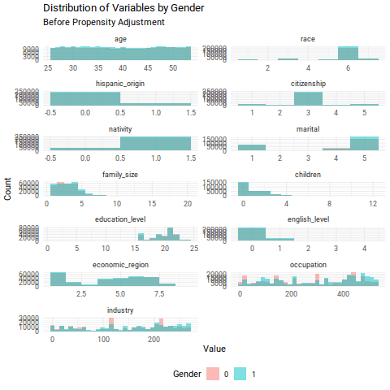
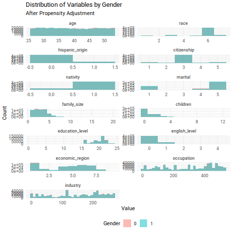
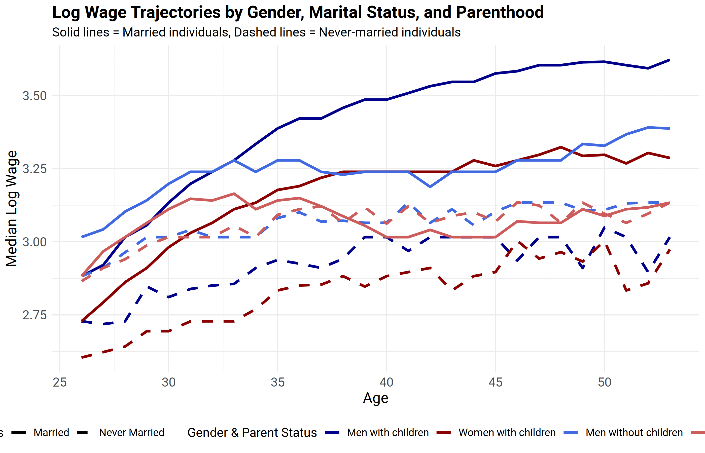
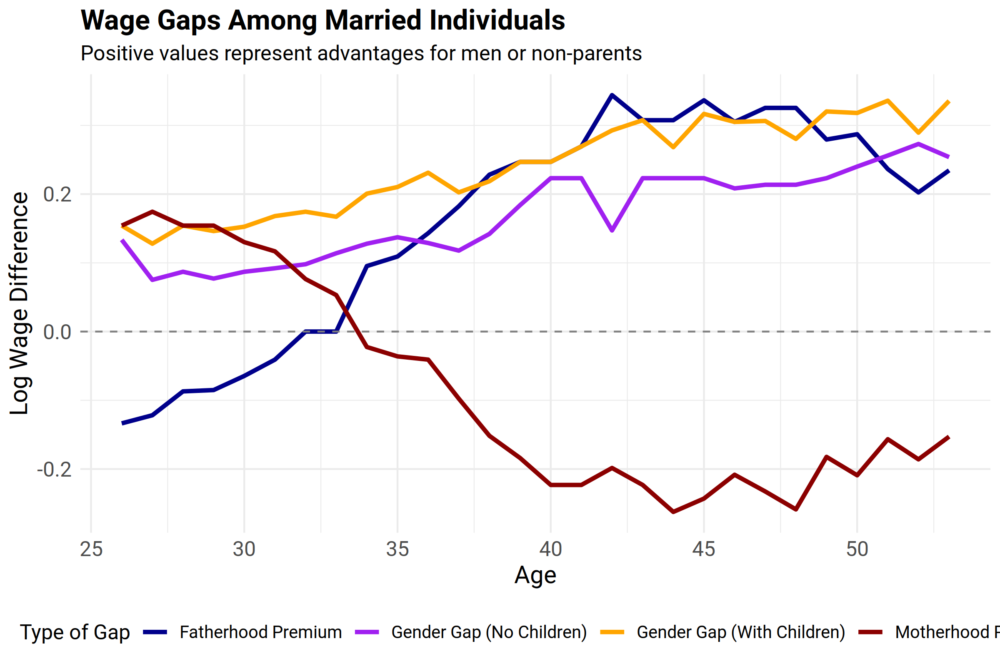

<!--
INPUT FILES (paths relative to the project directory; wage_file_outputs <- "./processing_files/"):
  processing_files/capped_weights_segregated_workforce.Rdata   made by Supplementary_2 (last chunk, "trim by propensity and save")
        objects used: Y.trimmed, W.trimmed, X_ordered_numeric_269_trimmed, weights_supplied.X_ordered_numeric_269_trimmed
        expected: about 575,000 rows (85 to 90 percent of the sample), 13 numeric columns (ages 26-53, 0.1 < propensity < 0.9)
  processing_files/industry_mapping_full_description.Rdata     made by Supplementary_1 (mapping chunk)
        object used: industry_mapping_full_description (original_code, new_code, description; 269 rows)
  wageinequality.bib                                           bibliography
  Supplementary_3_figs/*.png                                   figures, written by the figure chunks and included with include_graphics()

FLAGS (set in the setup chunk):
  eval_flag      TRUE runs the analysis chunks. FALSE knits the text and the saved figures only.
  fig_eval_flag  TRUE runs the figure chunks (the ones with png()); they need the objects made by the analysis chunks.

UNIT TESTS: chunks named tests_* call run_test("description", { testthat::expect_...() }). The results are listed by the last chunk
  and written to Supplementary_3_tests.txt. A failing test is a statement in the text, or an assumption of the analysis, that no longer holds.

SAVED RESULTS: the chunk save_results writes Supplementary_3_results.Rdata (the objects behind the four tables). The table chunks run even
  when eval_flag is FALSE, and then load that file.

FIGURES (file: chunk that writes it):
  propensities_capped_weights_age_trimmed.png  figure_propensities
  adjusted_balance.png                         figure_adjusted_balance
  withoutadjustment.png, withadjustment.png    figure_distributions
  variable_importance.png                      figure_variable_importance
  marital_status_effect.png                    figure_marital
  ageeffect.png                                figure_age
  industry_absolute.png                        figure_industry
  education.png                                figure_education
  children.png                                 figure_children
  age_martial_interactions_filtered.png        figure_age_marital
  wage_trajectories_simplified.png             figure_trajectories
  parenthood_wage_gaps.png                     figure_parenthood_gaps
  married_wage_by_parenthood.png               figure_married_wage
-->

```{bash, echo=FALSE, eval=FALSE}
# Start an interactive session on the HPC.
#
# WRONG (what was used before):
#   salloc --account=<ACCOUNT> --mem=200GB --nodes=1 --ntasks-per-node=64 -J interactive -t 6:00:00 srun --pty /bin/bash -l
# --ntasks-per-node=64 asks for 64 TASKS of 1 CPU each, not one task with 64 CPUs. Slurm then binds the shell, and R started from it,
# to a single core. The allocation shows NumCPUs=64 (so scontrol looks fine), but R (ranger, grf with num.threads = 32 or 64) ran 32
# threads on one core: 99% CPU for the whole process and many hours for the causal forest.
#
# HOW TO INVESTIGATE (inside the session, before starting R):
#   nproc                              # number of CPUs the shell may use: should be the number requested, not 1
#   echo $SLURM_CPUS_ON_NODE           # CPUs allocated on the node
#   taskset -cp $$                     # affinity list of the shell; for a running R job use its PID (from top / ps)
#   top -H -p <R pid>                  # one thread per row: many busy threads = parallel; one at 99% = pinned or serial
#   ps -o pid,stat,nlwp,time,rss -p <pid>   # TIME should grow by (CPUs used) x elapsed
#   scontrol show job -d $SLURM_JOB_ID # NumTasks, CPUs/Task, TimeLimit, RunTime, and CPU_IDs
# The affinity list need not be contiguous (e.g. 0-8,12-18,20-28,32,33,35-39 is 32 CPUs): do not assume 0-31.
# A wrongly pinned running process can be released with  taskset -a -cp <CPU list> <pid>  (use the CPU_IDs from scontrol).
#
# CORRECT: one task that owns all the CPUs, and repeat --cpus-per-task on srun (newer Slurm does not pass it on from salloc):
salloc --account=<ACCOUNT> --mem=200GB --nodes=1 --ntasks=1 --cpus-per-task=32 -J interactive -t 6:00:00 srun --cpus-per-task=32 --pty /bin/bash -l
# Then check that nproc prints 32. Ask for a time limit long enough for the causal forest (2000 trees, about 575,000 rows):
# when the limit is reached the session and everything in memory is lost, so save forest.tau as soon as it is built.
module load  pandoc
module load texlive

```

```{r setup, include=FALSE}
knitr::opts_chunk$set(fig.width=6, fig.height=6, dpi=300,echo = FALSE)
knitr::opts_chunk$set(fig.pos = "H", out.extra = "")

# eval_flag: TRUE runs the analysis chunks (every R chunk except the include_graphics() ones has eval=eval_flag).
#            FALSE knits the text and the saved figures without running anything.
# fig_eval_flag: TRUE runs the chunks that write the figures (png()); they need the objects made by the analysis chunks.
# The analysis chunks have results='hide' and fig.show='hide' so that their output is not in the PDF: look at the console.
eval_flag <- TRUE
fig_eval_flag <- TRUE
if (!eval_flag) fig_eval_flag <- FALSE

# Defaults for every later chunk: run only if eval_flag, and keep output out of the PDF. Chunks that differ say so in their header.
knitr::opts_chunk$set(eval = eval_flag, results = 'hide', fig.show = 'hide', warning = FALSE, message = FALSE)

# Unit tests: run_test("description", { testthat::expect_...(...) }) records PASS or FAIL and carries on, so that all the tests run.
# The last chunk lists the results and writes them to test_log.
test_log <- "Supplementary_3_tests.txt"
results_file <- "Supplementary_3_results.Rdata"   # saved at the end of the analysis; the table chunks load it when eval_flag is FALSE
test_results <- data.frame(test = character(), result = character(), detail = character(), stringsAsFactors = FALSE)
run_test <- function(description, code) {
  detail <- tryCatch({ force(code); "" }, error = function(e) conditionMessage(e))
  result <- if (identical(detail, "")) "PASS" else "FAIL"
  test_results[nrow(test_results) + 1, ] <<- c(description, result, detail)
  cat(sprintf("[%s] %s\n", result, description))
  if (result == "FAIL") cat("       ", detail, "\n")
  invisible(result == "PASS")
}

```
```{R, echo=FALSE, eval=TRUE , warning=FALSE, message=FALSE, include=FALSE, results='hide', fig.show='hide'}
# This chunk always runs (eval=TRUE, not eval_flag): loading kableExtra adds the LaTeX packages (threeparttable etc.) that the pasted tables need.
options(width=160)
library(ranger)
library(lmtest)
library(sandwich)
library(grf)
library(glmnet)
library(splines)
library(ggplot2)
library(reshape2)
library(RColorBrewer)
library(knitr)
library(MASS)
library(tidyverse)
library(kableExtra)

```
```{R, echo=FALSE , eval=eval_flag, results='hide', fig.show='hide', warning=FALSE, message=FALSE}
#set the path to the wage_data.Rdata file and the path for the outputs
# (wage_data_dir is not needed in this file: the raw data is read only in Supplementary 1)
# PATHS (must be set): run this file from the project directory. wage_file_outputs is where the intermediate .Rdata files are
# read from and written to; change it here if they are somewhere else.
wage_file_outputs <- "./processing_files/"
# Use the cores that Slurm allocated to the job. nproc reports the CPU affinity of the shell, which can be 1 under srun even when 32 CPUs
# were allocated (srun -n 32 binds the shell to one core; use srun -c 32 / --cpus-per-task=32 instead). parallel::detectCores() reports the node.
NUM.THREADS <- as.integer(Sys.getenv("SLURM_CPUS_ON_NODE", unset = system("nproc", intern=TRUE)))
print(NUM.THREADS)


```

```{R, echo=FALSE, eval=eval_flag, results='hide', fig.show='hide', warning=FALSE, message=FALSE}
load(file=paste(wage_file_outputs, "capped_weights_segregated_workforce.Rdata", sep=""))

Y <- Y.trimmed
W <- W.trimmed
X_ordered_numeric_269 <- X_ordered_numeric_269_trimmed
weights<-  weights_supplied.X_ordered_numeric_269_trimmed

load(file=paste(wage_file_outputs ,"industry_mapping_full_description.Rdata", sep="")) 

```

```{r tests_load, echo=FALSE, eval=eval_flag, include=FALSE}
library(testthat)

run_test("data: about 575,000 rows (570,000 to 580,000) and 13 numeric columns", {
  expect_equal(ncol(X_ordered_numeric_269), 13L)
  expect_gt(nrow(X_ordered_numeric_269), 570000)
  expect_lt(nrow(X_ordered_numeric_269), 580000)
  expect_true(all(sapply(X_ordered_numeric_269, is.numeric)))
})
run_test("data: no missing values, and Y, W and weights have one value per row", {
  expect_equal(sum(is.na(X_ordered_numeric_269)), 0)
  expect_false(anyNA(Y))
  expect_equal(c(length(Y), length(W), length(weights)), rep(nrow(X_ordered_numeric_269), 3))
})
run_test("data: W is 0/1 and men are 50 to 54 percent of the rows", {
  expect_true(all(W %in% c(0, 1)))
  expect_gt(mean(W), 0.50)
  expect_lt(mean(W), 0.54)
})
run_test("data: ages are 26 to 53 and the weights are positive", {
  expect_equal(range(X_ordered_numeric_269$age), c(26, 53))
  expect_true(all(weights > 0))
})
run_test("industry: 269 codes present, and the mapping has 269 rows in code order with Car washes as code 1", {
  expect_equal(length(unique(X_ordered_numeric_269$industry)), 269)
  expect_equal(industry_mapping_full_description$new_code, 1:269)
  expect_match(industry_mapping_full_description$description[1], "Car washes")
})

```


# Data

We continue our analysis of the PUBS data set. 

- the data files were created in Supplementary_1_The_PUBS_data_and_preprocessing.Rmd where 
- some preliminary analysis was carried out in  Supplementary_2_First_Look_at_the_Data.Rmd. After to this preliminary analysis
 
   - the data has been divided into 3 groups by the propensity score 
   - we do a causal analysis for the middle section, and separate analysis for high and low propensity segments
   - due to an issue with the "children" variable, the data set only contains individuals between 26 and 53 years old (about 575,000 observations)

# Estimating the Gender Wage Gap
## Difference-in-means estimator 
The difference-in-means estimator is the difference of the weighted means of the log wage (capped Census weights) of men and women in the sample of this file,
with a heteroskedasticity-robust (HC2) standard error from the weighted regression of $Y$ on $W$. It takes no account of the differences between men and women in the
covariates. (Supplementary 2 gives the value for the whole age-restricted sample, before the segments are separated.)

```{r difference_in_means}
ols_dim <- lm(Y ~ W, weights = weights)
dim_hc2 <- coeftest(ols_dim, vcov = vcovHC(ols_dim, type = "HC2"))[2, ]
dim_results <- c(estimate = unname(dim_hc2["Estimate"]), std.error = unname(dim_hc2["Std. Error"]), t.stat = unname(dim_hc2["t value"]))
print(dim_results)

```

```{r tests_difference_in_means, echo=FALSE, eval=eval_flag, include=FALSE}
run_test("difference in means: equals the weighted raw gap and is between 0.15 and 0.22", {
  expect_equal(dim_results[["estimate"]], weighted.mean(Y[W==1], weights[W==1]) - weighted.mean(Y[W==0], weights[W==0]), tolerance = 1e-8)
  expect_gt(dim_results[["estimate"]], 0.15)
  expect_lt(dim_results[["estimate"]], 0.22)
})

```

Its value is the first row of Table \@ref(tab:atecomparison).

## Direct estimation

Two direct estimates are made with `ranger`, both with the Census weights as `case.weights`.

- The *pooled forest* fits $Y$ on $X$ and $W$. The predictions at $W=1$ and $W=0$ are formed for every person, using for each person only the trees
  that did not contain that person in their bootstrap sample (out-of-bag), and the average of the difference is the estimate.
- The *separate forests* fit one forest for the men and one for the women and use the difference between the means of their out-of-bag predictions.
  Each forest predicts its own group, so the difference is close to the raw difference in the mean log wage: it does not adjust for the
  different covariate distributions of men and women. The values below are close to the raw (unweighted) gap of this sample, 0.195.

The `case.weights` of `ranger` are the probabilities with which observations are drawn into the trees. They are not survey weights, so the
predictions are not weighted conditional means and the mean of the predictions is not a weighted estimate. A survey-weighted version is

`weighted.mean(pred[W==1], weights[W==1]) - weighted.mean(pred[W==0], weights[W==0])`.

The standard errors printed with these estimates are **not valid**. They use the variance of the predictions across people, which is how much
the predicted wages differ with $X$, and not the variance of the estimator:

- the variance of the predictions leaves out the residual variance of $Y$ given $X$, so it is too small;
- the estimation error of the forest is ignored, and the out-of-bag predictions are correlated (shared trees and neighbours), so dividing by $n$
  assumes an independence that is not there;
- for the pooled forest the two predictions are for the same people, so the two terms are strongly positively correlated and not additive; for the
  separate forests the two means are over different covariate distributions;
- the weights are ignored.


The t-statistics of about 100 that result are not credible; the AIPW standard error of the gap is about 0.002 ($t$ about 65 to 70). Valid standard errors
come from `average_treatment_effect()` (below) or from a bootstrap that refits the forests.


```{r}
library(ranger)
# pooled forest: W must be one of the predictors, otherwise mu(x,1) and mu(x,0) cannot be formed
m3 <- ranger(y=Y,x=data.frame(X_ordered_numeric_269, W=W),  case.weights=weights, write.forest=TRUE, respect.unordered.factors="order",importance="impurity",seed=5, keep.inbag=TRUE)
pred_oob <- m3$predictions # OOB predictions at the observed W (used for the standard error below)

# Out-of-bag prediction at an arbitrary value of W: for person i, average only over the trees whose bootstrap sample did not contain i
oob_predict <- function(forest, newdata, chunk = 20000) {
  out <- numeric(nrow(newdata))
  for (start in seq(1, nrow(newdata), by = chunk)) {
    idx <- start:min(start + chunk - 1, nrow(newdata))
    p   <- predict(forest, data = newdata[idx, , drop = FALSE], predict.all = TRUE)$predictions   # persons x trees
    oob <- sapply(forest$inbag.counts, function(v) v[idx] == 0)                                   # persons x trees
    out[idx] <- rowSums(p * oob) / rowSums(oob)
  }
  out
}
mu1_hat <- oob_predict(m3, data.frame(X_ordered_numeric_269, W=1))
mu0_hat <- oob_predict(m3, data.frame(X_ordered_numeric_269, W=0))
tau_hat_rf1 <- mean(mu1_hat - mu0_hat, na.rm = TRUE)

# Standard error calculation (not valid, see the discussion above)
se_rf1 <- sqrt(var(pred_oob[W==1])/sum(W==1) + var(pred_oob[W==0])/sum(W==0))

# T-statistic and p-value
t_stat_rf1 <- tau_hat_rf1/se_rf1
p_value_rf1 <- 2*pnorm(-abs(t_stat_rf1))

# For the separate forests approach:
m1 <- ranger(Y[W==1]~.,data=X_ordered_numeric_269[W==1,],  write.forest=TRUE, case.weights=weights[W==1],
             respect.unordered.factors="order",importance="impurity",seed=5)
m0 <- ranger(Y[W==0]~.,data=X_ordered_numeric_269[W==0,],  write.forest=TRUE, case.weights=weights[W==0],
             respect.unordered.factors="order",importance="impurity",seed=5)
tau_hat_rf2 <- mean(m1$predictions) - mean(m0$predictions)

# Standard error calculation (not valid, see the discussion above)
se_rf2 <- sqrt(var(m1$predictions)/sum(W==1) + var(m0$predictions)/sum(W==0))

# T-statistic and p-value
t_stat_rf2 <- tau_hat_rf2/se_rf2
p_value_rf2 <- 2*pnorm(-abs(t_stat_rf2))

# Results for both approaches
results_rf1 <- c(estimate=tau_hat_rf1, std.error=se_rf1,  t.stat=t_stat_rf1, p.value=p_value_rf1)
results_rf2 <- c(estimate=tau_hat_rf2, std.error=se_rf2,  t.stat=t_stat_rf2, p.value=p_value_rf2)

print("Single Forest Results:")
print(results_rf1)
print("Separate Forests Results:")
print(results_rf2)

```

```{r tests_direct, echo=FALSE, eval=eval_flag, include=FALSE}
run_test("direct: the separate-forest estimate is within 0.01 of the raw gap, as the text says", {
  raw_gap <- mean(Y[W==1]) - mean(Y[W==0])
  expect_lt(abs(tau_hat_rf2 - raw_gap), 0.01)
})
run_test("direct: the OOB prediction at the observed W reproduces ranger's own OOB predictions", {
  mu_obs <- ifelse(W == 1, mu1_hat, mu0_hat)
  expect_lt(max(abs(mu_obs - pred_oob), na.rm = TRUE), 1e-8)
  expect_lt(mean(is.na(mu1_hat) | is.na(mu0_hat)), 0.001)
})
run_test("direct: the pooled-forest estimate is between 0.10 and 0.20", {
  expect_gt(tau_hat_rf1, 0.10)
  expect_lt(tau_hat_rf1, 0.20)
})

```


## Inverse propensity-weighted estimator 

The propensity $\hat e(x)$ is the out-of-bag prediction of a forest for $W$, truncated to $[0.1, 0.9]$, the bounds that defined this segment in
Supplementary 2 (the raw predictions run from 0.004 to 1, and $1/\hat e$ and $1/(1-\hat e)$ are unbounded). Observations are weighted by the
Census weights times $W/\hat e$ for the men and $(1-W)/(1-\hat e)$ for the women, and the estimate is the difference of the two normalised
(Hajek) weighted means. The normalisation matters: after truncation the weights $W/\hat e$ no longer average to 1, and the
unnormalised (Horvitz-Thompson) form $\frac1n\sum_i Y_i(W_i/\hat e_i - (1-W_i)/(1-\hat e_i))$ is biased (it gave 0.115 here against 0.137 for the
normalised estimate). The standard error is from the influence function of the normalised estimate, treating $\hat e$ and the weights as fixed, so
it ignores the estimation error of the propensity model and is somewhat too small.

```{r}
# Normalised (Hajek) IPW estimate of the difference in means, with a standard error from its influence function.
# w: survey weights (all 1 by default); e: propensity scores in (0, 1).
hajek_ate <- function(Y, W, e, w = rep(1, length(Y))) {
  a1 <- w * W / e
  a0 <- w * (1 - W) / (1 - e)
  mu1 <- sum(a1 * Y) / sum(a1)
  mu0 <- sum(a0 * Y) / sum(a0)
  psi <- a1 * (Y - mu1) / mean(a1) - a0 * (Y - mu0) / mean(a0)
  c(estimate = mu1 - mu0, std.error = sd(psi) / sqrt(length(Y)))
}

```

```{r tests_hajek, echo=FALSE, eval=eval_flag, include=FALSE}
run_test("hajek_ate recovers a known effect (2) in simulated data, within 4 standard errors", {
  set.seed(1)
  n <- 20000
  x <- rnorm(n)
  e <- plogis(x)
  w <- rbinom(n, 1, e)
  y <- 2 * w + x + rnorm(n)
  r <- hajek_ate(y, w, e)
  expect_lt(abs(r[["estimate"]] - 2), 4 * r[["std.error"]])
})
run_test("hajek_ate does not change when the propensity-type weights are all multiplied by a constant", {
  set.seed(2)
  n <- 1000
  e <- runif(n, 0.2, 0.8); w <- rbinom(n, 1, e); y <- rnorm(n)
  expect_equal(hajek_ate(y, w, e), hajek_ate(y, w, e, w = rep(3, n)))
})

```

```{r}
m3 <- ranger(W~.,data=X_ordered_numeric_269,  write.forest=TRUE,  case.weights=weights, respect.unordered.factors="order",importance="impurity",seed=5)

e.hat.raw <- m3$predictions                  # out-of-bag
e.hat.ipw <- pmin(pmax(e.hat.raw, 0.1), 0.9)  # truncate to the bounds that defined the sample
sum(e.hat.raw < 0.1 | e.hat.raw > 0.9)       # number truncated

ipw.results <- hajek_ate(Y, W, e.hat.ipw, w = weights)
ate.est <- ipw.results[["estimate"]]
ate.se <- ipw.results[["std.error"]]
print(ipw.results)

```


## Augmented inverse propensity-weighted (AIPW) estimator 

The causal forest (2000 trees) is the slow step: about 6 minutes on 32 cores, and many hours on one. Everything after this chunk uses `forest.tau`,
`tau.hat` and `propensities`. The forest estimates $E[Y|X]$ (`Y.hat`) and $e(X)$ (`W.hat`) itself, using out-of-bag predictions.
`average_treatment_effect()` gives the AIPW estimate and its standard error for four target populations: all, treated (men), control (women) and the
overlap population (weights $e(X)(1-e(X))$, which is robust to propensities near 0 and 1).

The estimated propensities take values between about 0.05 and 0.98, so they get close to 0 and 1 and `grf` warns about this. The AIPW scores
$\hat\tau_i + W_i/\hat e_i (Y_i - \hat\mu_1(X_i)) - (1-W_i)/(1-\hat e_i)(Y_i - \hat\mu_0(X_i))$ then have extreme values (about $\pm 40$ for a log wage), which is
why the analysis of heterogeneity is based on $\hat\tau(x)$ and not on the scores.

```{r}
set.seed(123)
# Estimate a causal forest.
system.time(
forest.tau <- causal_forest(
              X=X_ordered_numeric_269,  
              Y,
              W,
    #W.hat=...,  # In randomized settings, set W.hat
    sample.weights = weights_supplied.X_ordered_numeric_269_trimmed,
    num.trees = 2000,
    num.threads=NUM.THREADS)
)

forest.ate <- average_treatment_effect(forest.tau , target.sample = "all")
print(forest.ate)
forest.ate <- average_treatment_effect(forest.tau , target.sample = "control") 
print(forest.ate)
forest.ate <- average_treatment_effect(forest.tau , target.sample = "overlap") 
print(forest.ate)

# Get forest predictions
m.hat <- forest.tau$Y.hat  # E[Y|X] estimates
propensities <- forest.tau$W.hat  # e(X) := E[W|X] estimates (or known quantity)
tau.hat <- forest.tau$predictions  # tau(X) estimates

# Predicting mu.hat(X[i], 1) and mu.hat(X[i], 0) for obs in held-out sample
# Note: to understand this, read equations 6-8 in this vignette
# https://grf-labs.github.io/grf/articles/muhats.html
mu.hat.0 <- m.hat - propensities * tau.hat        # E[Y|X,W=0] = E[Y|X] - e(X)*tau(X)
mu.hat.1 <- m.hat + (1 - propensities) * tau.hat  # E[Y|X,W=1] = E[Y|X] + (1 - e(X))*tau(X)

# Compute AIPW scores
aipw.scores <- tau.hat + W / propensities * (Y -  mu.hat.1) - (1 - W) / (1 - propensities) * (Y -  mu.hat.0)
range(aipw.scores)

```

```{r tests_aipw, echo=FALSE, eval=eval_flag, include=FALSE}
ate.all <- average_treatment_effect(forest.tau, target.sample = "all")
ate.treated <- average_treatment_effect(forest.tau, target.sample = "treated")
ate.control <- average_treatment_effect(forest.tau, target.sample = "control")
ate.overlap <- average_treatment_effect(forest.tau, target.sample = "overlap")

run_test("AIPW: the average treatment effect for all is between 0.12 and 0.15, with standard error below 0.005", {
  expect_gt(ate.all[["estimate"]], 0.12)
  expect_lt(ate.all[["estimate"]], 0.15)
  expect_lt(ate.all[["std.err"]], 0.005)
})
run_test("AIPW: the effect for the control group (women) is below the effect for all, which is below the effect for the treated (men)", {
  expect_lt(ate.control[["estimate"]], ate.all[["estimate"]])
  expect_lt(ate.all[["estimate"]], ate.treated[["estimate"]])
})
run_test("AIPW: the overlap-population effect is within 0.01 of the effect for all", {
  expect_lt(abs(ate.overlap[["estimate"]] - ate.all[["estimate"]]), 0.01)
})
run_test("AIPW: the forest propensities are strictly between 0 and 1 and there are no NaN scores", {
  expect_true(all(forest.tau$W.hat > 0 & forest.tau$W.hat < 1))
  expect_equal(sum(is.na(aipw.scores)), 0)
})
run_test("AIPW: fewer than 3% of the forest propensities are outside [0.1, 0.9] (the text says 1.4%)", {
  expect_lt(mean(forest.tau$W.hat < 0.1 | forest.tau$W.hat > 0.9), 0.03)
})
run_test("IPW (Hajek) and AIPW estimates for all agree to within 0.02", {
  expect_lt(abs(ate.est - ate.all[["estimate"]]), 0.02)
})
run_test("IPW: the truncated propensities are in [0.1, 0.9] and fewer than 5% of them were truncated", {
  expect_true(all(e.hat.ipw >= 0.1 & e.hat.ipw <= 0.9))
  expect_lt(mean(e.hat.raw < 0.1 | e.hat.raw > 0.9), 0.05)
})

```
```{r table_comparison, eval=TRUE, results='asis'}
if (!eval_flag) load(results_file)
fmt <- function(x) formatC(x, format = "f", digits = 4)
comparison_df <- data.frame(
  Method = c("Difference-in-means",
             "Pooled forest ($Y \\sim X + W$)", "Separate forests (close to the raw gap)",
             "Inverse propensity weighted (normalised)",
             "All sample", "Control group", "Overlap population"),
  Estimate = fmt(c(dim_results[["estimate"]], results_rf1[["estimate"]], results_rf2[["estimate"]], ipw.results[["estimate"]],
                   ate.all[["estimate"]], ate.control[["estimate"]], ate.overlap[["estimate"]])),
  SE = c(fmt(dim_results[["std.error"]]), "--", "--", fmt(ipw.results[["std.error"]]),
         fmt(ate.all[["std.err"]]), fmt(ate.control[["std.err"]]), fmt(ate.overlap[["std.err"]])),
  t = c(formatC(dim_results[["t.stat"]], format = "f", digits = 1), rep("--", 6)),
  p = c("$< 2 \\times 10^{-16}$", rep("--", 6)),
  stringsAsFactors = FALSE)
kable(comparison_df, format = "latex", booktabs = TRUE, escape = FALSE, label = "atecomparison",
      caption = "Comparison of average treatment effect estimates. All rows are for the middle propensity segment used in this file (capped weights, ages 26--53); the difference in means has a robust (HC2) standard error. The direct estimates have no valid standard error (see the discussion of the direct estimators); the IPW estimate is the normalised estimate with the Census weights and its standard error ignores the estimation of the propensities.",
      col.names = c("Method", "Estimate", "Std. Error", "t-statistic", "p-value"),
      align = c("l", "c", "c", "c", "c")) %>%
  pack_rows("Direct estimation", 2, 3, italic = TRUE, bold = FALSE) %>%
  pack_rows("AIPW (causal forest)", 5, 7, italic = TRUE, bold = FALSE) %>%
  kable_styling(latex_options = "hold_position")

```

\clearpage

# Diagnostics 

## Assessing overlap

See figure \@ref(fig:propensityplot). The overlap in this middle segment appears adequate for causal inference, with only about 7,800 observations (1.4%)
showing extreme propensity scores outside the [0.1, 0.9] range. This is the segment that was selected on a propensity estimated by a separate forest in
Supplementary 2, so a small number of observations have a propensity outside the bounds when it is estimated again by the causal forest.

```{r figure_propensities, echo=FALSE, eval=fig_eval_flag, results='hide', fig.show='hide', warning=FALSE, message=FALSE}
png("./Supplementary_3_figs/propensities_capped_weights_age_trimmed.png")
hist(propensities, breaks = 50,  xlim=c(0,1),xlab = "Propensity Score")
abline(v=0.1,col="red",lwd=3)
abline(v=0.9,col="red",lwd=3)
dev.off()

```

```{r  propensityplot, echo=FALSE, eval=TRUE, results='markup', fig.show='asis', fig.cap="Propensity Score", out.width = '50%',fig.align = 'center'}
knitr::include_graphics("Supplementary_3_figs/propensities_capped_weights_age_trimmed.png")

```

\clearpage
\FloatBarrier
## Assessing calibration

```{r}
balance <- grf::test_calibration(forest.tau)
print(balance)

# The calibration results as a data frame, for the table
balance_df <- data.frame(
  Parameter = rownames(balance),
  Estimate = balance[, "Estimate"],
  Std.Error = balance[, "Std. Error"],
  t.value = balance[, "t value"],
  p.value = ifelse(balance[, "Pr(>t)"] < 2.2e-16, "< 2.2e-16", format(balance[, "Pr(>t)"], digits = 3)),
  Significance = as.character(cut(balance[, "Pr(>t)"], c(-Inf, 0.001, 0.01, 0.05, 0.1, Inf), labels = c("***", "**", "*", ".", "")))
)
colnames(balance_df) <- c("Parameter", "Estimate", "Std. Error", "t-value", "p-value", "Sig.")

```

```{r tests_calibration, echo=FALSE, eval=eval_flag, include=FALSE}
run_test("calibration: the mean forest prediction is within 2 standard errors of 1", {
  z <- (balance["mean.forest.prediction", "Estimate"] - 1) / balance["mean.forest.prediction", "Std. Error"]
  expect_lt(abs(z), 2)
})
run_test("calibration: the differential forest prediction is above 0.8 (heterogeneity is detected) and within 2.5 standard errors of 1", {
  est <- balance["differential.forest.prediction", "Estimate"]
  z <- (est - 1) / balance["differential.forest.prediction", "Std. Error"]
  expect_gt(est, 0.8)
  expect_lt(abs(z), 2.5)
})

```

```{r table_calibration, eval=TRUE, results='asis'}
if (!eval_flag) load(results_file)
kable(balance_df, format = "latex", booktabs = TRUE, row.names = FALSE, digits = c(0, 4, 4, 2, 0, 0),
      label = "CalibrationTestResults", caption = "Forest Calibration Test Results",
      col.names = c("Parameter", "Estimate", "Std. Error", "t-value", "p-value", "Sig."),
      align = c("l", "r", "r", "r", "r", "l")) %>%
  add_header_above(c(" " = 1, "Coefficient values" = 5)) %>%
  kable_styling(latex_options = c("hold_position", "scale_down")) %>%
  footnote(general = "Best linear fit using forest predictions (on held-out data) as well as the mean forest prediction as regressors, with heteroskedasticity-robust (HC3) SEs. The p-values are for the one-sided test that the coefficient is 0 (the test_calibration p-values). Significance codes: *** p<0.001, ** p<0.01, * p<0.05, . p<0.1",
           threeparttable = TRUE, general_title = "Note: ")

```


Table \@ref(tab:CalibrationTestResults) shows the results of the calibration test. 
The `test_calibration` function validates whether the forest predictions are well-calibrated by testing two key properties:

- **Mean forest prediction** (coefficient = 1.006): a coefficient of 1 means that the average of the forest's treatment effect predictions
  is correct, i.e. the forest estimates the average effect without bias. The coefficient 1.006 (standard error 0.013) is close to 1.

- **Differential forest prediction** (coefficient = 0.967): a coefficient of 1 means that the forest's predictions of how the effect
  varies across individuals are right on average; a value of 0 would mean there is no detectable heterogeneity. The coefficient 0.967
  (standard error 0.023) is close to 1.

The $p$-values in the table test the hypothesis that a coefficient is 0, so for the differential coefficient a small $p$-value is
evidence that the forest has found real heterogeneity. They do not test whether the coefficient equals 1. For that, $(\text{estimate} - 1)/\text{s.e.}$ is
$0.44$ for the mean prediction and $-1.4$ for the differential prediction, so neither differs from 1 at the 5\% level.

These results indicate that the causal forest is well calibrated: both the average effect and the heterogeneity in the effect (how the gender
wage gap varies across subgroups) are consistent with the data.

\clearpage 
\FloatBarrier

## before and after propensity adjustment

Figure \@ref(fig:adjustedbalance) shows a comparison of standardized mean differences between the treatment and control groups for various covariates
before and after propensity adjustment. Standardized mean differences measure the imbalance in covariates between treated and control groups. A common
rule of thumb is that standardized differences below 0.1 (or 10%) indicate adequate balance. The figure shows that propensity score adjustment
substantially reduces covariate imbalance, with all adjusted standardized differences falling well below this threshold. Before adjustment two covariates are above 0.1 (occupation 0.13 and
education 0.11; the other eleven are below 0.1); after adjustment the largest difference is 0.04 (children) and the others are below 0.025. This indicates that the
treated and control groups are now much more comparable after adjustment, aiding our ability to make causal inferences.

Figures \@ref(fig:withoutadjustment) and \@ref(fig:withadjustment) show the distributions of covariates before and after propensity adjustment. Before
adjustment (Figure \@ref(fig:withoutadjustment)), we observe notable differences in the distributions between treated and control groups, reflecting
the systematic differences between men and women in the workforce. After propensity score adjustment (Figure \@ref(fig:withadjustment)), these
distributions become more similar, indicating that the inverse propensity weighting has successfully created balance between the groups. This
balance is crucial for the identifying assumption of unconfoundedness: by ensuring treated and control groups are similar in observed characteristics,
we can more credibly attribute remaining differences in wages to gender rather than to confounding factors.


The standardized difference of a covariate is the absolute difference of the group means divided by the pooled standard deviation
$\sqrt{(s_1^2 + s_0^2)/2}$ of the unadjusted data. The same denominator is used before and after adjustment, so that the two sets of
points in the figure are on one scale. The adjusted means are inverse-propensity-weighted (normalised) means of men and of women.

```{r}
pp<- 13
Xtemp2 <- X_ordered_numeric_269

# Unadjusted covariate means, variances and standardized abs mean differences
means.treat <- apply(Xtemp2[W == 1,], 2, mean, na.rm = TRUE)
means.ctrl <- apply(Xtemp2[W == 0,], 2, mean)
abs.mean.diff <- abs(means.treat - means.ctrl)

var.treat <- apply(Xtemp2[W == 1,], 2, var)
var.ctrl <- apply(Xtemp2[W == 0,], 2, var)
std <- sqrt((var.treat + var.ctrl)/2)   # usual pooled SD, computed on the unadjusted data

# Adjusted covariate means: inverse-propensity-weighted (Hajek) means
w1 <- W/propensities
w0 <- (1-W)/(1-propensities)
means.treat.adj <- colSums(Xtemp2*w1)/sum(w1)
means.ctrl.adj <- colSums(Xtemp2*w0)/sum(w0)
abs.mean.diff.adj <- abs(means.treat.adj - means.ctrl.adj)
std.adj <- std

```

```{r tests_balance, echo=FALSE, eval=eval_flag, include=FALSE}
run_test("balance: all adjusted standardized differences are below 0.1", {
  expect_true(all(abs.mean.diff.adj/std.adj < 0.1))
})
run_test("balance: every covariate that was above 0.1 before adjustment is smaller after it", {
  big <- abs.mean.diff/std > 0.1
  expect_true(any(big))
  expect_true(all(abs.mean.diff.adj[big]/std[big] < abs.mean.diff[big]/std[big]))
})
run_test("balance: before adjustment exactly occupation and education_level are above 0.1 (as the text says)", {
  expect_setequal(names(which(abs.mean.diff/std > 0.1)), c("occupation", "education_level"))
})

```

```{r figure_adjusted_balance, echo=FALSE, eval=fig_eval_flag, results='hide', fig.show='hide', warning=FALSE, message=FALSE}
png("./Supplementary_3_figs/adjusted_balance.png")
par(oma=c(0,4,0,0), mar=c(4,6,2,1))  # Adjust margins
plot(-2, xaxt="n", yaxt="n", xlab="Absolute Standardized Mean Difference", ylab="", 
     xlim=c(0, max(abs.mean.diff/std, abs.mean.diff.adj/std.adj) * 1.1),
     ylim=c(0, pp+1) )
axis(side=1, at=seq(0, ceiling(max(abs.mean.diff/std, abs.mean.diff.adj/std.adj)*10)/10, by=0.1), las=1)

# Add reference line at 0.1
abline(v = 0.1, lty = 2, col = "red", lwd=1)  # Common threshold for balance
abline(v = 0, lty = 1, col = "black", lwd=1)  # Zero line

# Add grid lines
abline(v = seq(0, ceiling(max(abs.mean.diff/std, abs.mean.diff.adj/std.adj)*10)/10, by=0.1), 
       lty = 2, col = "grey", lwd=.5)
abline(h = 1:pp, lty = 2, col = "grey", lwd=.5)

# Add points on top
points(abs.mean.diff/std, seq(1, pp), col="blue", pch=19, cex=1.2)
points(abs.mean.diff.adj/std.adj, seq(1, pp), col="orange", pch=19, cex=1.2)

# Add labels
mtext(colnames(Xtemp2), side=2, cex=0.8, at=1:pp, padj=.4, adj=1, col="black", las=1, line=1)

# Legend and title
legend("topright", 
       c("Unadjusted", "Adjusted", "Balance threshold (0.1)"), 
       col=c("blue", "orange", "red"), 
       pch=c(19, 19, NA), 
       lty=c(NA, NA, 2),
       lwd=c(NA, NA, 1),
       cex=0.9,
       bg="white")
title(main="Covariate Balance Before and After Propensity Adjustment", cex.main=0.9)
dev.off()

```

```{R adjustedbalance, echo=FALSE, eval=TRUE, results='markup', fig.show='asis', fig.cap='A comparison of standardized mean differences between the treatment for various covariates before and after propensity adjustment.', out.width = '50%',fig.align = 'center'}
knitr::include_graphics("Supplementary_3_figs/adjusted_balance.png")

```


\FloatBarrier
\clearpage

```{r}
XX<-X_ordered_numeric_269
pp<-13

plot.df <- data.frame(XX, W = as.factor(W), IPW = ifelse(W == 1, 1 / propensities, 1 / (1 - propensities)))
plot.df <- reshape(plot.df, varying = list(1:pp), direction = "long", v.names = "X",
                   times = factor(colnames(XX), levels = colnames(XX)))

```

```{r figure_distributions, echo=FALSE, eval=fig_eval_flag, results='hide', fig.show='hide', warning=FALSE, message=FALSE}
png("./Supplementary_3_figs/withoutadjustment.png")
ggplot(plot.df, aes(x = X, fill = W)) +
  geom_histogram(position = "identity", alpha = 0.5, 
                 binwidth = function(x) {
                   # Use appropriate bin widths for different variables
                   if(max(x) - min(x) < 100) return(1)  # For variables like age
                   else return((max(x) - min(x))/30)    # For other variables
                 }) +
  facet_wrap(~ time, ncol = 2, scales = "free") +
  theme_minimal() +
  labs(title = "Distribution of Variables by Gender", 
       subtitle = "Before Propensity Adjustment",
       x = "Value", y = "Count", fill = "Gender") +
  theme(legend.position = "bottom")
dev.off()

png("./Supplementary_3_figs/withadjustment.png")
ggplot(plot.df, aes(x = X, weight = IPW, fill = W)) +
  geom_histogram(position = "identity", alpha = 0.5,
                 binwidth = function(x) {
                   if(max(x) - min(x) < 100) return(1)
                   else return((max(x) - min(x))/30)
                 }) +
  facet_wrap(~ time, ncol = 2, scales = "free") +
  theme_minimal() +
  labs(title = "Distribution of Variables by Gender", 
       subtitle = "After Propensity Adjustment",
       x = "Value", y = "Count", fill = "Gender") +
  theme(legend.position = "bottom")
dev.off()

```

```{r withoutadjustment, echo=FALSE, eval=TRUE, results='markup', fig.show='asis', include=TRUE, fig.cap="Distributions before propensity adjustment.", out.width = '50%',fig.align = 'center'}


```

```{r withadjustment, echo=FALSE, eval=TRUE, results='markup', fig.show='asis', include=TRUE, fig.cap="Distributions after propensity adjustment.",out.width = '50%',fig.align = 'center'}


```
\clearpage
\FloatBarrier


## Best linear projection

The `best_linear_projection` function in the Generalized Random Forest (GRF) package is a tool for interpreting the heterogeneity in treatment effects
estimated by a causal forest. It projects the estimated treatment effects onto a small number of specified covariates to identify which variables are
most associated with treatment effect heterogeneity. The function fits a weighted linear regression where:

- the dependent variable is the doubly robust (AIPW) score of each observation, whose conditional mean given $X$ is the treatment effect $\tau(x)$
- the independent variables are the covariates of interest
- standard errors are heteroskedasticity-robust (HC3)

The coefficients represent how much the treatment effect changes, on average, with a one-unit change in each covariate, holding other
variables constant. It provides a simple, interpretable summary of which variables drive variations in treatment effects, without requiring
the assumption that the true treatment effect is actually linear in these covariates.


## Interpreting Results with Large Sample Sizes

With about 575,000 observations, our analysis has substantial statistical power. While this is advantageous for detecting true effects, it also
means that conventional $p$-values become less useful as a guide to interpretation: with such large sample sizes, even substantively
negligible effects will be statistically significant at conventional levels (e.g., $p<0.05$). Therefore, we focus our interpretation on
effect sizes rather than $p$-values alone, asking not just "is this effect statistically significant?" but rather "is this effect large
enough to matter in practice?" Note that this is not the same issue as multiple testing.

Table \@ref(tab:bestlinear) presents the best linear projection results. We organize our discussion by effect magnitude rather than
statistical significance.

### Variables with Substantial Effects

**Children**  (Estimate: 0.0244, p<0.001):

- Each additional child is associated with a 2.4 percentage point increase in the wage gap
- This represents the largest effect among all variables
- Consistent with a larger gap among parents (the medians in the parenthood section below show this mainly through a fatherhood premium)

**Hispanic Origin**  (Estimate: 0.0199, p<0.001):

- Hispanic origin is associated with a 2.0 percentage point increase in the gender wage gap
- This suggests the gender wage gap is larger among Hispanic workers
- May reflect differential impacts of discrimination or occupational segregation

**Marital Status** (Estimate: 0.0155, p<0.001):

- Being married is associated with a 1.6 percentage point increase in the gender wage gap
- This effect is independent of the effect of having children
- Aligns with the age-marital status interactions observed earlier

**English Level** (Estimate: -0.0106, p<0.001):

- Higher English proficiency is associated with a 1.1 percentage point decrease in the gender wage gap
- Suggests language skills may help mitigate gender disparities

### Variables with Modest Effects

**Race** (Estimate: 0.0092, p<0.001):

-  Racial differences are associated with a 0.92 percentage point variation in the gender wage gap
- Suggests interaction effects between gender and race

**Education Level** (Estimate: -0.0061, p<0.001):

- Each additional year of education is associated with a 0.61 percentage point decrease in the gender wage gap
- Suggests education may partially mitigate the gender wage gap
- However, a substantial gap persists even at high education levels

**Age** (Estimate: 0.0033, p<0.001):

-  Each additional year of age is associated with a 0.33 percentage point increase in the gender wage gap
- Over a 27-year career span (age 26 to 53), this accumulates to approximately 9.0 percentage points
- Confirms the pattern observed earlier where the gap grows with age
- Suggests cumulative disadvantages for women throughout their careers

**Economic Region** (Estimate: -0.0030, p<0.001):

- Regional differences show a small association with wage gap variation

### Variables with Minimal Effects

**Citizenship** (Estimate: -0.0038, p=0.074):

- Shows a small association with the wage gap, not significant at the 5% level

**Occupation** (Estimate: -0.000057, p<0.001):

-  Although statistically significant, the coefficient is extremely small in magnitude
-  The effect size may be attenuated due to the coding structure of the occupation variable

### Non-significant Variables

**Industry** (p=0.282):

- Despite showing variation in earlier analyses, industry doesn't have a statistically significant relationship with the gender wage gap in this linear projection
- This suggests that industry effects may be better captured through non-linear relationships or interactions

**Family Size** (p=0.616):

- After controlling for number of children, family size doesn't significantly predict variation in the gender wage gap

**Nativity** (p=0.838):

- Not a significant predictor when controlling for other demographics

Key insight: children (0.024 per child) and Hispanic origin (0.020) have the largest coefficients. The coefficients are per unit of each variable and the variables are on very different scales (a binary variable, a count, an age in years, a wage-ordered code), so their sizes are not directly comparable. In terms of variable importance (below) marital status, education and age matter most.


```{r bestlinear}
aa<- best_linear_projection(forest.tau, X_ordered_numeric_269)
coefficients_matrix <- as.matrix(aa)

blp_df <- data.frame(
  `Estimate` = coefficients_matrix[, 1],
  `Std. Error` = coefficients_matrix[, 2],
  `t value` = coefficients_matrix[, 3],
  `Pr(>|t|)` = coefficients_matrix[, 4],
  `significance` = ifelse(coefficients_matrix[, 4] < 0.05, "*", ""),
  check.names = FALSE
)

# Set the row names to the variable names
row.names(blp_df) <- rownames(coefficients_matrix)


```

```{r tests_blp, echo=FALSE, eval=eval_flag, include=FALSE}
run_test("BLP: 13 covariates and an intercept", {
  expect_equal(nrow(blp_df), 14)
})
run_test("BLP: age, marital and children have positive coefficients and education_level a negative one, all significant (as the text says)", {
  est <- blp_df[, "Estimate"]; names(est) <- rownames(blp_df)
  pv <- blp_df[, "Pr(>|t|)"]; names(pv) <- rownames(blp_df)
  expect_true(all(est[c("age", "marital", "children")] > 0))
  expect_lt(est[["education_level"]], 0)
  expect_true(all(pv[c("age", "marital", "children", "education_level")] < 0.001))
})
run_test("BLP: industry, family_size and nativity are not significant at 5% (as the text says)", {
  pv <- blp_df[c("industry", "family_size", "nativity"), "Pr(>|t|)"]
  expect_true(all(pv > 0.05))
})
run_test("BLP: the age effect over the 27 years from 26 to 53 is between 0.08 and 0.10 (the text says 9 percentage points)", {
  effect <- 27 * blp_df["age", "Estimate"]
  expect_gt(effect, 0.08)
  expect_lt(effect, 0.10)
})

```

```{r table_blp, eval=TRUE, results='asis'}
if (!eval_flag) load(results_file)   # the table is made from saved results when the analysis is not run
blp_print <- blp_df
blp_print[["Pr(>|t|)"]] <- format.pval(blp_df[["Pr(>|t|)"]], digits = 3, eps = 1e-10)
kable(blp_print, format = "latex", booktabs = TRUE, digits = c(5, 5, 2, 3, 0),
      label = "bestlinear", caption = "Best linear projection",
      align = c("l", "r", "r", "r", "r", "c")) %>%
  kable_styling(latex_options = "hold_position")

```


\clearpage
\FloatBarrier

## Diagnostic Summary

Our diagnostic tests support the validity of the causal forest analysis:

**Overlap**: Excellent, with 98.6% of observations falling within the [0.1, 0.9] propensity score range. This ensures reliable
comparisons across the covariate space and justifies our focus on this middle segment.

**Calibration**: The causal forest model is well-calibrated. The mean forest prediction coefficient (1.006) and differential forest prediction
coefficient (0.97) are both very close to the ideal value of 1.0, indicating that both average predictions and heterogeneous treatment effects are
accurate.

**Balance**: Propensity score adjustment substantially reduced covariate imbalance, with all adjusted standardized mean differences falling well below
the 0.1 threshold. This indicates the treated and control groups are comparable after adjustment.

**Treatment Effect Heterogeneity**: The best linear projection analysis reveals that children, age, and marital status are the primary drivers of
variation in the gender wage gap, with education and several demographic factors playing more modest roles.

Based on these diagnostics, we conclude that the AIPW estimates (0.126 for the control group, 0.133 for the overlap population and 0.138 for the whole segment) are the most reliable estimates of the average treatment effect,
representing a gap of 0.138 log points (about 15%, $e^{0.138}-1$) in this population segment.

\clearpage
\FloatBarrier


# Variable Importance

The *grf* algorithm produces a variable importance measure based on a weighted sum of how many times each feature was split on at each depth in the
forest. This captures each variable's overall contribution to predicting treatment effect heterogeneity, including both linear and non-linear
relationships and interactions with other variables.

Figure \@ref(fig:varimp) shows that marital status, age, and education level dominate the variable importance rankings, accounting for the majority of
predictive power. We can compare these results with the best linear projection (Table \@ref(tab:bestlinear)) to understand both the overall importance
and the specific directional effects of each variable.

**Consistent findings**: Marital status (highest importance, 0.634), education level (second highest, 0.112), and age (third highest, 0.104) rank highly in variable importance
and all show significant linear effects in the projection. This consistency indicates these variables have strong,
interpretable relationships with the gender wage gap.


**Divergent findings**: Children shows moderate variable importance (ranked 4th, 0.053) despite having the largest linear coefficient (0.024). 
 This may suggest that while children have a strong linear effect on the wage gap, this relationship may be concentrated in
specific subgroups or involve interactions that don't contribute as much to overall predictive accuracy across the full sample.


Occupation shows modest variable importance (ranked 5th, 0.027) but has a very small linear coefficient in the projection, suggesting its influence
operates primarily through non-linear patterns or interactions rather than simple linear relationships.

Industry ranks near the bottom in variable importance and shows no significant linear relationship ($p = 0.282$), confirming it plays a minimal role
in explaining treatment effect heterogeneity in this population segment.

These differences highlight complementary insights from the two methods: variable importance identifies which variables matter most for prediction
(including complex patterns), while best linear projection quantifies interpretable, directional effects. Together, they reveal that marital status,
age, education, and children are the key drivers of gender wage gap variation, with marital status being the single most important factor.

```{r}
var_imp <- c(variable_importance(forest.tau))
names(var_imp) <- names(X_ordered_numeric_269)
var_imp <-  rev(sort(var_imp))
head(var_imp) 

```

```{r tests_varimp, echo=FALSE, eval=eval_flag, include=FALSE}
run_test("variable importance: the importances sum to 1", {
  expect_equal(sum(var_imp), 1, tolerance = 1e-6)
})
run_test("variable importance: marital, education_level and age are the three most important, in that order (as the text says)", {
  expect_equal(names(var_imp)[1:3], c("marital", "education_level", "age"))
})
run_test("variable importance: marital is above 0.5, children is 4th and occupation 5th", {
  expect_gt(var_imp[["marital"]], 0.5)
  expect_equal(names(var_imp)[4:5], c("children", "occupation"))
})

```

```{r figure_variable_importance, echo=FALSE, eval=fig_eval_flag, results='hide', fig.show='hide', warning=FALSE, message=FALSE}
png("./Supplementary_3_figs/variable_importance.png")
par(mar = c(10, 4, 4, 2) + 0.1)
bp <- barplot(var_imp, names.arg = NA, cex.names = 0.8)
text(bp, par("usr")[3] - 0.02, srt = 45, adj = 1, labels = names(var_imp), xpd = TRUE, cex = 0.8)
par(mar = c(5, 4, 4, 2) + 0.1)
dev.off()

```
```{R varimp, echo=FALSE, eval=TRUE, results='markup', fig.show='asis', fig.cap='Variable Importance for the causal forest model.', out.width = '60%',fig.align = 'center'}
knitr::include_graphics("Supplementary_3_figs/variable_importance.png")

```
# Conditional Average Treatment Effect

Having established an average treatment effect of approximately 0.13 (0.126 for the control group, 0.133 for the overlap population, 0.138 for all; a gap of about 14--15% in wages), we now examine **heterogeneity** in this
effect: does the gender wage gap vary systematically across different subgroups defined by observable characteristics?

The conditional average treatment effect (CATE) asks: what is the average treatment effect for individuals with specific covariate values $X$? Rather
than a single overall average, we estimate $\tau(x) = E[Y(1) - Y(0) | X = x]$, allowing the treatment effect to vary by characteristics such as age,
marital status, education, and number of children.

Our causal forest has already estimated individual-level treatment effects $\hat{\tau}_i$ for each person. To understand patterns in this
heterogeneity, we regress these predictions on covariates: $\hat{\tau}_i \sim X_i$. The coefficients from these regressions tell us how the gender
wage gap changes with each characteristic, holding others constant.


Because we test multiple hypotheses across different subgroups and covariates, we adjust for multiple testing using the Romano-Wolf stepdown procedure
(@golubcapitalsocialimpactlabMLBasedCausal2021). This method controls the family-wise error rate while maintaining greater statistical power than
simpler corrections like Bonferroni. The adjustment accounts for correlations between test statistics through bootstrap resampling.


```{r, echo=FALSE, eval=eval_flag, results='hide', fig.show='hide', warning=FALSE, message=FALSE}
# Auxiliary function to computes adjusted p-values
# following the Romano-Wolf method.
# For a reference, see http://ftp.iza.org/dp12845.pdf page 8
#  t.orig: vector of t-statistics from original model
#  t.boot: matrix of t-statistics from bootstrapped models
romano_wolf_correction <- function(t.orig, t.boot) {
  abs.t.orig <- abs(t.orig)
  abs.t.boot <- abs(t.boot)
  abs.t.sorted <- sort(abs.t.orig, decreasing = TRUE)

  max.order <- order(abs.t.orig, decreasing = TRUE)
  rev.order <- order(max.order)

  M <- nrow(t.boot)
  S <- ncol(t.boot)

  p.adj <- rep(0, S)
  p.adj[1] <- mean(apply(abs.t.boot, 1, max) > abs.t.sorted[1])
  for (s in seq(2, S)) {
    cur.index <- max.order[s:S]
    p.init <- mean(apply(abs.t.boot[, cur.index, drop=FALSE], 1, max) > abs.t.sorted[s])
    p.adj[s] <- max(p.init, p.adj[s-1])
  }
  p.adj[rev.order]
}

# Computes adjusted p-values for linear regression (lm) models.
#    model: object of lm class (i.e., a linear reg model)
#    indices: vector of integers for the coefficients that will be tested
#    cov.type: type of standard error (to be passed to sandwich::vcovHC)
#    num.boot: number of null bootstrap samples. Increase to stabilize across runs.
# Note: results are probabilitistic and may change slightly at every run.
#
# Adapted from the p_adjust from from the hdm package, written by Philipp Bach.
# https://github.com/PhilippBach/hdm_prev/blob/master/R/p_adjust.R
summary_rw_lm <- function(model, indices=NULL, cov.type="HC2", num.boot=10000, seed=1) {

  if (is.null(indices)) {
    indices <- 1:nrow(coef(summary(model)))
  }
  # Grab the original t values.
  summary <- coef(summary(model))[indices,,drop=FALSE]
  t.orig <- summary[, "t value"]

  # Null resampling.
  # This is a trick to speed up bootstrapping linear models.
  # Here, we don't really need to re-fit linear regressions, which would be a bit slow.
  # We know that betahat ~ N(beta, Sigma), and we have an estimate Sigmahat.
  # So we can approximate "null t-values" by
  #  - Draw beta.boot ~ N(0, Sigma-hat) --- note the 0 here, this is what makes it a *null* t-value.
  #  - Compute t.boot = beta.boot / sqrt(diag(Sigma.hat))
  Sigma.hat <- vcovHC(model, type=cov.type)[indices, indices]
  se.orig <- sqrt(diag(Sigma.hat))
  num.coef <- length(se.orig)
  set.seed(seed)   # the null t-values are simulated, so fix the seed for reproducible adjusted p-values
  beta.boot <- mvrnorm(n=num.boot, mu=rep(0, num.coef), Sigma=Sigma.hat)
  t.boot <- sweep(beta.boot, 2, se.orig, "/")
  p.adj <- romano_wolf_correction(t.orig, t.boot)

  result <- cbind(summary[,c(1,2,4),drop=F], p.adj)
  colnames(result) <- c('Estimate', 'Std. Error', 'Orig. p-value', 'Adj. p-value')
  result
}

```

```{r tests_romano_wolf, echo=FALSE, eval=eval_flag, include=FALSE}
run_test("Romano-Wolf: adjusted p-values are in [0, 1] and non-decreasing along the ordering of the t-statistics", {
  set.seed(1)
  t.orig <- c(4, 2, 0.5)
  t.boot <- matrix(rnorm(3000), 1000, 3)
  p.adj <- romano_wolf_correction(t.orig, t.boot)
  expect_true(all(p.adj >= 0 & p.adj <= 1))
  expect_true(all(diff(p.adj[order(-abs(t.orig))]) >= 0))
})

```
\clearpage
\FloatBarrier

## by marital status

"Never married" is the reference class. They have the lowest income (see Supplementary 1). The marital codes 1 to 5 are in increasing order of the mean
log wage: 1 never married, 2 separated, 3 widowed, 4 divorced, 5 married (the labels were checked against the raw data).

The intervals in the figure are not confidence intervals for the gap. The regression treats the predictions $\hat\tau_i$ as data, so the intervals
describe the sampling variation of the group means of the predictions and ignore the estimation error of the forest; they are far too narrow
(half-widths of 0.0003 to 0.002 against a standard error of about 0.002 for the average effect). The interval of a non-reference category uses
$\sqrt{se_1^2 + se_k^2}$ and so ignores the covariance with the intercept.

```{r}
# Start with the basic regression model
group <- "marital"
fmla <- formula(paste0('tau.hat ~ factor(', group, ')'))
ols_marital <- lm(fmla, data=transform(X_ordered_numeric_269, tau.hat=tau.hat))

# Extract coefficients and standard errors
coefs <- coef(ols_marital)
intercept <- coefs[1]  # Reference category "Never Married" = 1
se <- sqrt(diag(vcovHC(ols_marital, type="HC2")))  # Robust standard errors

# Data frame for plotting
marital_labels <- c("Never Married", "Separated", "Widowed", "Divorced", "Married")
marital_codes <- 1:5

plot_data <- data.frame(
  marital_code = marital_codes,
  marital_status = marital_labels,
  estimate = numeric(5),
  ci_lower = numeric(5),
  ci_upper = numeric(5)
)

# First one is just the intercept, the others add the coefficient
plot_data$estimate[1] <- intercept
plot_data$estimate[2:5] <- intercept + coefs[-1]

# Confidence intervals (a simple approximation for the non-reference categories)
plot_data$ci_lower[1] <- intercept - 1.96 * se[1]
plot_data$ci_upper[1] <- intercept + 1.96 * se[1]
plot_data$ci_lower[2:5] <- plot_data$estimate[2:5] - 1.96 * sqrt(se[1]^2 + se[-1]^2)
plot_data$ci_upper[2:5] <- plot_data$estimate[2:5] + 1.96 * sqrt(se[1]^2 + se[-1]^2)

```

```{r tests_marital, echo=FALSE, eval=eval_flag, include=FALSE}
run_test("marital: the estimates are the group means of tau.hat", {
  expect_equal(plot_data$estimate, as.numeric(tapply(tau.hat, X_ordered_numeric_269$marital, mean)), ignore_attr = TRUE)
})
run_test("marital: never married has the smallest gap and married the largest", {
  expect_equal(which.min(plot_data$estimate), 1)
  expect_equal(which.max(plot_data$estimate), 5)
})

```

```{r figure_marital, echo=FALSE, eval=fig_eval_flag, results='hide', fig.show='hide', warning=FALSE, message=FALSE}
png("./Supplementary_3_figs/marital_status_effect.png", width=2000, height=1200, res=300)
p_marital <- ggplot(plot_data, aes(x = reorder(marital_status, estimate), y = estimate)) +
  geom_bar(stat = "identity", fill = "steelblue", width = 0.6) +
  geom_errorbar(aes(ymin = ci_lower, ymax = ci_upper), width = 0.3, color = "darkred") +
  geom_hline(yintercept = 0, linetype = "dashed", color = "red") +
  coord_flip() +  # Horizontal bar plot
  theme_minimal() +
  labs(
    title = "Absolute Gender Wage Gap by Marital Status",
    x = "",
    y = "Estimated Gender Wage Gap"
  ) +
  theme(
    axis.text.y = element_text(size = 12, face = "bold"),
    axis.text.x = element_text(size = 10),
    plot.title = element_text(size = 14, face = "bold"),
    panel.grid.minor = element_blank()
  ) +
  # Add value labels at the end of each bar
  geom_text(aes(label = sprintf("%.3f", estimate)), 
            hjust = -0.3, size = 4)
print(p_marital)
dev.off()

```


```{r  maritalstatuseffect, echo=FALSE, eval=TRUE, results='markup', fig.show='asis', fig.cap="The effect of marital status on $\\hat{\\tau}$", out.width = '50%',fig.align = 'center'}
knitr::include_graphics("./Supplementary_3_figs/marital_status_effect.png")

```

\clearpage
\FloatBarrier

## by age

Figure \@ref(fig:ageeffect) reveals a relationship between age and predicted gender wage gaps. 

The simple linear regression gives a somewhat different results to the "best linear projection" due to the fact that

- age is correlated with other important variables (marital status, children, education, etc.) so when 
    we only include age, the coefficient captures:

    - the direct effect of age on the wage gap
    - plus the indirect effects through correlated variables

the  "best linear projection' includes all covariates, so the age coefficient represents the partial effect of age holding everything else constant.

- The simple regression model says: "Each year of age increases the wage gap by about 0.44 percentage points"
- BLP says: "Each year of age increases the wage gap by 0.33 percentage points, holding marriage, children, education, etc. constant" (the `age` row of the best linear projection table)

The regression of $\hat\tau$ on all the covariates gives an age coefficient close to, but not equal to, the best linear projection, because the
projection regresses the doubly robust scores and not $\hat\tau$. Age alone explains about 19% of the variation of $\hat\tau$ and all the covariates
about 51%. The quadratic term is statistically significant but adds only about 0.5 percentage points of $R^2$, and its maximum (age 61) is outside the
range of the data, so the effect of age is increasing and flattens a little; a spline gives the same $R^2$ as the quadratic.

```{r}
# Simple age regression
fmla <- formula(paste0('tau.hat ~ age'))
ols_age <- lm(fmla, data=transform(X_ordered_numeric_269, tau.hat=tau.hat))
summary(ols_age)

simple_age_coef <- coef(ols_age)[2]
simple_intercept <- coef(ols_age)[1]

# Compare with the Best Linear Projection result (aa is made in the chunk 'bestlinear')
blp_age_coef <- aa["age", "Estimate"]
cat("Best Linear Projection:\n")
cat("Age coefficient:", blp_age_coef, "\n")
cat("Difference:", simple_age_coef - blp_age_coef, "\n\n")

# Regression of tau.hat on all the covariates (mimicking best_linear_projection)
full_fmla <- formula('tau.hat ~ age + race + hispanic_origin + citizenship + 
                     nativity + marital + family_size + children + 
                     education_level + english_level + economic_region + 
                     occupation + industry')

ols_full <- lm(full_fmla, data=transform(X_ordered_numeric_269, tau.hat=tau.hat))
summary(ols_full)
full_age_coef <- coef(ols_full)["age"]
cat("Full Model Age Coefficient:", full_age_coef, "\n")

# How much variation does age alone explain?
cat("\nModel Comparison:\n")
cat("Simple age model R-squared:", summary(ols_age)$r.squared, "\n")
cat("Full model R-squared:", summary(ols_full)$r.squared, "\n")

# Quadratic model
fmla_quad <- formula('tau.hat ~ age + I(age^2)')
ols_quad <- lm(fmla_quad, data=transform(X_ordered_numeric_269, tau.hat=tau.hat))
summary(ols_quad)

# Spline model
fmla_spline <- formula('tau.hat ~ bs(age, df = 4)')
ols_spline <- lm(fmla_spline, data=transform(X_ordered_numeric_269, tau.hat=tau.hat))

cat("\nModel Fit Comparison:\n")
cat("Linear R-squared:", summary(ols_age)$r.squared, "\n")
cat("Quadratic R-squared:", summary(ols_quad)$r.squared, "\n") 
cat("Spline R-squared:", summary(ols_spline)$r.squared, "\n")

# F-test for linearity vs quadratic
anova_result <- anova(ols_age, ols_quad)
cat("F-test p-value (linear vs quadratic):", anova_result$`Pr(>F)`[2], "\n")

```

```{r tests_age, echo=FALSE, eval=eval_flag, include=FALSE}
run_test("age: the simple age coefficient is positive and larger than the best linear projection coefficient (as the text says)", {
  expect_gt(simple_age_coef, 0)
  expect_gt(simple_age_coef, blp_age_coef)
})
run_test("age: the full-model age coefficient is within 25% of the best linear projection coefficient", {
  expect_lt(abs(full_age_coef - blp_age_coef) / blp_age_coef, 0.25)
})
run_test("age: the quadratic maximum is above 53, and the quadratic adds less than 0.02 to R-squared", {
  expect_gt(-coef(ols_quad)[["age"]] / (2 * coef(ols_quad)[["I(age^2)"]]), 53)
  expect_lt(summary(ols_quad)$r.squared - summary(ols_age)$r.squared, 0.02)
})
run_test("age: the mean predicted gap increases from age 26 to age 50 (it rises in at least 80 percent of the yearly steps)", {
  m <- tapply(tau.hat, X_ordered_numeric_269$age, mean)
  expect_gt(m[["50"]], m[["26"]])
  expect_gt(mean(diff(m[as.character(26:50)]) > 0), 0.8)
})

```

```{r figure_age, echo=FALSE, eval=fig_eval_flag, results='hide', fig.show='hide', warning=FALSE, message=FALSE}
png("./Supplementary_3_figs/ageeffect.png")
p_age <- ggplot(data.frame(age = X_ordered_numeric_269[,"age"], tau = tau.hat), aes(x = age, y = tau)) +
  geom_point() +
  geom_smooth() +
  labs(x = "Age", y = "Predicted Treatment Effect")
print(p_age)
dev.off()

```
```{R ageeffect, echo=FALSE, eval=TRUE, results='markup', fig.show='asis',  warning=FALSE, message=FALSE, fig.cap='Predicted treatment effects versus age', out.width = '50%',fig.align = 'center'}
knitr::include_graphics("Supplementary_3_figs/ageeffect.png")

```

\clearpage
\FloatBarrier


## by industry 

Figure \@ref(fig:industryeffects) shows the gender wage gap by industry.

- this is a factor regression with 269 groups. This means  269  parameters are estimated
- reference category: car washes (code 1, the lowest-wage industry; only 297 people, so the estimate for the reference class is imprecise and
  its error is shared by all the contrasts)
- pattern: wide variation in gender wage gaps across industries
- best linear projection: industry was not statistically significant (p = 0.282).
    industry effects may be non-linear or work through interactions with other variables
- visual evidence: figure shows substantial variation between industries
-  methodological note: the ordered encoding (by mean wages) may affect linear relationships

```{r}

# The industry names are paired with the coefficients by position: the coefficient names are `factor(industry)2`, ...,
# `factor(industry)269` and the mapping is in code order, which is right when all 269 industries are present in the
# segment (this is tested below). The industries shown in the figure are the 10 with the lowest estimates and two sets of
# 11 (positions 115 to 125 and 258 to 268 of the 268 sorted estimates); names longer than 60 characters are shortened.

group <-"industry"
fmla <- formula(paste0('tau.hat ~ factor(', group, ')'))
ols <- lm(fmla, data=transform(X_ordered_numeric_269  , tau.hat=tau.hat))
ols.res <- coeftest(ols, vcov = vcovHC(ols, "HC2"))
indices <- which(names(coef(ols.res)) != '(Intercept)')
summary_rw_lm(ols, indices=indices)
# the coefficients represent wage gaps compared to "Car washes", the reference class

# A summary of the industry effects, excluding the reference class
industry_effects <- data.frame(
  industry_name = industry_mapping_full_description$description[-1],  # Remove reference class
  estimate = coef(ols)[-1],                                          # Excludes the intercept
  std.error = sqrt(diag(vcovHC(ols, type="HC2")))[-1],
  new_code = industry_mapping_full_description$new_code[-1]          # Remove reference code
)

# Confidence intervals
industry_effects$ci_lower <- industry_effects$estimate - 1.96 * industry_effects$std.error
industry_effects$ci_upper <- industry_effects$estimate + 1.96 * industry_effects$std.error

# Sort by effect size and keep the industries that are shown
industry_effects <- industry_effects[order(industry_effects$estimate),]
industry_effects2<- industry_effects[ c(1:10,115:125,258:268) ,]

# Shorten long names (matching the name, because the positions change with the data)
industry_effects2$industry_name <- sub("^General medical and surgical hospitals.*", "General medical and surgical hospitals", industry_effects2$industry_name)
industry_effects2$industry_name <- sub("^Real estate property managers.*", "Real estate property managers, appraisers, etc", industry_effects2$industry_name)
long <- nchar(industry_effects2$industry_name) > 60
industry_effects2$industry_name[long] <- paste0(substr(industry_effects2$industry_name[long], 1, 57), "...")

# The reference class effect is the intercept: put all the effects on the absolute scale
reference_effect <- coef(ols)[1]
industry_effects_absolute <- industry_effects2
industry_effects_absolute$estimate <- industry_effects_absolute$estimate + reference_effect
industry_effects_absolute$ci_lower <- industry_effects_absolute$ci_lower + reference_effect
industry_effects_absolute$ci_upper <- industry_effects_absolute$ci_upper + reference_effect

# Add a row for the reference category (car washes)
car_wash_row <- data.frame(
  industry_name = "Car washes",
  estimate = reference_effect,
  std.error = sqrt(diag(vcovHC(ols, type="HC2")))[1],  # Standard error of intercept
  new_code = industry_mapping_full_description$new_code[1],  # Reference code
  ci_lower = reference_effect - 1.96 * sqrt(diag(vcovHC(ols, type="HC2")))[1],
  ci_upper = reference_effect + 1.96 * sqrt(diag(vcovHC(ols, type="HC2")))[1]
)
industry_effects_absolute <- rbind(car_wash_row, industry_effects_absolute)
industry_effects_absolute <- industry_effects_absolute[order(industry_effects_absolute$estimate),]

```

```{r tests_industry, echo=FALSE, eval=eval_flag, include=FALSE}
run_test("industry: the coefficient names agree with the mapping codes, so the positional pairing is right", {
  codes <- as.integer(sub("factor\\(industry\\)", "", names(coef(ols))[-1]))
  expect_equal(codes, industry_mapping_full_description$new_code[-1], ignore_attr = TRUE)
})
run_test("industry: the effect for the reference class (Car washes) equals the mean of tau.hat in code 1", {
  expect_equal(unname(reference_effect), mean(tau.hat[X_ordered_numeric_269$industry == 1]))
})
run_test("industry: 32 industries and the reference class are shown, and the estimates are sorted", {
  expect_equal(nrow(industry_effects_absolute), 33)
  expect_false(is.unsorted(industry_effects_absolute$estimate))
})

```

```{r figure_industry, echo=FALSE, eval=fig_eval_flag, results='hide', fig.show='hide', warning=FALSE, message=FALSE}
industry_plot <-ggplot(industry_effects_absolute, aes(x = reorder(industry_name, estimate), y = estimate)) +
  geom_point(size = 2) +
  geom_errorbar(aes(ymin = ci_lower, ymax = ci_upper), width = 0.2) +
  geom_hline(yintercept = 0, linetype = "dashed", color = "red") +  # Zero line for reference
  coord_flip() +
  theme_minimal() +
  labs(
    title = "Gender Wage Gap by Industry",
    x = "",
    y = "Estimated Gender Wage Gap ($\\hat{\\tau}$)"
  ) +
  theme(
    axis.text.y = element_text(size = 8),
    plot.title = element_text(size = 12, face = "bold"),
    plot.subtitle = element_text(size = 10)
  )

ggsave("Supplementary_3_figs/industry_absolute.png",
       industry_plot,
       width = 10, height = 8, 
       dpi = 300)

```

```{R industryeffects, echo=FALSE, eval=TRUE, results='markup', fig.show='asis', fig.cap="Absolute Gender Wage Gap by Industry ($\\hat{\\tau}$ estimates)", out.width = '100%', fig.align = 'center'}
knitr::include_graphics("Supplementary_3_figs/industry_absolute.png")

```


\clearpage
\FloatBarrier

## by education

The gender wage gap is present at every education level ($\hat\tau$ is the mean predicted gap in log wage; $e^{0.17}-1$ is about 18\%). It is
about 0.17--0.19 for up to 12 years of schooling (highest, 0.194, at 9 years), falls to about 0.165--0.17 at 13--18 years, and then declines to about 0.12 at
21 years and about 0.10 at 22--24 years (the doctoral and professional levels). More years of education therefore reduces the gap only at the top of
the distribution, and a substantial gap of about 10\% persists even at the highest level. The estimates at 2--8 years rest on few people (68 to 507 at each level, against 3,868 at 1 year) and have wide intervals.

```{r}
# Education levels (including the reference level)
educ_levels <- sort(unique(X_ordered_numeric_269$education_level))

fmla <- formula('tau.hat ~ factor(education_level)')
ols <- lm(fmla, data=transform(X_ordered_numeric_269, tau.hat=tau.hat))

# The intercept is the effect for the lowest education level
reference_effect <- coef(ols)[1]

education_effects <- data.frame(
  education_years = educ_levels,
  estimate = c(reference_effect, reference_effect + coef(ols)[-1]),  # Add reference effect to all estimates
  std.error = c(sqrt(diag(vcovHC(ols, type="HC2")))[1], sqrt(diag(vcovHC(ols, type="HC2")))[-1])
)

education_effects$ci_lower <- education_effects$estimate - 1.96 * education_effects$std.error
education_effects$ci_upper <- education_effects$estimate + 1.96 * education_effects$std.error

```

```{r tests_education, echo=FALSE, eval=eval_flag, include=FALSE}
run_test("education: the estimates are the group means of tau.hat, for 24 levels", {
  expect_equal(nrow(education_effects), 24)
  expect_equal(unname(education_effects$estimate), as.numeric(tapply(tau.hat, X_ordered_numeric_269$education_level, mean)))
})
run_test("education: the gap at 24 years is at least 0.05 below the gap at 16 years, and the highest estimate is at 9 years (as the text says)", {
  est <- setNames(education_effects$estimate, education_effects$education_years)
  expect_gt(est[["16"]] - est[["24"]], 0.05)
  expect_equal(names(which.max(est)), "9")
})

```

```{r figure_education, echo=FALSE, eval=fig_eval_flag, results='hide', fig.show='hide', warning=FALSE, message=FALSE}
png("./Supplementary_3_figs/education.png", width=1800, height=1200, res=300)
p_education <- ggplot(education_effects, aes(x = education_years, y = estimate)) +
  geom_point(size = 3) +
  geom_errorbar(aes(ymin = ci_lower, ymax = ci_upper), width = 0.2) +
  geom_line(aes(group = 1), linetype = "dashed", alpha = 0.5) +  # Add connecting line
  geom_hline(yintercept = 0, linetype = "dashed", color = "red") +  # Zero line (no gender gap)
  theme_minimal() +
  labs(
    title = "Absolute Gender Wage Gap by Education Level",
    x = "Years of Education",
    y = "Estimated Gender Wage Gap (τ̂)"
  ) +
  theme(
    axis.text.x = element_text(angle = 0),
    plot.title = element_text(size = 14, face = "bold"),
    axis.title = element_text(size = 12),
    panel.grid.minor = element_blank()
  ) +
  scale_x_continuous(breaks = educ_levels) +  # Ensure all education levels are shown
  annotate("text", x = education_effects$education_years, 
           y = education_effects$estimate + 0.01, 
           label = sprintf("%.3f", education_effects$estimate),
           size = 3.5)
print(p_education)
dev.off()

```

```{R educationeffects, echo=FALSE, eval=TRUE, results='markup', fig.show='asis', fig.cap="Gender Wage Gap by Education Level", out.width = '50%',fig.align = 'center'}
knitr::include_graphics("Supplementary_3_figs/education.png")

```
\clearpage
\FloatBarrier

## by children

Figure \@ref(fig:plotchildren) shows the mean predicted gap $\hat\tau$ for each number of children, and the table below gives the factor
regression of $\hat\tau$ on the number of children, with no children as the reference category (the intercept is 0.114, an 11.4\% gap).
The coefficients for the other categories are the additional gap relative to that baseline, so the gap for $k$ children is the intercept plus the coefficient.
The relationship is non-linear (group means from the table, intercept plus coefficient):

- sharp rise for 0--3 children: the gap is about 11.4\% with no children, 15.3\% with one, 17.6\% with two and 19.5\% with three.
- plateau for 3--8 children: the gap stays at about 20--21\% (19.8\% for four and 20.8\% for eight), so the marginal effect of a further child is small after the third.
- 9--10 children: the gap is about 20\% and 19\%, with wide confidence intervals.
- 11--12 children: the point estimates rise to about 24\% and 23\%, but the intervals are very wide because there are few such people. These should not be interpreted.

A regression of $\hat\tau$ on a factor reproduces the group means exactly, so the table and the plot agree (this is tested). The standard errors in
the table treat $\hat\tau$ as data, so they are too small to be used for inference.

Also keep in mind that `children` counts *dependent* children (see Supplementary 2), and that the estimates are associations in a model for $\hat\tau$, not
the causal effect of having a child. These findings highlight that the gender wage gap is not uniform but varies substantially with family structure.


```{r}
group <- "children"
fmla <- formula(paste0('tau.hat ~ factor(', group, ')'))
(summary.ols <- summary(ols <- lm(fmla, data=transform(X_ordered_numeric_269, tau.hat=tau.hat))))

ols.res <- coeftest(ols, vcov = vcovHC(ols, "HC2"))
indices <- which(names(coef(ols.res)) != '(Intercept)')
(summary_rw_lm_result <- summary_rw_lm(ols, indices=indices))
coefficients_table <- summary.ols$coefficients

# Convert the coefficients table to a data frame
children_df <- as.data.frame(coefficients_table)

# Nicer row names
n_children <- sort(unique(X_ordered_numeric_269$children))
new_names <- ifelse(n_children == 0, "No children", ifelse(n_children == 1, "1 child", paste(n_children, "children")))

children_table <- data.frame(
  "Children" = new_names,
  "Group.mean" = formatC(coef(ols)[1] + c(0, coef(ols)[-1]), format = "f", digits = 4),
  "Estimate" = formatC(children_df$Estimate, format = "fg", digits = 3),
  "Std.Error" = formatC(children_df$`Std. Error`, format = "fg", digits = 3),
  "t.value" = formatC(children_df$`t value`, format = "fg", digits = 3),
  "p.value" = format.pval(children_df$`Pr(>|t|)`, digits = 3)
)

# Significance stars
children_table$sig <- sapply(children_df$`Pr(>|t|)`, function(p) {
  if(p < 0.001) return("***")
  else if(p < 0.01) return("**")
  else if(p < 0.05) return("*")
  else if(p < 0.1) return(".")
  else return("")
})

# Group means with confidence intervals, for the figure
children_groups <- sort(unique(X_ordered_numeric_269$children))
plot_data <- data.frame(
  children = children_groups,
  mean_tau = numeric(length(children_groups)),
  se = numeric(length(children_groups)),
  n = numeric(length(children_groups))
)

for(i in 1:length(children_groups)) {
  group_data <- tau.hat[X_ordered_numeric_269$children == children_groups[i]]
  plot_data$mean_tau[i] <- mean(group_data)
  plot_data$se[i] <- sd(group_data) / sqrt(length(group_data))
  plot_data$n[i] <- length(group_data)
}

plot_data$ci_lower <- plot_data$mean_tau - 1.96 * plot_data$se
plot_data$ci_upper <- plot_data$mean_tau + 1.96 * plot_data$se

```

```{r tests_children, echo=FALSE, eval=eval_flag, include=FALSE}
run_test("children: the table (intercept + coefficient) equals the group means used in the figure", {
  expect_equal(unname(coef(ols)[1] + c(0, coef(ols)[-1])), plot_data$mean_tau)
})
run_test("children: the gap increases with the number of children from 0 to 3 and is about 0.11, 0.15, 0.18, 0.19 (as the text says)", {
  expect_true(all(diff(plot_data$mean_tau[1:4]) > 0.015))
  expect_equal(plot_data$mean_tau[1:4], c(0.113, 0.153, 0.176, 0.195), tolerance = 0.05)
})
run_test("children: there are fewer than 100 people with 9 or more children (the estimates are not interpreted)", {
  expect_lt(sum(plot_data$n[plot_data$children >= 9]), 100)
})

```

```{r figure_children, echo=FALSE, eval=fig_eval_flag, results='hide', fig.show='hide', warning=FALSE, message=FALSE}
p_children <- ggplot(plot_data, aes(x = factor(children), y = mean_tau)) +
  geom_point(size = 3, color = "blue") +
  geom_errorbar(aes(ymin = ci_lower, ymax = ci_upper), width = 0.2, color = "blue") +
  geom_line(aes(group = 1), color = "blue", alpha = 0.7) +
  theme_minimal() +
  labs(
    title = "Mean Gender Wage Gap by Number of Children",
    subtitle = "Points show group means with 95% CIs",
    x = "Number of Children",
    y = "Mean Estimated Gender Wage Gap (τ̂)"
  ) +
  theme(axis.text.x = element_text(angle = 45, hjust = 1)) +
  scale_y_continuous(labels = scales::percent_format(accuracy = 0.1))

png("Supplementary_3_figs/children.png")
print(p_children)
dev.off()

```
 
```{r table_children, eval=TRUE, results='asis'}
if (!eval_flag) load(results_file)
kable(children_table,
      format = "latex", booktabs = TRUE, label = "children", row.names = FALSE,
      caption = "Effect of the number of children on the gender wage gap. Group mean is the mean of the estimated gap; the estimate is the difference from the group with no children (the first row is the mean for no children). The standard errors treat the estimated gaps as data and are far too small.",
      align = c('l', 'r', 'r', 'r', 'r', 'r', 'l'),
      col.names = c("Number of Children", "Group mean", "Estimate", "Std. Error", "t-value", "p-value", ""),
      escape = FALSE) %>%
  kable_styling(latex_options = c("hold_position", "scale_down")) %>%
  footnote(general = "Significance codes: *** p<0.001, ** p<0.01, * p<0.05, . p<0.1", threeparttable = TRUE)

```


```{r plotchildren, echo=FALSE, eval=TRUE, results='markup', fig.show='asis', fig.cap="Gender Wage Gap by Number of Children", out.width = '50%',fig.align = 'center'}
knitr::include_graphics("Supplementary_3_figs/children.png")

```

\clearpage
\FloatBarrier

## marital age interaction 

We examine whether the relationship between marital status and the gender wage gap varies across age groups. This is important because marriage
patterns and their effects on earnings may differ substantially across the life course—for instance, marrying young may have different implications
than marrying in one's 30s or 40s.

### Initial Model and Issues

We begin by fitting an interaction model with age groups (3-year bins from 26 to 53) and marital status:

```{r}
X <- X_ordered_numeric_269

# Create age groups (3-year bins; the first bin is 26-28 and the last is 50-53)
X$age_group <- cut(X$age, 
                   breaks = c(seq(26, 53, by = 3)),
                  labels = c(paste0(seq(26, 50, by = 3), "-", seq(29, 53, by = 3))),
                   right = FALSE,
                   include.lowest = TRUE)

# Counts in each cell (and no NAs)
table(X$age_group, X$marital, useNA = "ifany")

# Fit the initial exploratory model
model_initial <- lm(tau.hat ~ factor(marital) * age_group, 
                    data = transform(X, tau.hat = tau.hat))
summary(model_initial)

```

While this initial model provides insight into interaction patterns, it has several important limitations:

- omitted variable bias: The model excludes critical confounders such as education, number of children, race, and citizenship. Since these variables
are correlated with both marital status and age (e.g., older individuals tend to have more education and children), the estimates may confound the
direct effects of marriage and age with these omitted factors.
- model complexity: With 5 marital statuses $\times$ 9 age groups, the model has 45 parameters, raising concerns about overfitting and
  interpretability.
- unbalanced samples: Some combinations (especially young widowed/divorced individuals) have very small sample sizes (n < 100: widowed at ages 26-28 and 29-31, 51 and 82 people), leading to unstable
estimates with large standard errors. However, these two cells represent only 0.02% of total observations.

We compare four progressively complex models to determine the optimal specification:

```{r}
analysis_data <- transform(X, tau.hat = tau.hat)
marital_labels <- c("Never Married", "Separated", "Widowed", "Divorced", "Married")

# Progressive model building
model1 <- lm(tau.hat ~ factor(marital), data = analysis_data)
model2 <- lm(tau.hat ~ factor(marital) + age, data = analysis_data)
model3 <- lm(tau.hat ~ factor(marital) + age + education_level + factor(children), 
            data = analysis_data)
model4 <- lm(tau.hat ~ factor(marital) * age + education_level + factor(children), 
            data = analysis_data)

# Model comparison
models <- list("Marital only" = model1,
               "Marital + Age" = model2,
               "Marital + Age + Controls" = model3,
               "Marital × Age + Controls" = model4)

model_comparison <- data.frame(
  Model = names(models),
  R_squared = sapply(models, function(m) summary(m)$r.squared),
  AIC = sapply(models, AIC),
  BIC = sapply(models, BIC),
  Num_params = sapply(models, function(m) length(coef(m)))
)

print(model_comparison)

# F-tests confirm each addition significantly improves fit
anova(model1, model2)  # p < 0.001
anova(model2, model3)  # p < 0.001
anova(model3, model4)  # p < 0.001

```

The model comparison reveals that:

- adding age improves $R^2$ from 0.306 to 0.377 (7.1 percentage point improvement)
- adding controls (education, children) increases $R^2$ to 0.488 — a substantial 11.1 percentage point improvement, confirming that omitted variable bias was a serious concern
- including the marital  $\times$ age interaction provides additional improvement to $R^2$= 0.514 (2.6 percentage point gain); adding race and citizenship gives 0.524
- all improvements are statistically significant (p < 0.001)


We also tested non-linear age specifications (quadratic and splines), which showed minimal improvement over linear age, so we retain the
simpler linear specification. Based on these comparisons, we adopt a model with continuous age (rather than age groups), marital status,
their interaction, and key confounders:


The figure is drawn from the model with marital status $\times$ age group only (`model_for_viz`). The controls of the recommended model are not
used in the plot, and the main effect of married in the recommended model (about $-0.07$) is at age 0, so it is not interpretable by itself.

```{r}
# Recommended model with controls
recommended_model <- lm(tau.hat ~ factor(marital) * age + 
                       education_level + factor(children) + 
                       race + citizenship,
                       data = analysis_data)

summary(recommended_model)

# Extract key interaction coefficient
marriage_age_coef <- coef(recommended_model)["factor(marital)5:age"]
cat("Marriage × Age interaction coefficient:", marriage_age_coef, "\n")
cat("Interpretation: Each year of age increases the marriage wage gap by", 
    round(marriage_age_coef * 100, 2), "percentage points\n")

# Predictions for the figure, from the model with marital status x age group
pred_data <- expand.grid(
  marital = 1:5,
  age_group = levels(X$age_group)
)

pred_data$marital_label <- factor(marital_labels[pred_data$marital], 
                                 levels = marital_labels)

model_for_viz <- lm(tau.hat ~ factor(marital) * age_group, 
                    data = analysis_data)
pred_data$predicted_gap <- predict(model_for_viz, newdata = pred_data)

# Sample size of each cell
count_data <- as.data.frame(table(X$age_group, X$marital))
names(count_data) <- c("age_group", "marital", "count")
count_data$marital <- as.numeric(as.character(count_data$marital))
count_data$proportion <- count_data$count / sum(count_data$count)

# Merge with predictions
pred_data <- merge(pred_data, count_data, by = c("age_group", "marital"))

# Filter out very small groups (< 0.09% of sample)
pred_data_filtered <- pred_data[pred_data$proportion >=  0.0009, ] 

# Point sizes based on sample size
pred_data_filtered$point_size <- 1 + 2 * log(pred_data_filtered$count + 1) / 
                                  max(log(pred_data_filtered$count + 1))

```

```{r tests_age_marital, echo=FALSE, eval=eval_flag, include=FALSE}
run_test("age x marital: 45 cells; the cells with fewer than 100 people are two, with 134 people (0.02%)", {
  tb <- table(X$age_group, X$marital)
  expect_equal(length(tb), 45)
  expect_equal(sum(tb < 100), 2)
  expect_equal(sum(tb[tb < 100]), 134)
})
run_test("age x marital: at ages 26-28 about 31% are married, 1% separated, 2.6% divorced and 0.08% widowed (as the text says)", {
  sh <- prop.table(table(X$age_group, X$marital), 1)[1, ]
  expect_equal(as.numeric(sh), c(0.653, 0.0096, 0.0008, 0.026, 0.311), tolerance = 0.02)
})
run_test("age x marital: R-squared increases along the four models", {
  expect_true(!is.unsorted(model_comparison$R_squared))
})
run_test("age x marital: the married x age coefficient is positive (the gap of the married grows with age)", {
  expect_gt(marriage_age_coef, 0)
})
run_test("age x marital: the gap of the married is above that of the never married in every age group, and grows by more than 0.05 from 26-28 to 50-53", {
  g <- reshape(pred_data[, c("age_group", "marital_label", "predicted_gap")], idvar = "age_group", timevar = "marital_label", direction = "wide")
  expect_true(all(g[["predicted_gap.Married"]] > g[["predicted_gap.Never Married"]]))
  expect_gt(g[["predicted_gap.Married"]][9] - g[["predicted_gap.Married"]][1], 0.05)
})

```

```{r figure_age_marital, echo=FALSE, eval=fig_eval_flag, results='hide', fig.show='hide', warning=FALSE, message=FALSE}
png("./Supplementary_3_figs/age_martial_interactions_filtered.png", width=2000, height=1600, res=300)
p_age_marital <- ggplot(pred_data_filtered, aes(x = age_group, y = predicted_gap, 
                      color = marital_label, group = marital_label)) +
  geom_line(size = 0.8) +
  geom_point(aes(size = point_size)) +
  labs(
    title = "Predicted Gender Wage Gap by Age Group and Marital Status",
    subtitle = "Point size indicates relative sample size (log scale)\nOnly showing groups with at least 0.09% of total observations",
    x = "Age Group",
    y = "Predicted Gender Wage Gap",
    color = "Marital Status"
  ) +
  theme_minimal() +
  theme(
    axis.text.x = element_text(angle = 45, hjust = 1),
    legend.position = "bottom",
    panel.grid.minor = element_blank(),
    plot.title = element_text(size = 14, face = "bold"),
    plot.subtitle = element_text(size = 11)
  ) +
  scale_y_continuous(labels = scales::percent_format(accuracy = 1)) +
  scale_color_brewer(palette = "Set1") +
  guides(size = "none")
print(p_age_marital)
dev.off()

```

Figure \@ref(fig:agemartialinterctions) reveals several key patterns in how the gender wage gap varies with age and marital status:

- never married individuals experience the smallest wage gaps in every age group: about 6\% at ages 26-29, rising to about 7.5\% at ages 38-44 and
  then falling slightly to about 7\% by 50-53. For the never married the gap is small and nearly flat over the career.
- married individuals show a different pattern. At the youngest ages (26-29) the gap is already about 11\%, well above the never married. It increases
  steadily with age: about 13\% at 32-35, 17\% at 38-41, 19\% at 44-47 and 21\% at 50-53 (values from the coefficients of the model for the figure). The marriage $\times$ age interaction coefficient from the
  recommended model (which controls for education, children, race and citizenship) is of the same kind: each additional year of age
  increases the marriage-related wage gap by approximately 0.38 percentage points (coefficient 0.0038 for married $\times$ age).
- the figure is drawn from the model with marital status $\times$ age group only. The controls of the recommended model are not used in the plot.

Other marital statuses (separated, divorced, widowed) generally fall between these extremes: separated and divorced individuals have gaps of 12--14\% at the youngest ages
and 16--17\% by the end, below the married at the oldest ages. Widowed individuals are shown only in the two oldest age groups, where the numbers are large enough.

The youngest age discontinuity: The most striking feature is the large gap between never-married and all other marital statuses at ages 26-29. This
discontinuity may reflect selection: married people are 31% of this age group, but separated (1.0%), divorced (2.6%) and widowed (0.1%) people are
small groups. Early marriage may be associated with different educational trajectories, socioeconomic backgrounds, earlier workforce entry and
different family responsibilities. The small sample sizes for the separated, divorced and widowed groups at young ages (reflected in the small
point sizes on the plot) suggest these estimates should be interpreted cautiously.

Cumulative marriage penalty: The widening gap with age for married individuals suggests a cumulative process whereby marriage-related factors
(potentially including traditional gender role specialization, childrearing responsibilities, career interruptions, or discrimination) compound over
the career. Even after controlling for education and number of children in our recommended model, this pattern persists, indicating that marriage
itself—or factors closely associated with it—plays an independent role in driving gender wage inequality.

These findings highlight that the gender wage gap is not uniform but varies substantially with both marital status and age, with married women facing
particularly large and growing disadvantages over their careers.


```{r  agemartialinterctions, echo=FALSE, eval=TRUE, results='markup', fig.show='asis', fig.cap="The interaction of age and marital status", out.width = '50%',fig.align = 'center'}
knitr::include_graphics("Supplementary_3_figs/age_martial_interactions_filtered.png")

```

\clearpage
\FloatBarrier


## Parenthood and the Gender Wage Gap 

In our earlier analysis, we found that number of children was one of the strongest predictors of the gender wage gap in the best linear projection
(estimate = 0.024, representing a 2.4 percentage point increase per child). Here we examine how parenthood interacts with gender, marriage, and age to
shape wage trajectories across the life course. This allows us to visualize the well-documented phenomena of the "motherhood penalty" (wage
disadvantages for mothers) and "fatherhood premium" (wage advantages for fathers).

```{r}
X_analysis <- data.frame(
  age = X_ordered_numeric_269$age,
  marital = X_ordered_numeric_269$marital,
  children = X_ordered_numeric_269$children > 0,  # Binary indicator for having children
  gender = ifelse(W == 1, "Men", "Women"),
  log_wage = Y
)

# "Married" means not never married: it includes separated, widowed and divorced people
X_analysis$marriage_status <- ifelse(X_analysis$marital == 1, "Never Married", "Married")

# Combined grouping variable
X_analysis$group <- paste(
  X_analysis$gender, 
  X_analysis$marriage_status,
  ifelse(X_analysis$children, "with children", "without children")
)

# Median wages by age and group
wage_summary <- X_analysis %>%
  group_by(age, group) %>%
  summarize(
    median = median(log_wage, na.rm = TRUE),
    n = n()
  ) %>%
  filter(n >= 20)  # Only include groups with sufficient observations

# Components of the group, for the figure
wage_summary <- wage_summary %>%
  mutate(
    gender = ifelse(grepl("Men", group), "Men", "Women"),
    marriage_status = ifelse(grepl("Never Married", group), "Never Married", "Married"),
    parent_status = ifelse(grepl("with children", group), "With Children", "Without Children")
  )

# Wage gaps for married individuals
gap_data <- wage_summary %>%
  filter(marriage_status == "Married") %>%
  select(age, gender, parent_status, median) %>%
  pivot_wider(names_from = c(gender, parent_status), 
              values_from = median,
              names_sep = "_") %>%
  mutate(
    motherhood_penalty = `Women_Without Children` - `Women_With Children`,
    fatherhood_premium = `Men_With Children` - `Men_Without Children`,
    gender_gap_no_children = `Men_Without Children` - `Women_Without Children`,
    gender_gap_with_children = `Men_With Children` - `Women_With Children`
  ) %>%
  select(age, motherhood_penalty, fatherhood_premium, 
         gender_gap_no_children, gender_gap_with_children) %>%
  pivot_longer(
    cols = -age,
    names_to = "gap_type",
    values_to = "wage_difference"
  )

```

```{r tests_parenthood, echo=FALSE, eval=eval_flag, include=FALSE}
gap_at <- function(type, a) gap_data$wage_difference[gap_data$gap_type == type & gap_data$age == a]

run_test("parenthood: all 28 ages with 8 groups are present (every cell has at least 20 people)", {
  expect_equal(nrow(wage_summary), 28 * 8)
  expect_gte(min(wage_summary$n), 20)
})
run_test("parenthood: married mothers earn less than childless women at 26 and more at 40 (a penalty only at the youngest ages)", {
  expect_gt(gap_at("motherhood_penalty", 26), 0.1)
  expect_lt(gap_at("motherhood_penalty", 40), -0.1)
})
run_test("parenthood: married fathers earn less than childless men at 26 and more at 40 (a premium from the 30s)", {
  expect_lt(gap_at("fatherhood_premium", 26), 0)
  expect_gt(gap_at("fatherhood_premium", 40), 0.2)
})
run_test("parenthood: the gender gap among the married is larger with children than without, on average over ages 35 to 50", {
  ages <- 35:50
  with <- mean(sapply(ages, function(a) gap_at("gender_gap_with_children", a)))
  without <- mean(sapply(ages, function(a) gap_at("gender_gap_no_children", a)))
  expect_gt(with - without, 0.02)
  expect_lt(with - without, 0.15)
})

```

```{r figure_trajectories, echo=FALSE, eval=fig_eval_flag, results='hide', fig.show='hide', warning=FALSE, message=FALSE}
png("./Supplementary_3_figs/wage_trajectories_simplified.png", width=2800, height=1800, res=300)
p_trajectories <- ggplot(wage_summary, aes(x = age, y = median, 
                         color = interaction(gender, parent_status),
                         linetype = marriage_status)) +
  geom_line(size = 1.2) +
  scale_color_manual(
    values = c(
      "Men.With Children" = "darkblue",
      "Men.Without Children" = "royalblue", 
      "Women.With Children" = "darkred",
      "Women.Without Children" = "indianred"
    ),
    labels = c(
      "Men.With Children" = "Men with children",
      "Men.Without Children" = "Men without children", 
      "Women.With Children" = "Women with children",
      "Women.Without Children" = "Women without children"
    )
  ) +
  scale_linetype_manual(
    values = c("Married" = "solid", "Never Married" = "dashed")
  ) +
  labs(
    title = "Log Wage Trajectories by Gender, Marital Status, and Parenthood",
    subtitle = "Solid lines = Married individuals, Dashed lines = Never-married individuals",
    x = "Age",
    y = "Median Log Wage",
    color = "Gender & Parent Status",
    linetype = "Marital Status"
  ) +
  theme_minimal() +
  theme(
    legend.position = "bottom",
    plot.title = element_text(size = 16, face = "bold"),
    plot.subtitle = element_text(size = 12),
    axis.title = element_text(size = 14),
    axis.text = element_text(size = 12),
    legend.title = element_text(size = 12),
    legend.text = element_text(size = 10)
  )
print(p_trajectories)
dev.off()

```

```{r figure_married_wage, echo=FALSE, eval=fig_eval_flag, results='hide', fig.show='hide', warning=FALSE, message=FALSE}
# Median and interquartile range of the log wage of married people (not never married), by age, sex and parenthood (cells of at least 20 people)
married_q <- X_analysis %>%
  filter(marriage_status == "Married") %>%
  mutate(group = paste(gender, ifelse(children, "with children", "without children"))) %>%
  group_by(age, group) %>%
  summarize(n = n(), median = median(log_wage), q25 = quantile(log_wage, 0.25), q75 = quantile(log_wage, 0.75), .groups = "drop") %>%
  filter(n >= 20)
group_cols <- c("Men with children" = "darkblue", "Men without children" = "lightblue3",
                "Women with children" = "darkred", "Women without children" = "pink2")
png("./Supplementary_3_figs/married_wage_by_parenthood.png", width=2400, height=1531, res=300)
p_married <- ggplot(married_q, aes(x = age, color = group, fill = group)) +
  geom_ribbon(aes(ymin = q25, ymax = q75), alpha = 0.15, colour = NA) +
  geom_line(aes(y = median), size = 1.2) +
  scale_color_manual(values = group_cols) +
  scale_fill_manual(values = group_cols) +
  labs(title = "Log Wage Trajectories for Married Individuals",
       subtitle = "Median and interquartile range, men and women with and without children",
       x = "Age", y = "Log Wage", color = "Gender & Parental Status", fill = "Gender & Parental Status") +
  theme_minimal() +
  guides(color = guide_legend(nrow = 2), fill = guide_legend(nrow = 2)) +
  theme(legend.position = "bottom", plot.title = element_text(size = 16, face = "bold"),
        axis.title = element_text(size = 14), axis.text = element_text(size = 12), legend.text = element_text(size = 10))
print(p_married)
dev.off()

```

```{r figure_parenthood_gaps, echo=FALSE, eval=fig_eval_flag, results='hide', fig.show='hide', warning=FALSE, message=FALSE}
png("./Supplementary_3_figs/parenthood_wage_gaps.png", width=2400, height=1600, res=300)
p_gaps <- ggplot(gap_data, aes(x = age, y = wage_difference, color = gap_type)) +
  geom_line(size = 1.2) +
  geom_hline(yintercept = 0, linetype = "dashed", color = "gray50") +
  scale_color_manual(
    values = c(
      "motherhood_penalty" = "darkred",
      "fatherhood_premium" = "darkblue",
      "gender_gap_no_children" = "purple",
      "gender_gap_with_children" = "orange"
    ),
    labels = c(
      "motherhood_penalty" = "Motherhood Penalty",
      "fatherhood_premium" = "Fatherhood Premium",
      "gender_gap_no_children" = "Gender Gap (No Children)",
      "gender_gap_with_children" = "Gender Gap (With Children)"
    )
  ) +
  labs(
    title = "Wage Gaps Among Married Individuals",
    subtitle = "Positive values represent advantages for men or non-parents",
    x = "Age",
    y = "Log Wage Difference",
    color = "Type of Gap"
  ) +
  theme_minimal() +
  theme(
    legend.position = "bottom",
    plot.title = element_text(size = 16, face = "bold"),
    plot.subtitle = element_text(size = 12),
    axis.title = element_text(size = 14),
    axis.text = element_text(size = 12),
    legend.title = element_text(size = 12),
    legend.text = element_text(size = 10)
  )
print(p_gaps)
dev.off()

```

Figure \@ref(fig:wagetrajectories) shows median log wages by age for men and women with and without children, married (solid lines) and never married
(dashed lines). "Married" means not never married, so it includes the separated, widowed and divorced. The values below are computed from the medians.

- the fatherhood premium: among married men, those with children earn less than those without at 26--31 (by 0.04--0.14), the same at 32, and more
  from 33. The premium is about 0.1 log points at age 35, 0.25 at 38--40, 0.32--0.33 at ages 42--48, and falls back to 0.22 at 53.
- there is no lasting motherhood penalty in these medians: married women with children earn less than those without at 26--33 (by 0.15 at 26--28,
  0.06 at 33), about the same at 34, and *more* from 35 on (by about 0.15 at 38 and 0.2--0.27 at ages 40--50). This is probably selection: this is a sample of
  full-time year-round workers, and married mothers who work full time may differ from married women without children in unmeasured ways.
  It also means that the larger gender gap among parents is due to the fathers, not to lower wages for the mothers.
- among the never married the four groups lie closer together, at about 2.7--3.1 log wage after age 30, and never-married women with children have the lowest wages
  (the gap to never-married women without children is 0.28 at 26, 0.2--0.3 in the 30s and 0.1--0.2 after 40).
- medians are taken on a coarse grid of wage values, so the lines are jumpy from one year of age to the next; differences of less than about 0.05 should not be read.

Figure \@ref(fig:parenthoodwagegaps) shows four differences for married individuals:

- the motherhood penalty (`Women_Without Children - Women_With Children`, dark red line): positive (0.15--0.16) at ages 26--28, 0.06 at 33 and zero by about 34,
  then negative: $-0.05$ at 35, $-0.15$ at 38 and $-0.19$ to $-0.27$ at 40--50. Negative values mean that mothers earn more than childless women.
- the fatherhood premium (`Men_With Children - Men_Without Children`, dark blue line): negative (about $-0.13$) at age 26, zero by 32,
  0.14 at 36, 0.24 at 38 and 0.32--0.33 at 42--48.
- the gender gap among those without children (purple line): about 0.09--0.13 up to age 38 and 0.15--0.25 from 40 (irregular).
- the gender gap among those with children (orange line): about 0.14--0.2 in the late 20s and early 30s and 0.25--0.32 from 40.
  It is larger than the gap without children, typically by 0.05 to 0.1 log points (between 0.02 and 0.15). It is not 3--4 times larger.

Parenthood therefore operates differently for men and women: for men it is associated with a wage premium, and for women with a penalty only at the
youngest ages and no lasting penalty in these medians. These are descriptive medians for married full-time workers and not causal effects of having children.

```{R wagetrajectories, echo=FALSE, eval=TRUE, results='markup', fig.show='asis', fig.cap="wage trajectories", out.width = '80%',fig.align = 'center'}


```


```{R marriedwagebyparenthood, echo=FALSE, eval=TRUE, results='markup', fig.show='asis', fig.cap="Married wage by parenthood", out.width = '80%',fig.align = 'center'}
knitr::include_graphics("Supplementary_3_figs/married_wage_by_parenthood.png")

```


\FloatBarrier
\clearpage

```{R parenthoodwagegaps, echo=FALSE, eval=TRUE, results='markup', fig.show='asis', fig.cap="parenthood wage gaps", out.width = '80%',fig.align = 'center'}


```

```{r tests_figures, echo=FALSE, eval=eval_flag, include=FALSE}
run_test("figures: every figure included in the document exists and is not empty (larger than 5 KB)", {
  figs <- c("propensities_capped_weights_age_trimmed", "adjusted_balance", "withoutadjustment", "withadjustment", "variable_importance",
            "marital_status_effect", "ageeffect", "industry_absolute", "education", "children", "age_martial_interactions_filtered",
            "wage_trajectories_simplified", "married_wage_by_parenthood", "parenthood_wage_gaps")
  f <- file.path("Supplementary_3_figs", paste0(figs, ".png"))
  expect_true(all(file.exists(f)))
  expect_true(all(file.size(f) > 5000))
})

```

```{r save_results, echo=FALSE, eval=eval_flag, include=FALSE}
# The objects behind the tables, so that the document can be knitted with eval_flag <- FALSE
save(dim_results, ate.all, ate.treated, ate.control, ate.overlap, ipw.results, results_rf1, results_rf2,
     balance, balance_df, blp_df, children_df, children_table, file = results_file)

```

```{r tests_summary, echo=FALSE, eval=eval_flag, include=FALSE}
# Results of all the tests, written to test_log; the session information is written next to it.
print(test_results[, c("result", "test")], right = FALSE)
cat(sum(test_results$result == "PASS"), "of", nrow(test_results), "tests passed\n")
write.table(test_results, test_log, sep = "\t", row.names = FALSE, quote = FALSE)
writeLines(capture.output(sessionInfo()), "Supplementary_3_session.txt")

```

# Discussion

1. **Why marital status appears so important**: Marriage seems to be a framework that enables other effects - it creates conditions where traditional
   gender roles may be amplified. Within marriage, men and women appear to make different career/family tradeoffs.
2. **Parenthood effects are gendered**: Rather than just affecting "parents," parenthood is associated with different wage patterns by gender - a premium
   for men, and for women a penalty at the youngest ages that is not found later in these medians (probably selection into full-time work).
3. **Lifecycle dimension**: The effects compound over time, which explains why the age interactions were significant in the model.
4. **Selection vs. causation**: It's unclear whether marriage and children cause these wage differences or if people with certain earning potentials
   are more likely to marry and have children. Both mechanisms likely contribute.

These findings align with Claudia Goldin's research on gender inequality, suggesting that gender differences in earnings are deeply connected to
family formation and the gendered division of household labor within marriages.


# Further work

- the relationship between gender wage gap and wages i.e "never married" have a smaller gender wage gap but also the lowest wages
- the sudden  jump at the youngest age group between the never married and the other groups. 
 
   1. Control for additional covariates: Examine whether education level, occupation, hours worked, or children explain the difference.
   2. Propensity score matching: Compare married and unmarried individuals with similar background characteristics. 
   3. Examine interactions with other variables: Is the marriage effect stronger for certain education levels or industries?
   4. Longitudinal analysis: Track individuals before and after marriage to see if the gap emerges after marriage or if it pre-exists.

The sudden jump suggests that marriage itself might not be causing a gradual change in the wage gap, but rather that early marriage is associated with a
distinct pattern of gender-based economic specialization or different labor market opportunities. This aligns with Claudia Goldin's research, which suggests
that family formation decisions are strongly linked to gender wage differences.


