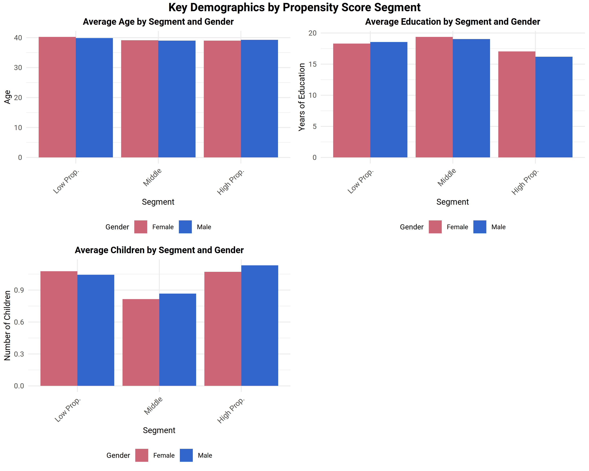
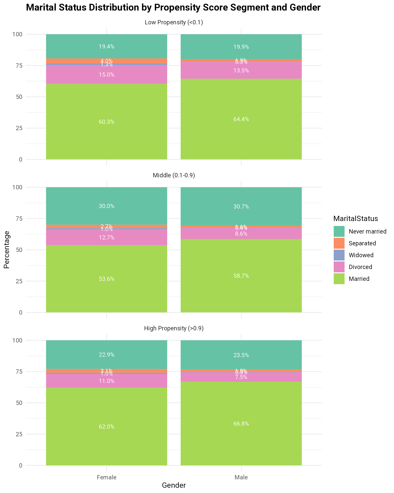
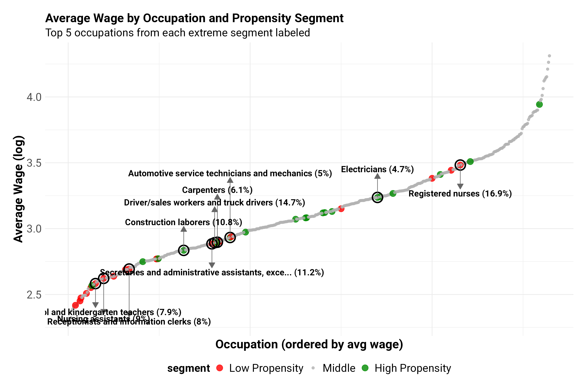
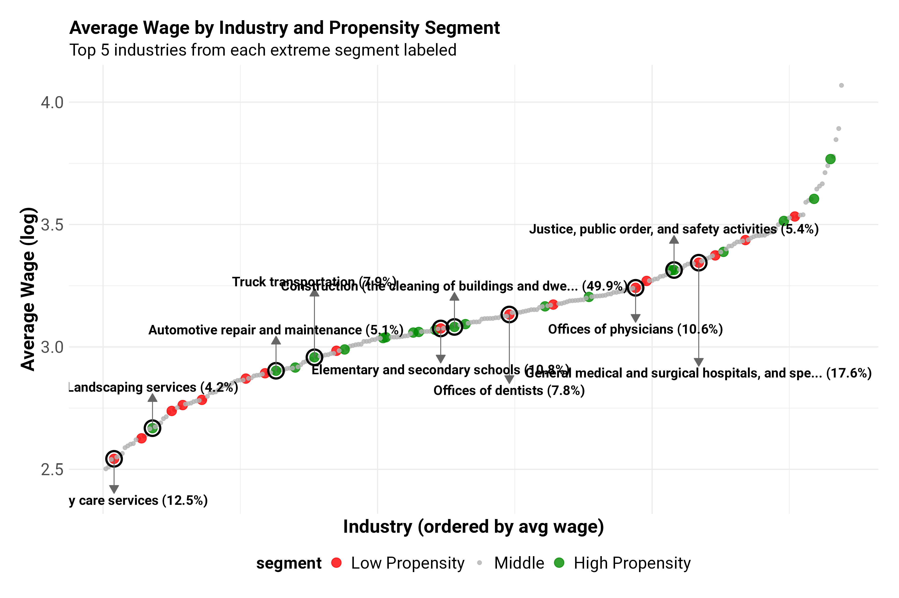
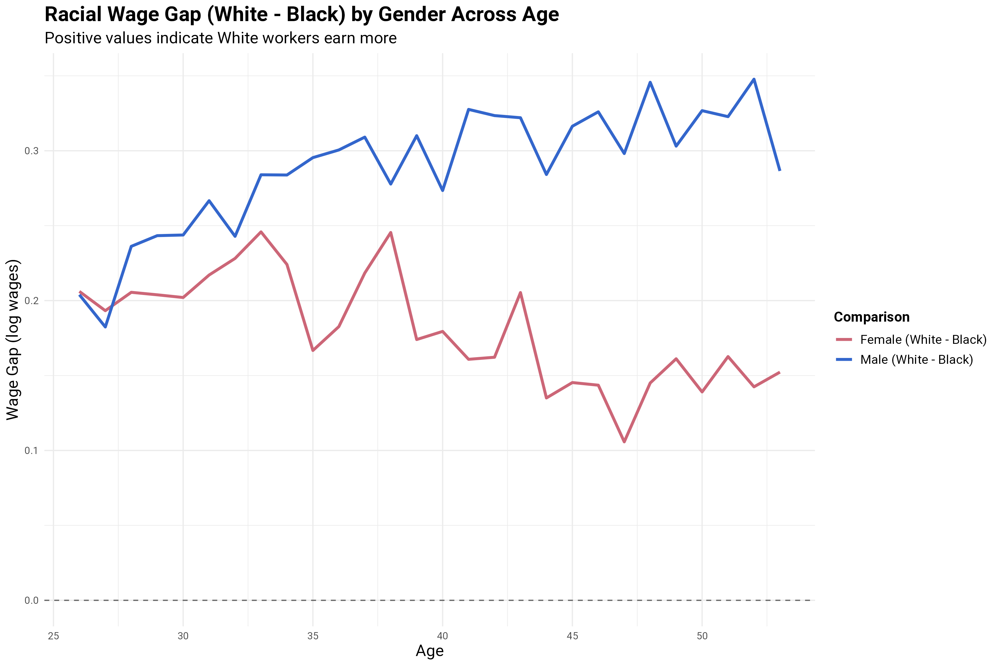

<!--
INPUT FILES (paths relative to the project directory; wage_file_outputs <- "./processing_files/"):
  processing_files/capped_weights_segregated_workforce.Rdata   made by Supplementary_2 (last chunk, "trim by propensity and save")
        objects used: Y.low, W.low, X_ordered_numeric_269.low, weights_supplied.X_ordered_numeric_269_low        (propensity < 0.1)
                      Y.trimmed, W.trimmed, X_ordered_numeric_269_trimmed, weights_supplied.X_ordered_numeric_269_trimmed   (0.1 to 0.9)
                      Y.high, W.high, X_ordered_numeric_269.high, weights_supplied.X_ordered_numeric_269_high     (propensity > 0.9)
  processing_files/variable_mappings.Rdata                     made by Supplementary_1
        objects used: race_mapping
  processing_files/occupation_mapping_full_description.Rdata, industry_mapping_full_description.Rdata   made by Supplementary_1
        objects used: occupation_mapping_full_description, industry_mapping_full_description (original_code, new_code, description)
  wageinequality.bib                                           bibliography
  Supplementary_4_figs/*.png                                   figures, written by the figure chunks and included with include_graphics()

FLAGS (set in the setup chunk):
  eval_flag      TRUE runs the analysis chunks. FALSE knits the text and tables from Supplementary_4_results.Rdata and the saved figures.
  fig_eval_flag  TRUE runs the figure chunks (the ones with png()/ggsave()); they need the objects made by the analysis chunks.
  use_weights    TRUE uses the Census person weights (as Supplementary 2 and 3 do) in every mean, share and regression.

SAVED RESULTS: the chunk save_results writes Supplementary_4_results.Rdata (the list res: every number in the text and tables).

UNIT TESTS: chunks named tests_* call run_test("description", { testthat::expect_...() }). The results are listed by the last chunk
  and written to Supplementary_4_tests.txt. A failing test is a statement in the text, or an assumption of the analysis, that no longer holds.

FIGURES (file: chunk that writes it):
  gender_plot.png                  figure_gender
  segment_comparison_plots.png     figure_segment_comparison
  marital_distribution_plot.png    figure_marital
  occupation_segregation_plot.png  figure_occupation
  industry_segregation_plot.png    figure_industry
  race_gender_age.png, race_wage_gaps_by_gender.png   figure_race
-->

```{r setup, include=FALSE}
knitr::opts_chunk$set(fig.width=6, fig.height=6, dpi=300,echo = FALSE)
knitr::opts_chunk$set(fig.pos = "H", out.extra = "")

# eval_flag: TRUE runs the analysis chunks. FALSE knits the text, the tables (from the saved results) and the saved figures.
# fig_eval_flag: TRUE runs the chunks that write the figures; they need the objects made by the analysis chunks.
eval_flag <- TRUE
fig_eval_flag <- TRUE
if (!eval_flag) fig_eval_flag <- FALSE
# use_weights: TRUE uses the Census person weights in every mean, share and regression (as in Supplementary 2 and 3).
use_weights <- TRUE

# Defaults for every later chunk: run only if eval_flag, and keep output out of the PDF. Chunks that differ say so in their header.
knitr::opts_chunk$set(eval = eval_flag, results = 'hide', fig.show = 'hide', warning = FALSE, message = FALSE)

test_log <- "Supplementary_4_tests.txt"
results_file <- "Supplementary_4_results.Rdata"   # saved at the end of the analysis; loaded when eval_flag is FALSE
test_results <- data.frame(test = character(), result = character(), detail = character(), stringsAsFactors = FALSE)
run_test <- function(description, code) {
  detail <- tryCatch({ force(code); "" }, error = function(e) conditionMessage(e))
  result <- if (identical(detail, "")) "PASS" else "FAIL"
  test_results[nrow(test_results) + 1, ] <<- c(description, result, detail)
  cat(sprintf("[%s] %s\n", result, description))
  if (result == "FAIL") cat("       ", detail, "\n")
  invisible(result == "PASS")
}

```

```{r libraries, echo=FALSE, eval=TRUE, include=FALSE}
# This chunk always runs: loading kableExtra adds the LaTeX packages that the tables need.
options(width=160)
library(sandwich)
library(lmtest)
library(ggplot2)
library(tidyverse)
library(kableExtra)
library(gridExtra)
library(grid)

# helpers for the inline numbers in the text
f <- function(x, d = 2) formatC(x, format = "f", digits = d, big.mark = ",")
pct <- function(x, d = 1) formatC(100 * x, format = "f", digits = d)
if (!eval_flag) load(results_file)   # res: the numbers behind the text and the tables

```

```{r data}
# PATHS (must be set): run this file from the project directory. wage_file_outputs is where the intermediate .Rdata files are
# read from and written to; change it here if they are somewhere else.
wage_file_outputs <- "./processing_files/"
# (wage_data_dir is not needed in this file: the raw data is read only in Supplementary 1)

load(paste0(wage_file_outputs, "capped_weights_segregated_workforce.Rdata"))
load(paste0(wage_file_outputs, "variable_mappings.Rdata"))   # race_mapping, marital_mapping, ...
# the occupation and industry mappings (original_code, new_code, description) are loaded from their own files, as in Supplementary 3
load(paste0(wage_file_outputs, "occupation_mapping_full_description.Rdata"))
load(paste0(wage_file_outputs, "industry_mapping_full_description.Rdata"))
# In the saved occupation mapping `description` is a list column (one character string in each element). Make it a character vector.
as_character_column <- function(x) vapply(x, function(e) if (length(e) == 0) NA_character_ else as.character(e)[1], character(1))
occupation_mapping_full_description$description <- as_character_column(occupation_mapping_full_description$description)
industry_mapping_full_description$description   <- as_character_column(industry_mapping_full_description$description)

make_segment <- function(X, Y, W, w) {
  list(X = X, Y = as.numeric(Y), W = as.numeric(W), w = if (use_weights) as.numeric(w) else rep(1, length(Y)))
}
segments <- list(
  low  = make_segment(X_ordered_numeric_269.low,     Y.low,     W.low,     weights_supplied.X_ordered_numeric_269_low),
  mid  = make_segment(X_ordered_numeric_269_trimmed, Y.trimmed, W.trimmed, weights_supplied.X_ordered_numeric_269_trimmed),
  high = make_segment(X_ordered_numeric_269.high,    Y.high,    W.high,    weights_supplied.X_ordered_numeric_269_high)
)
segment_labels <- c(low = "Low Propensity (<0.1)", mid = "Middle (0.1-0.9)", high = "High Propensity (>0.9)")

# all three segments in one data frame
all_data <- do.call(rbind, lapply(names(segments), function(s) {
  with(segments[[s]], data.frame(X, Y = Y, W = W, w = w, segment = s, stringsAsFactors = FALSE))
}))
all_data$segment <- factor(all_data$segment, levels = names(segments))

wmean <- function(x, w) sum(x * w) / sum(w)

res <- list()   # everything that the text and the tables need

```

```{r tests_data, echo=FALSE, eval=eval_flag, include=FALSE}
library(testthat)

run_test("data: each segment has 13 numeric columns, no missing values and one Y, W and weight per row", {
  for (s in segments) {
    expect_equal(ncol(s$X), 13L)
    expect_true(all(sapply(s$X, is.numeric)))
    expect_equal(sum(is.na(s$X)), 0)
    expect_equal(c(length(s$Y), length(s$W), length(s$w)), rep(nrow(s$X), 3))
    expect_true(all(s$W %in% c(0, 1)))
    expect_true(all(s$w > 0))
  }
})
run_test("data: the middle segment is 85 to 90 percent of the sample and all ages are 26 to 53", {
  expect_gt(nrow(segments$mid$X) / (nrow(segments$low$X) + nrow(segments$mid$X) + nrow(segments$high$X)), 0.85)
  expect_lt(nrow(segments$mid$X) / (nrow(segments$low$X) + nrow(segments$mid$X) + nrow(segments$high$X)), 0.90)
  expect_equal(range(all_data$age), c(26, 53))
})
run_test("data: the low segment is more than 90% women and the high segment more than 90% men (unweighted)", {
  expect_lt(mean(segments$low$W), 0.10)
  expect_gt(mean(segments$high$W), 0.90)
})
run_test("data: the segment sizes are in the order low < high < middle, as the text says", {
  n <- sapply(segments, function(s) length(s$Y))
  expect_lt(n[["low"]], n[["high"]])
  expect_lt(n[["high"]], n[["mid"]])
})
run_test("mappings: the occupation and industry mappings have the columns new_code and description", {
  expect_true(all(c("new_code", "description") %in% names(occupation_mapping_full_description)))
  expect_true(all(c("new_code", "description") %in% names(industry_mapping_full_description)))
  expect_true(is.character(occupation_mapping_full_description$description))
  expect_false(anyNA(occupation_mapping_full_description$description))
})
run_test("mappings: occupation and industry codes are all in the mappings", {
  expect_true(all(all_data$occupation %in% occupation_mapping_full_description$new_code))
  expect_true(all(all_data$industry %in% industry_mapping_full_description$new_code))
})

```

```{r summaries}
segment_summary <- function(s) {
  d <- segments[[s]]; m <- d$W == 1
  data.frame(
    segment = segment_labels[[s]], n = length(d$Y), n_men = sum(m), n_women = sum(!m),
    w_men = sum(d$w[m]), w_women = sum(d$w[!m]),
    pct_men = 100 * sum(d$w[m]) / sum(d$w), pct_women = 100 * sum(d$w[!m]) / sum(d$w),
    age_men = wmean(d$X$age[m], d$w[m]),                       age_women = wmean(d$X$age[!m], d$w[!m]),
    edu_men = wmean(d$X$education_level[m], d$w[m]),           edu_women = wmean(d$X$education_level[!m], d$w[!m]),
    children_men = wmean(d$X$children[m], d$w[m]),             children_women = wmean(d$X$children[!m], d$w[!m]),
    wage_men = wmean(d$Y[m], d$w[m]),                          wage_women = wmean(d$Y[!m], d$w[!m]),
    stringsAsFactors = FALSE)
}
res$summary <- do.call(rbind, lapply(names(segments), segment_summary))
res$summary$gap <- res$summary$wage_men - res$summary$wage_women
rownames(res$summary) <- names(segments)
res$summary

# the same numbers for each segment as a whole (men and women together), for the statements about the segments
res$segment_means <- sapply(segments, function(d) c(
  education = wmean(d$X$education_level, d$w),
  children  = wmean(d$X$children, d$w),
  married   = wmean(d$X$marital == 5, d$w)))     # marital code 5 is "Married" (Supplementary 3)

```

# Introduction

- the data has been divided into 3 groups by propensity score (see Supplementary 2)
- we do a causal analysis for the middle section (Supplementary 3), and a separate analysis for the high and low propensity segments. This file records the
  analysis for the high and low propensity segments, and compares them with the middle
- due to issues with the "children" variable, the analysis is restricted to individuals aged 26 to 53
- the segments are the ones saved by Supplementary 2 in `capped_weights_segregated_workforce.Rdata`: `r f(res$summary$n[1], 0)` samples (low propensity),
  `r f(res$summary$n[2], 0)` samples (middle) and `r f(res$summary$n[3], 0)` samples (high propensity)
- means, shares and regressions use the Census person weights supplied with the data (the same weights as in Supplementary 2 and 3), unless `use_weights` is FALSE.
  The sample sizes are counts of people.

```{r tests_summaries, echo=FALSE, eval=eval_flag, include=FALSE}
run_test("segments: the raw wage gap is positive in every segment, below 0.22, and smallest in the high propensity segment (0.08 against 0.17 and 0.19)", {
  expect_true(all(res$summary$gap > 0.05 & res$summary$gap < 0.22))
  expect_lt(res$summary["high", "gap"], min(res$summary["low", "gap"], res$summary["mid", "gap"]))
})
run_test("segments: the weighted share of men is below 15% in the low and above 85% in the high segment, and between 40% and 60% in the middle", {
  expect_lt(res$summary["low", "pct_men"], 15)
  expect_gt(res$summary["high", "pct_men"], 85)
  expect_gt(res$summary["mid", "pct_men"], 40)
  expect_lt(res$summary["mid", "pct_men"], 60)
})
run_test("segments: education is highest in the middle segment (the text says 19+ years against 16-18 in the extremes)", {
  e <- res$segment_means["education", ]
  expect_gt(e[["mid"]], e[["low"]])
  expect_gt(e[["mid"]], e[["high"]])
})
run_test("segments: the high segment has more children per person and a higher share married than the middle", {
  expect_gt(res$segment_means["children", "high"], res$segment_means["children", "mid"])
  expect_gt(res$segment_means["married", "high"], res$segment_means["married", "mid"])
})

```

## Demographics of the segments

```{r table_segments, eval=TRUE, results='asis'}
table_data <- res$summary[, c("segment", "pct_men", "pct_women", "age_men", "age_women", "edu_men", "edu_women",
                               "children_men", "children_women", "gap")]
rownames(table_data) <- NULL
kable(table_data, format = "latex", booktabs = TRUE, digits = 2, label = "comparisonsacrosssegments",
      caption = "Demographic comparison across propensity score segments",
      col.names = c("Segment", "Male", "Female", "Male", "Female", "Male", "Female", "Male", "Female", "Gap"),
      align = c("l", rep("r", 9))) %>%
  kable_styling(latex_options = c("striped", "hold_position")) %>%
  add_header_above(c(" " = 1, "Gender Dist. (%)" = 2, "Age" = 2, "Education (yrs)" = 2, "Children" = 2, "Wage Gap" = 1)) %>%
  footnote(general = "Ages 26 to 53. Means and shares are weighted with the Census person weights. Low propensity indicates female-dominated sectors; High propensity indicates male-dominated sectors.",
           general_title = "Note:", footnote_as_chunk = TRUE, threeparttable = TRUE)

```

```{r figure_gender, eval=fig_eval_flag}
gender_data <- data.frame(
  Segment = rep(segment_labels, each = 2),
  Gender  = rep(c("Male", "Female"), 3),
  Count   = as.vector(rbind(res$summary$n_men, res$summary$n_women)),
  Weight  = as.vector(rbind(res$summary$w_men, res$summary$w_women)))
gender_data$Percentage_of_Total <- 100 * gender_data$Weight / sum(gender_data$Weight)
gender_data$Segment <- factor(gender_data$Segment, levels = segment_labels)

gender_plot_total <- ggplot(gender_data, aes(x = Segment, y = Percentage_of_Total, fill = Gender)) +
  geom_bar(stat = "identity", position = position_dodge()) +
  geom_text(aes(label = sprintf("%.1f%%\n(n=%s)", Percentage_of_Total, formatC(Count, big.mark = ","))),
            position = position_dodge(width = 0.9), vjust = -0.5, size = 6) +
  scale_fill_manual(values = c("Male" = "#3366CC", "Female" = "#CC6677")) +
  scale_y_continuous(limits = c(0, 52), expand = c(0, 0)) +
  theme_minimal() +
  labs(title = "Distribution of Overall Population by Propensity Score Segment and Gender",
       y = "Percentage of Total Population", x = "") +
  theme(plot.title = element_text(size = 18, face = "bold"),
        axis.title.y = element_text(size = 16, face = "bold"),
        axis.text.x = element_text(angle = 45, hjust = 1, size = 14),
        axis.text.y = element_text(size = 14),
        legend.title = element_text(size = 16, face = "bold"),
        legend.text = element_text(size = 14),
        legend.position = "bottom",
        plot.margin = margin(t = 10, r = 10, b = 10, l = 10))

ggsave("./Supplementary_4_figs/gender_plot.png", gender_plot_total, width = 12, height = 8, dpi = 300, bg = "white")

```

```{r genderplot, echo=FALSE, eval=TRUE, results='markup', fig.show='asis', fig.cap="Distribution of Overall Population by Propensity Score Segment and Gender", out.width = '100%',fig.align = 'center'}
knitr::include_graphics("./Supplementary_4_figs/gender_plot.png")

```

```{r figure_segment_comparison, eval=fig_eval_flag}
# Comparison plot of one variable (a column of res$summary, without the _men/_women suffix)
create_comparison_plot <- function(var_name, y_label, title_label = y_label) {
  df <- data.frame(
    Segment = factor(rep(c("Low Prop.", "Middle", "High Prop."), each = 2), levels = c("Low Prop.", "Middle", "High Prop.")),
    Gender = rep(c("Female", "Male"), 3),
    Value = as.vector(rbind(res$summary[[paste0(var_name, "_women")]], res$summary[[paste0(var_name, "_men")]])))
  ggplot(df, aes(x = Segment, y = Value, fill = Gender)) +
    geom_bar(stat = "identity", position = "dodge") +
    theme_minimal() +
    labs(title = paste("Average", title_label, "by Segment and Gender"), y = y_label) +
    theme(plot.title = element_text(size = 11, face = "bold", hjust = 0.5),
          axis.title = element_text(size = 10),
          axis.text.x = element_text(angle = 45, hjust = 1, size = 9),
          legend.position = "bottom", legend.title = element_text(size = 9), legend.text = element_text(size = 8),
          plot.margin = margin(5, 5, 5, 5)) +
    scale_fill_manual(values = c("Female" = "#CC6677", "Male" = "#3366CC"))
}
age_plot      <- create_comparison_plot("age", "Age")
edu_plot      <- create_comparison_plot("edu", "Years of Education", "Education")
children_plot <- create_comparison_plot("children", "Number of Children", "Children")

# marital status is not in the plot: it is an unordered category (see the marital distribution plot)
png("./Supplementary_4_figs/segment_comparison_plots.png", width = 10, height = 8, units = "in", res = 300, bg = "white")
grid.arrange(age_plot, edu_plot, children_plot, ncol = 2,
             top = textGrob("Key Demographics by Propensity Score Segment", gp = gpar(fontsize = 14, fontface = "bold")))
dev.off()

```

```{r segmentcomparison, echo=FALSE, eval=TRUE, results='markup', fig.show='asis', fig.cap="Several Demographics by Propensity Score Segment",  out.width = '100%',fig.align = 'center'}


```

```{r marital}
# Marital status distribution (percentages, weighted) for each segment and gender.
# The codes 1 to 5 are in increasing order of the mean log wage (Supplementary 1 and 3):
# 1 never married, 2 separated, 3 widowed, 4 divorced, 5 married.
marital_categories <- c("Never married", "Separated", "Widowed", "Divorced", "Married")
res$marital_dist <- do.call(rbind, lapply(names(segments), function(s) {
  d <- segments[[s]]
  do.call(rbind, lapply(c(Male = 1, Female = 0), function(g) {
    ww <- tapply(d$w[d$W == g], factor(d$X$marital[d$W == g], levels = 1:5), sum)
    ww[is.na(ww)] <- 0
    data.frame(Segment = segment_labels[[s]], Gender = ifelse(g == 1, "Male", "Female"),
               MaritalStatus = marital_categories, Percentage = 100 * as.numeric(ww) / sum(ww))
  }))
}))
rownames(res$marital_dist) <- NULL

```

```{r tests_marital, echo=FALSE, eval=eval_flag, include=FALSE}
run_test("marital: the percentages add to 100 in each segment and gender, and all five codes are present in the data", {
  s <- tapply(res$marital_dist$Percentage, list(res$marital_dist$Segment, res$marital_dist$Gender), sum)
  expect_equal(as.numeric(s), rep(100, 6))
  expect_true(all(1:5 %in% all_data$marital))
})

```

```{r figure_marital, eval=fig_eval_flag}
md <- res$marital_dist
md$Segment <- factor(md$Segment, levels = segment_labels)
md$MaritalStatus <- factor(md$MaritalStatus, levels = marital_categories)
p_marital <- ggplot(md, aes(x = Gender, y = Percentage, fill = MaritalStatus)) +
  geom_bar(stat = "identity", position = "stack") +
  geom_text(aes(label = sprintf("%.1f%%", Percentage)), position = position_stack(vjust = 0.5), size = 3, color = "white") +
  facet_wrap(~ Segment, ncol = 1) +
  scale_fill_brewer(palette = "Set2") +
  theme_minimal() +
  labs(title = "Marital Status Distribution by Propensity Score Segment and Gender", y = "Percentage") +
  theme(legend.position = "right", plot.title = element_text(face = "bold", size = 14))
ggsave("./Supplementary_4_figs/marital_distribution_plot.png", p_marital, width = 8, height = 10, dpi = 300, bg = "white")

```

```{r maritaldistributionplot, echo=FALSE, eval=TRUE, results='markup', fig.show='asis', fig.cap="Marital Distribution  by Propensity Score Segment", out.width = '100%',fig.align = 'center'}


```

# Compare occupations and industries for low and high propensity groups

- tables \@ref(tab:occupationlowpropensity) to \@ref(tab:occupationhighpropensity) show the top occupations in the low, middle and high propensity segments
- tables \@ref(tab:industrylowpropensity) to \@ref(tab:industryhighpropensity) show the top industries in the low, middle and high propensity segments
- the percentage is the weighted share of the segment, and the segments are ordered by that share

```{r distributions}
# The most common categories of a variable in a segment: count (people), weighted percentage of the segment, and description
top_categories <- function(x, w, mapping, number = 20) {
  share <- tapply(w, x, sum)
  share <- 100 * share / sum(share)
  n <- table(x)
  o <- order(share, decreasing = TRUE)[seq_len(number)]
  cat <- names(share)[o]
  stopifnot("the mapping needs the columns new_code and description" = all(c("new_code", "description") %in% names(mapping)))
  data.frame(Category = cat, Count = as.numeric(n[cat]), Percentage = as.numeric(share[o]),
             Description = mapping$description[match(as.numeric(cat), mapping$new_code)], stringsAsFactors = FALSE)
}
res$occupation_dist <- lapply(segments, function(d) top_categories(d$X$occupation, d$w, occupation_mapping_full_description, 20))
res$industry_dist   <- lapply(segments, function(d) top_categories(d$X$industry,   d$w, industry_mapping_full_description,   20))

```

```{r tests_distributions, echo=FALSE, eval=eval_flag, include=FALSE}
run_test("occupations and industries: the top five of every segment have a description, and the percentages are in decreasing order", {
  for (d in c(res$occupation_dist, res$industry_dist)) {
    expect_false(anyNA(d$Description[1:5]))
    expect_true(all(diff(d$Percentage) <= 0))
  }
})
run_test("occupations and industries: the single largest industry of the high segment is more than a third of it (the text says construction, 42%)", {
  expect_gt(res$industry_dist$high$Percentage[1], 33)
})

```

```{r table_distributions, eval=TRUE, results='asis'}
distribution_table <- function(d, kind, kind_plural, segment_name, label) {
  d <- d[1:5, ]
  d$Percentage <- paste0(round(d$Percentage, 1), "%")
  d$Count <- format(d$Count, big.mark = ",")
  kable(d, format = "latex", booktabs = TRUE, row.names = FALSE, label = label,
        caption = paste("Top", kind_plural, "in the", segment_name, "segment"),
        col.names = c(paste(kind, "code"), "Count", "Percentage", "Description"),
        align = c("l", "r", "r", "l")) %>%
    kable_styling(latex_options = c("striped", "hold_position")) %>%
    column_spec(4, width = "20em") %>%
    row_spec(0, bold = TRUE)
}
# kable returns a character vector with a class; cat() it so that the tables are written in order
for (s in c("low", "mid", "high")) {
  nm <- c(low = "lowpropensity", mid = "middle", high = "highpropensity")[[s]]
  seg <- c(low = "low propensity", mid = "middle", high = "high propensity")[[s]]
  cat(distribution_table(res$occupation_dist[[s]], "Occupation", "occupations", seg, paste0("occupation", nm)), "\n\n")
}
for (s in c("low", "mid", "high")) {
  nm <- c(low = "lowpropensity", mid = "middle", high = "highpropensity")[[s]]
  seg <- c(low = "low propensity", mid = "middle", high = "high propensity")[[s]]
  cat(distribution_table(res$industry_dist[[s]], "Industry", "industries", seg, paste0("industry", nm)), "\n\n")
}

```

\FloatBarrier
\clearpage

## Wage determinants across propensity segments

We fit a weighted linear regression of the log wage on gender, age, education, marital status, children, occupation and industry in each of the low and
high propensity segments. Marital status, occupation and industry enter as the numeric codes of `X_ordered_numeric_269` (ordered by mean log wage,
Supplementary 1), so their coefficients are for a unit step in that ordering and are not interpreted. The standard errors are heteroskedasticity-robust (HC2).
The coefficients are multiplied by 100 so that they are percentage points of the wage (log points).

```{r regression}
fit_segment <- function(s) {
  d <- segments[[s]]
  dat <- data.frame(d$X, Y = d$Y, W = d$W, w = d$w)
  fit <- lm(Y ~ W + age + education_level + marital + children + occupation + industry, data = dat, weights = w)
  ct <- coeftest(fit, vcov = vcovHC(fit, type = "HC2"))
  ct[c("W", "age", "education_level", "marital", "children"), , drop = FALSE]
}
low_coef  <- fit_segment("low")
high_coef <- fit_segment("high")
res$regression <- data.frame(
  Variable = c("Gender (Male)", "Age", "Education (years)", "Marital Status", "Children"),
  Low_Coef = low_coef[, "Estimate"],   Low_SE = low_coef[, "Std. Error"],   Low_p = low_coef[, "Pr(>|t|)"],
  High_Coef = high_coef[, "Estimate"], High_SE = high_coef[, "Std. Error"], High_p = high_coef[, "Pr(>|t|)"],
  row.names = NULL, stringsAsFactors = FALSE)
res$regression$Low_Pct  <- 100 * res$regression$Low_Coef
res$regression$High_Pct <- 100 * res$regression$High_Coef
res$regression$Difference <- res$regression$High_Pct - res$regression$Low_Pct
res$regression

```

```{r tests_regression, echo=FALSE, eval=eval_flag, include=FALSE}
run_test("regression: the gender coefficient is positive in both segments and larger in the high (male-dominated) segment (the text says 11% and 17%)", {
  g <- res$regression[1, ]
  expect_gt(g$Low_Coef, 0)
  expect_gt(g$High_Coef, g$Low_Coef)
  expect_lt(g$High_Coef, 0.25)
})
run_test("regression: children are negative (p < 0.05) in the low segment and positive (p < 0.001) in the high segment, as the text says", {
  k <- res$regression[res$regression$Variable == "Children", ]
  expect_lt(k$Low_Coef, 0)
  expect_lt(k$Low_p, 0.05)
  expect_gt(k$High_Coef, 0)
  expect_lt(k$High_p, 0.001)
})
run_test("regression: age, education and marital coefficients are positive in both segments and larger in the high segment", {
  r <- res$regression[res$regression$Variable %in% c("Age", "Education (years)", "Marital Status"), ]
  expect_true(all(r$Low_Coef > 0))
  expect_true(all(r$High_Coef > r$Low_Coef))
})

```

```{r table_regression, eval=TRUE, results='asis'}
reg <- res$regression[, c("Variable", "Low_Pct", "High_Pct", "Difference")]
kable(reg, format = "latex", booktabs = TRUE, digits = 2, label = "segmentregression",
      caption = "Wage determinants by propensity score segment (percentage effects)",
      col.names = c("Variable", "Low Propensity", "High Propensity", "Difference"),
      align = c("l", "r", "r", "r")) %>%
  kable_styling(latex_options = c("striped", "hold_position")) %>%
  add_header_above(c(" " = 1, "Coefficient (%)" = 2, " " = 1)) %>%
  row_spec(1, bold = TRUE) %>%
  footnote(general = c(
    "Weighted linear regression of log wages on the covariates, including occupation and industry codes; heteroskedasticity-robust (HC2) standard errors.",
    "Coefficients are multiplied by 100.",
    paste0("The low propensity segment is ", round(res$summary["low", "pct_women"]), " percent female and the high propensity segment is ",
           round(res$summary["high", "pct_men"]), " percent male."),
    paste0("The children coefficient in the low propensity segment has p=", round(res$regression$Low_p[5], 3), ".")),
    general_title = "Note:", footnote_as_chunk = TRUE, threeparttable = TRUE)

```

- Gender wage gap (the coefficient of gender)

  -  Low propensity (female-dominated): `r f(res$regression$Low_Coef[1], 3)`, a `r pct(res$regression$Low_Coef[1])`\% wage premium for being male
  -  High propensity (male-dominated): `r f(res$regression$High_Coef[1], 3)`, a `r pct(res$regression$High_Coef[1])`\% wage premium for being male

  The gender wage gap is `r round(100 * (res$regression$High_Coef[1] / res$regression$Low_Coef[1] - 1))`\% larger in male-dominated sectors than in female-dominated sectors.

- Children

   -  Low propensity: `r f(res$regression$Low_Coef[5], 3)`, $p = `r f(res$regression$Low_p[5], 3)`$
   -  High propensity: `r f(res$regression$High_Coef[5], 3)`, $p = `r format(res$regression$High_p[5], digits = 2)`$

Table \@ref(tab:segmentregression) compares wage determinants in female-dominated (low propensity, `r round(res$summary["low", "pct_women"])`\% female) versus
male-dominated (high propensity, `r round(res$summary["high", "pct_men"])`\% male) sectors, controlling for occupation and industry.

The gender wage gap is `r round(100 * (res$regression$High_Coef[1] / res$regression$Low_Coef[1] - 1))`\% larger in male-dominated sectors
(`r pct(res$regression$High_Coef[1])`\%) than female-dominated sectors (`r pct(res$regression$Low_Coef[1])`\%). This suggests that
occupational segregation not only separates workers but that male-dominated sectors exhibit larger within-sector pay disparities.

The relationship between family structure and wages differs across segments. In female-dominated sectors, children are associated with a small wage penalty
(`r pct(res$regression$Low_Coef[5])`\%, p=`r f(res$regression$Low_p[5], 3)`), while in male-dominated sectors children are linked to a `r pct(res$regression$High_Coef[5])`\% wage premium,
consistent with a "fatherhood premium". Similarly, a step up in marital status code yields a larger wage return in male-dominated sectors
(`r pct(res$regression$High_Coef[4])`\% against `r pct(res$regression$Low_Coef[4])`\%).

Returns to age and education are also higher in male-dominated sectors, with the return to age (`r pct(res$regression$High_Coef[2])`\% against
`r pct(res$regression$Low_Coef[2])`\% per year) suggesting steeper experience-wage profiles in traditionally male occupations.

\FloatBarrier
\clearpage

## Occupation plot

- occupations are ordered by their average (weighted) log wage
- the 20 largest occupations of the low propensity segment are in red and the 20 largest of the high propensity segment are in green (an occupation in both lists is green)
- the five largest occupations of each of these two segments are circled and labelled with their description and their percentage of the segment

```{r wage_by_category}
# average (weighted) log wage of every occupation and industry, and the segment (if any) in whose top 20 it is
wage_by_category <- function(var, dist) {
  m <- tapply(all_data$Y * all_data$w, all_data[[var]], sum) / tapply(all_data$w, all_data[[var]], sum)
  df <- data.frame(code = as.numeric(names(m)), avg_wage = as.numeric(m))
  df$segment <- "Middle"
  df$segment[df$code %in% as.numeric(dist$low$Category)]  <- "Low Propensity"
  df$segment[df$code %in% as.numeric(dist$high$Category)] <- "High Propensity"
  df$segment <- factor(df$segment, levels = c("Low Propensity", "Middle", "High Propensity"))
  df$x_position <- rank(df$avg_wage, ties.method = "first")
  df
}
res$occupation_wages <- wage_by_category("occupation", res$occupation_dist)
res$industry_wages   <- wage_by_category("industry",   res$industry_dist)

```

```{r tests_wage_by_category, echo=FALSE, eval=eval_flag, include=FALSE}
run_test("wage by occupation and industry: one value per code (occupation and industry codes are ordered by mean wage, so the unweighted order agrees roughly with the weighted one)", {
  expect_equal(nrow(res$industry_wages), 269)
  expect_gt(cor(res$occupation_wages$code, res$occupation_wages$avg_wage, method = "spearman"), 0.9)
  expect_gt(cor(res$industry_wages$code, res$industry_wages$avg_wage, method = "spearman"), 0.9)
})

```

```{r figure_occupation, eval=fig_eval_flag}
# One plot for occupations and industries. The five largest categories of the low and of the high segment are labelled; the labels are
# moved away from the points by an offset that is staggered when labels are close together.
segregation_plot <- function(wage_df, dist, what, subtitle) {
  key <- c(dist$low$Category[1:5], dist$high$Category[1:5])
  wage_df$key <- ifelse(as.character(wage_df$code) %in% key, "Key", "Regular")
  label_text <- function(d) {
    desc <- ifelse(nchar(d$Description) > 50, paste0(substr(d$Description, 1, 47), "..."), d$Description)
    setNames(paste0(desc, " (", round(d$Percentage, 1), "%)"), d$Category)
  }
  labels <- c(label_text(dist$low[1:5, ]), label_text(dist$high[1:5, ]))
  label_data <- subset(wage_df, key == "Key")
  label_data$label <- labels[as.character(label_data$code)]
  label_data$direction <- ifelse(label_data$segment == "Low Propensity", "down", "up")
  label_data <- label_data[order(label_data$segment, label_data$x_position), ]
  base_offset <- diff(range(wage_df$avg_wage)) * 0.09
  label_data$offset_multiplier <- 1
  for (seg in c("Low Propensity", "High Propensity")) {
    idx <- which(label_data$segment == seg)
    if (length(idx) > 1) {
      mult <- rep(1, length(idx))
      for (i in 2:length(idx)) {
        if (label_data$x_position[idx[i]] - label_data$x_position[idx[i - 1]] < 40) {
          mult[i] <- c(1, 1.5, 2, 2.5, 3)[(i - 1) %% 5 + 1]
        }
      }
      label_data$offset_multiplier[idx] <- mult
    }
  }
  label_data$label_y <- ifelse(label_data$direction == "down",
                               label_data$avg_wage - base_offset * label_data$offset_multiplier,
                               label_data$avg_wage + base_offset * label_data$offset_multiplier)
  ggplot(wage_df, aes(x = x_position, y = avg_wage, color = segment, size = segment)) +
    geom_point(alpha = 0.8) +
    geom_point(data = label_data, color = "black", size = 6, shape = 1, stroke = 1.5) +
    geom_segment(data = label_data, aes(x = x_position, y = avg_wage, xend = x_position, yend = label_y),
                 color = "gray40", linewidth = 0.4, arrow = arrow(length = unit(0.02, "npc"), type = "closed"),
                 inherit.aes = FALSE) +
    geom_text(data = label_data, aes(x = x_position, y = label_y, label = label),
              size = 4.5, color = "black", fontface = "bold", hjust = 0.5,
              vjust = ifelse(label_data$direction == "down", 1.2, -0.2), inherit.aes = FALSE) +
    scale_color_manual(values = c("Low Propensity" = "red", "Middle" = "gray70", "High Propensity" = "green4")) +
    scale_size_manual(values = c("Low Propensity" = 4, "Middle" = 1.5, "High Propensity" = 4)) +
    labs(title = paste("Average Wage by", what, "and Propensity Segment"), subtitle = subtitle,
         x = paste0(what, " (ordered by avg wage)"), y = "Average Wage (log)") +
    theme_minimal() +
    theme(plot.title = element_text(size = 18, face = "bold"), plot.subtitle = element_text(size = 16),
          axis.title.x = element_text(size = 18, face = "bold"), axis.title.y = element_text(size = 18, face = "bold"),
          axis.text.y = element_text(size = 16), axis.text.x = element_blank(),
          legend.title = element_text(size = 16, face = "bold"), legend.text = element_text(size = 16),
          legend.position = "bottom", plot.margin = margin(t = 20, r = 20, b = 20, l = 20)) +
    guides(size = guide_legend(override.aes = list(size = c(4, 1.5, 4))))
}
p_occupation <- segregation_plot(res$occupation_wages, res$occupation_dist, "Occupation",
                                 "Top 5 occupations from each extreme segment labeled")
ggsave("./Supplementary_4_figs/occupation_segregation_plot.png", p_occupation, width = 12, height = 8, dpi = 300, bg = "white")

```

```{r occupationsegregationplot, echo=FALSE, eval=TRUE, results='markup', fig.show='asis', fig.cap="Occupations, ranked by average wages. The 20 largest occupations of the low (red) and of the high (green) propensity segment are coloured; the five largest of each are circled and labelled with their percentage of the segment.", out.width = '100%',fig.align = 'center'}


```

## Industry plot

```{r figure_industry, eval=fig_eval_flag}
p_industry <- segregation_plot(res$industry_wages, res$industry_dist, "Industry",
                               "Top 5 industries from each extreme segment labeled")
ggsave("./Supplementary_4_figs/industry_segregation_plot.png", p_industry, width = 12, height = 8, dpi = 300, bg = "white")

```

```{r industrysegregationplot, echo=FALSE, eval=TRUE, results='markup', fig.show='asis', fig.cap="Industries, ranked by average wages. The 20 largest industries of the low (red) and of the high (green) propensity segment are coloured; the five largest of each are circled and labelled with their percentage of the segment.", out.width = '100%',fig.align = 'center'}


```

# How large is the segregation effect

The fact that low propensity occupations span the wage spectrum suggests that occupation is not the only factor determining propensity
scores. Other factors like education, marital status, and children likely interact with occupation to determine which segment an individual
falls into.

This visualization supports the idea that gender segregation in occupations is an important factor in the wage gap, but the relationship is
complex. The fact that both low and high propensity segments contain both low and high-wage occupations suggests that:

- The gender wage gap can't be explained solely by occupational segregation
- Even within similar occupations, there might be gender-based wage differences
- The propensity score is capturing complex interactions between multiple variables, not just occupation

We could investigate more deeply the characteristics of occupations that are heavily represented in each segment, beyond just their
average wages. Factors like flexibility, work hours, physical demands, and education requirements might be important drivers of gender segregation.

To estimate how much of the gender wage gap is explained by occupational segregation, we use a counterfactual calculation (it is distinct from the
Oaxaca-Blinder decomposition of Supplementary 5):

> what would the gender wage gap be if women had the same occupational distribution as men, but kept their own within-occupation wages?

With $m_o$ and $f_o$ the mean log wages of men and women in occupation $o$, and $p^M_o$ and $p^F_o$ the shares of men and women in $o$, the observed gap
is $\sum_o m_o p^M_o - \sum_o f_o p^F_o$ and the counterfactual gap is $\sum_o m_o p^M_o - \sum_o f_o p^M_o$. The difference is the part of the gap that
is due to the different occupational distributions. This method only looks at occupational sorting, not at differential returns to characteristics, and it
does not split the gap into explained and unexplained parts. Occupations that have no men or no women have no wage for one gender; they are left out
(and the shares renormalised), which is `r pct(res$counterfactual$excluded_men)`\% of men and `r pct(res$counterfactual$excluded_women)`\% of women.
(The earlier version of this analysis gave such occupations a wage of 0 for the missing gender, which biases the counterfactual female wage downwards.)

```{r counterfactual}
counterfactual_gap <- function(Y, W, occ, w) {
  both <- intersect(unique(occ[W == 1]), unique(occ[W == 0]))
  ok <- occ %in% both
  y <- Y[ok]; g <- W[ok]; o <- factor(occ[ok]); ww <- w[ok]
  mean_wage <- function(sel) tapply(y[sel] * ww[sel], o[sel], sum) / tapply(ww[sel], o[sel], sum)
  share     <- function(sel) { s <- tapply(ww[sel], o[sel], sum); s / sum(s) }
  male_wage <- mean_wage(g == 1); female_wage <- mean_wage(g == 0)
  male_share <- share(g == 1);    female_share <- share(g == 0)
  current_male <- sum(male_wage * male_share)
  current_female <- sum(female_wage * female_share)
  counterfactual_female <- sum(female_wage * male_share)
  observed <- current_male - current_female
  counterfactual <- current_male - counterfactual_female
  list(current_male = current_male, current_female = current_female, counterfactual_female = counterfactual_female,
       observed_gap = observed, counterfactual_gap = counterfactual,
       segregation_effect = observed - counterfactual, segregation_percentage = 100 * (observed - counterfactual) / observed,
       excluded_men = 1 - sum(ww[g == 1]) / sum(w[W == 1]), excluded_women = 1 - sum(ww[g == 0]) / sum(w[W == 0]),
       overall_gap = wmean(Y[W == 1], w[W == 1]) - wmean(Y[W == 0], w[W == 0]))
}
res$counterfactual <- counterfactual_gap(all_data$Y, all_data$W, all_data$occupation, all_data$w)
str(res$counterfactual)

```

```{r tests_counterfactual, echo=FALSE, eval=eval_flag, include=FALSE}
run_test("counterfactual: the counterfactual gap is smaller than the observed gap, which is close to the overall gap", {
  cf <- res$counterfactual
  expect_lt(cf$counterfactual_gap, cf$observed_gap)
  expect_lt(abs(cf$observed_gap - cf$overall_gap), 0.01)
})
run_test("counterfactual: occupational segregation explains between 0 and 30 percent of the gap (the text says a modest portion)", {
  expect_gt(res$counterfactual$segregation_percentage, 0)
  expect_lt(res$counterfactual$segregation_percentage, 30)
})
run_test("counterfactual: fewer than 2 percent of men and of women are in occupations without the other gender", {
  expect_lt(res$counterfactual$excluded_men, 0.02)
  expect_lt(res$counterfactual$excluded_women, 0.02)
})

```

- Current male average wage: `r f(res$counterfactual$current_male, 3)`
- Current female average wage: `r f(res$counterfactual$current_female, 3)`
- Counterfactual female wage (with the male occupational distribution): `r f(res$counterfactual$counterfactual_female, 3)`
- Observed gap: `r f(res$counterfactual$observed_gap, 4)`
- Counterfactual gap: `r f(res$counterfactual$counterfactual_gap, 4)`
- Segregation effect: `r f(res$counterfactual$segregation_effect, 4)`
- Percentage explained by occupational segregation: `r f(res$counterfactual$segregation_percentage, 1)`\%

\FloatBarrier

# Race, gender and age (exploratory)

This is an exploratory replication of an analysis in another paper on intersectional wage gaps. It is not used in the conclusions. It uses the whole
sample (the three segments together) and the Black and White individuals.

```{r race}
race_code <- function(code, pattern) {
  i <- which(race_mapping$original_code == code | grepl(pattern, race_mapping$description, ignore.case = TRUE))
  unique(race_mapping$new_code[i])
}
white_code <- race_code("1", "^white")   # PUMS RAC1P: 1 is White alone, 2 is Black or African American alone
black_code <- race_code("2", "^black")

race_data <- all_data %>%
  filter(race %in% c(white_code, black_code)) %>%
  mutate(group = paste(ifelse(race == white_code, "White", "Black"), ifelse(W == 1, "Male", "Female")))

res$race_wage_by_age <- race_data %>%
  group_by(age, group) %>%
  summarize(mean_wage = weighted.mean(Y, w),
            se_wage = sqrt(sum(w^2 * (Y - weighted.mean(Y, w))^2)) / sum(w),
            n = n(), .groups = "drop")
res$race_group_summary <- race_data %>%
  group_by(group) %>%
  summarize(n = n(), mean_wage = weighted.mean(Y, w), .groups = "drop")
res$race_gaps <- res$race_wage_by_age %>%
  select(age, group, mean_wage) %>%
  tidyr::pivot_wider(names_from = group, values_from = mean_wage) %>%
  mutate(male_gap = `White Male` - `Black Male`, female_gap = `White Female` - `Black Female`)
res$race_group_summary

```

```{r tests_race, echo=FALSE, eval=eval_flag, include=FALSE}
run_test("race: one code for White and one for Black, and all four race-gender groups are present", {
  expect_length(white_code, 1)
  expect_length(black_code, 1)
  expect_false(white_code == black_code)
  expect_equal(sort(res$race_group_summary$group), c("Black Female", "Black Male", "White Female", "White Male"))
})

```

```{r figure_race, eval=fig_eval_flag}
p_race <- ggplot(res$race_wage_by_age, aes(x = age, y = mean_wage, color = group)) +
  geom_line(linewidth = 1) +
  geom_ribbon(aes(ymin = mean_wage - 1.96 * se_wage, ymax = mean_wage + 1.96 * se_wage, fill = group), alpha = 0.2, color = NA) +
  labs(title = "Mean Log Wages by Age, Race, and Gender", subtitle = "With approximate 95% confidence intervals",
       x = "Age", y = "Mean Log Wage", color = "Demographic Group", fill = "Demographic Group") +
  theme_minimal() +
  theme(plot.title = element_text(size = 18, face = "bold"), plot.subtitle = element_text(size = 14),
        axis.title = element_text(size = 14), legend.title = element_text(size = 12, face = "bold"), legend.text = element_text(size = 11)) +
  scale_color_brewer(palette = "Set1") + scale_fill_brewer(palette = "Set1")
ggsave("./Supplementary_4_figs/race_gender_age.png", p_race, width = 12, height = 8, dpi = 300, bg = "white")

p_race_gap <- ggplot(res$race_gaps %>% tidyr::pivot_longer(cols = c(male_gap, female_gap), names_to = "gender", values_to = "gap"),
                     aes(x = age, y = gap, color = gender)) +
  geom_line(linewidth = 1.2) +
  geom_hline(yintercept = 0, linetype = "dashed", color = "gray40") +
  labs(title = "Racial Wage Gap (White - Black) by Gender Across Age", subtitle = "Positive values indicate White workers earn more",
       x = "Age", y = "Wage Gap (log wages)", color = "Comparison") +
  theme_minimal() +
  theme(plot.title = element_text(size = 18, face = "bold"), plot.subtitle = element_text(size = 14),
        axis.title = element_text(size = 14), legend.title = element_text(size = 12, face = "bold"), legend.text = element_text(size = 11)) +
  scale_color_manual(values = c("male_gap" = "#3366CC", "female_gap" = "#CC6677"),
                     labels = c("male_gap" = "Male (White - Black)", "female_gap" = "Female (White - Black)"))
ggsave("./Supplementary_4_figs/race_wage_gaps_by_gender.png", p_race_gap, width = 12, height = 8, dpi = 300, bg = "white")

```

```{r raceplots, echo=FALSE, eval=TRUE, results='markup', fig.show='asis', fig.cap="Mean log wages by age, race and gender", out.width = '100%',fig.align = 'center'}
knitr::include_graphics("./Supplementary_4_figs/race_gender_age.png")

```

```{r racegapplots, echo=FALSE, eval=TRUE, results='markup', fig.show='asis', fig.cap="Racial wage gap (White minus Black) by gender across age", out.width = '100%',fig.align = 'center'}


```

```{r tests_figures, echo=FALSE, eval=fig_eval_flag, include=FALSE}
run_test("figures: every figure file exists and is larger than 5 KB", {
  figs <- c("gender_plot", "segment_comparison_plots", "marital_distribution_plot", "occupation_segregation_plot",
            "industry_segregation_plot", "race_gender_age", "race_wage_gaps_by_gender")
  for (fn in figs) {
    path <- file.path("Supplementary_4_figs", paste0(fn, ".png"))
    expect_true(file.exists(path), info = path)
    expect_gt(file.size(path), 5000)
  }
})

```

# Conclusions

-  see figure \@ref(fig:genderplot) for the distribution of the population by propensity score segment and gender. The segments show dramatic gender imbalances.
- raw wage gaps are substantial in every segment (`r f(min(res$summary$gap), 2)` to `r f(max(res$summary$gap), 2)`), and smallest in the male-dominated segment. See table \@ref(tab:comparisonsacrosssegments)
- education levels are highest in the middle segment (`r f(res$segment_means["education", "mid"], 1)` years against `r f(res$segment_means["education", "low"], 1)` and `r f(res$segment_means["education", "high"], 1)` years in the low and high segments), figure \@ref(fig:segmentcomparison)
- the high propensity segment has more children per person (`r f(res$segment_means["children", "high"], 2)` against `r f(res$segment_means["children", "mid"], 2)` in the middle) and a higher
  share married (`r pct(res$segment_means["married", "high"], 0)`\% against `r pct(res$segment_means["married", "mid"], 0)`\%), figures \@ref(fig:segmentcomparison) and \@ref(fig:maritaldistributionplot)

This supplementary analysis examined the role of occupational segregation in the gender wage gap by analyzing workforce segments with extreme gender
imbalances. We divided the sample into three propensity score segments: low propensity (<0.1, predominantly female at `r round(res$summary["low", "pct_women"])`\%), middle (0.1-0.9,
gender-balanced), and high propensity (>0.9, predominantly male at `r round(res$summary["high", "pct_men"])`\%). Figure \@ref(fig:genderplot) illustrates these dramatic gender imbalances
across segments.

**The primary finding is that occupational segregation explains only a modest portion of the overall gender wage gap.** Our counterfactual analysis,
which estimated what women's wages would be if they had men's occupational distribution while maintaining their own within-occupation wage rates,
reveals that only `r f(res$counterfactual$segregation_percentage, 1)`\% of the observed gender wage gap can be attributed to differential sorting into occupations. This finding suggests that the
majority of the wage gap operates through mechanisms other than simple occupational segregation, namely differences in pay within occupations and sectors.
(The calculation does not adjust for other characteristics, and it is not a causal estimate.)

Several additional patterns emerged from this analysis. First, raw wage gaps remain substantial in every propensity segment,
ranging from `r pct(min(res$summary$gap), 0)`\% to `r pct(max(res$summary$gap), 0)`\% (Table \@ref(tab:comparisonsacrosssegments)). The gap is similar in the
low (`r pct(res$summary["low", "gap"], 0)`\%) and middle (`r pct(res$summary["mid", "gap"], 0)`\%) segments and about half as large in the male-dominated
segment (`r pct(res$summary["high", "gap"], 0)`\%), although the regression coefficient of gender, which controls for occupation and industry, is larger there.
The persistence of wage gaps even in highly segregated sectors indicates that occupational segregation alone cannot account for gender wage disparities.

Second, wage determinants vary between female-dominated and male-dominated sectors. Most
strikingly, children are associated with a `r pct(res$regression$High_Coef[5])`\% wage premium in male-dominated sectors but a small penalty
(`r pct(res$regression$Low_Coef[5])`\%, p=`r f(res$regression$Low_p[5], 3)`) in female-dominated sectors (Table \@ref(tab:segmentregression)). This "fatherhood premium" in male-dominated occupations suggests that family
structure interacts with occupational context. Similarly, a step up in marital status code yields a larger wage return in
male-dominated sectors (`r pct(res$regression$High_Coef[4])`\%) than in female-dominated sectors (`r pct(res$regression$Low_Coef[4])`\%).

Third, both low and high propensity occupations span a wide range of wage levels (Figures \@ref(fig:occupationsegregationplot) and
\@ref(fig:industrysegregationplot)). This finding indicates that propensity scores capture complex interactions between multiple variables beyond just
occupation and wage level. Female-dominated and male-dominated occupations each include both lower-wage and higher-wage positions.

Fourth, demographic patterns differ across segments. Education levels are highest in the middle, gender-balanced segment
compared to the extreme segments, as shown in Figure \@ref(fig:segmentcomparison). The high propensity (male-dominated) segment exhibits
a higher share married and more children per person (Figure \@ref(fig:maritaldistributionplot)), potentially reflecting different work-family
arrangements between heavily gendered occupational contexts.

**Implications:** These findings have implications for understanding and addressing gender wage inequality. Since the different occupational distributions
account for only `r f(res$counterfactual$segregation_percentage, 1)`\% of the gap, policies focused solely on increasing women's representation in male-dominated fields
are unlikely to be sufficient. The "fatherhood premium" in male-dominated sectors combined with the absence of a wage association with
children in female-dominated sectors suggests that workplace cultures and employer perceptions of workers with caregiving responsibilities may differ
between gendered occupational contexts. This is a suggestion from associations, not a finding about causes.

The persistence of wage gaps within highly segregated sectors, combined with differences in the returns to education, marriage, and children across these
sectors, points to the importance of within-occupation and within-sector dynamics in perpetuating gender wage inequality. Future research should
investigate the mechanisms through which family characteristics translate into wage premiums in some occupational contexts but not others, and how
workplace policies and norms in different sectors shape these differential returns.

```{r save_results, echo=FALSE, eval=eval_flag, include=FALSE}
# The numbers behind the text and the tables, so that the document can be knitted with eval_flag <- FALSE
save(res, file = results_file)

```

```{r tests_summary, echo=FALSE, eval=eval_flag, include=FALSE}
# Results of all the tests, written to test_log; the session information is written next to it.
print(test_results[, c("result", "test")], right = FALSE)
cat(sum(test_results$result == "PASS"), "of", nrow(test_results), "tests passed\n")
write.table(test_results, test_log, sep = "\t", row.names = FALSE, quote = FALSE)
writeLines(capture.output(sessionInfo()), "Supplementary_4_session.txt")

```
