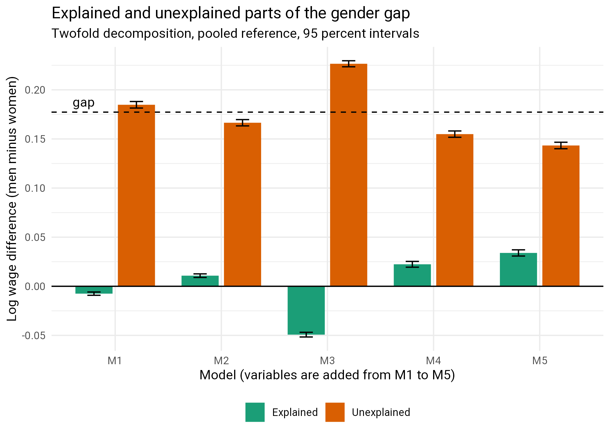
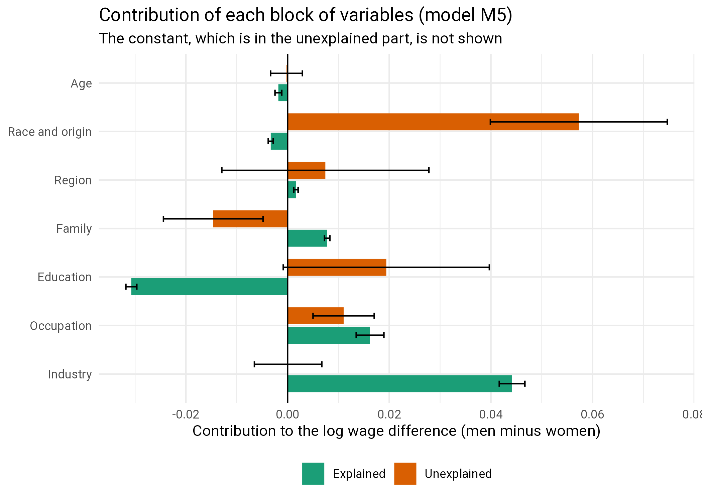

<!--
INPUT FILES (paths relative to the project directory; wage_file_outputs <- "./processing_files/"):
  processing_files/numeric_age_truncated_data.Rdata               made by Supplementary_2 (chunk save_age_truncated)
        objects used: X_ordered_numeric_269 (13 numeric covariates, ages 26-53), W.ordered_numeric (1 for male), Y.ordered_numeric (log hourly wage),
                      weights_supplied.X_ordered_numeric_269 (Census weights capped at the 95th percentile)
  processing_files/capped_weights_segregated_workforce.Rdata      made by Supplementary_2 (chunk segments)
        objects used: minp, midp, maxp (the rows of the low, middle and high propensity segments)
  Supplementary_3_results.Rdata                                   made by Supplementary_3 (optional: the AIPW estimates for the comparison)
  Supplementary_2_results.Rdata                                   made by Supplementary_2 (optional: the difference in means, for a test)
  wageinequality.bib                                              bibliography

OUTPUT FILES:
  Supplementary_5_results.Rdata                                   the list res: every number in the text and tables
  Supplementary_5_tests.txt, Supplementary_5_session.txt          test results and session information
  Supplementary_5_figs/oaxaca_models.png, oaxaca_detail.png       figures

FLAGS (set in the setup chunk):
  eval_flag      TRUE runs the analysis chunks. FALSE knits the text and tables from Supplementary_5_results.Rdata and the saved figures.
  fig_eval_flag  TRUE runs the figure chunks (the ones with ggsave()); they need the objects made by the analysis chunks.
  n_boot         number of bootstrap samples for the standard errors (each is a refit of every model).
  min_n          a level of a factor with fewer than min_n people of either gender is merged into "other".

UNIT TESTS: chunks named tests_* call run_test("description", { testthat::expect_...() }). The results are listed by the last chunk
  and written to Supplementary_5_tests.txt. A failing test is a statement in the text, or an assumption of the analysis, that no longer holds.

HISTORY: the first version of this file was a set of exploratory notes. The decomposition did not run (occupation as a factor has levels that occur in only one
  gender, and the call failed with "non-conformable arguments"), it called functions that did not exist, and the text interpreted a table that was not in the file.
  It has been rewritten. The package `oaxaca` is no longer used: the decomposition is computed here (it needs the weights, a large number of factor levels, and the
  pooled reference), and is checked by tests.

HPC: salloc --account=<ACCOUNT> --mem=200GB --nodes=1 --ntasks=1 --cpus-per-task=32 -J interactive -t 6:00:00 srun --cpus-per-task=32 --pty /bin/bash -l
     module load pandoc texlive
-->

```{r setup, include=FALSE}
knitr::opts_chunk$set(fig.width=6, fig.height=6, dpi=300,echo = FALSE)
knitr::opts_chunk$set(fig.pos = "H", out.extra = "")

# eval_flag: TRUE runs the analysis chunks. FALSE knits the text, the tables (from the saved results) and the saved figures.
# fig_eval_flag: TRUE runs the chunks that write the figures; they need the objects made by the analysis chunks.
eval_flag <- TRUE
fig_eval_flag <- TRUE
if (!eval_flag) fig_eval_flag <- FALSE

n_boot <- 100      # bootstrap samples for the standard errors
min_n  <- 30       # levels with fewer than min_n people of either gender are merged into "other"

# Defaults for every later chunk: run only if eval_flag, and keep output out of the PDF. Chunks that differ say so in their header.
knitr::opts_chunk$set(eval = eval_flag, results = 'hide', fig.show = 'hide', warning = FALSE, message = FALSE)

test_log <- "Supplementary_5_tests.txt"
results_file <- "Supplementary_5_results.Rdata"   # saved at the end of the analysis; loaded when eval_flag is FALSE
test_results <- data.frame(test = character(), result = character(), detail = character(), stringsAsFactors = FALSE)
run_test <- function(description, code) {
  detail <- tryCatch({ force(code); "" }, error = function(e) conditionMessage(e))
  result <- if (identical(detail, "")) "PASS" else "FAIL"
  test_results[nrow(test_results) + 1, ] <<- c(description, result, detail)
  cat(sprintf("[%s] %s\n", result, description))
  if (result == "FAIL") cat("       ", detail, "\n")
  invisible(result == "PASS")
}

```

```{r libraries, echo=FALSE, eval=TRUE, include=FALSE}
# This chunk always runs: loading kableExtra adds the LaTeX packages that the tables need.
options(width=160)
library(Matrix)
library(ggplot2)
library(tidyverse)
library(testthat)
library(parallel)
library(knitr)
library(kableExtra)

# helpers for the inline numbers in the text
f <- function(x, d = 3) formatC(x, format = "f", digits = d, big.mark = ",")
pct <- function(x, d = 0) formatC(100 * x, format = "f", digits = d)
if (!eval_flag) load(results_file)   # res: the numbers behind the text and the tables

```

```{r}
# PATHS (must be set): run this file from the project directory. wage_file_outputs is where the intermediate .Rdata files are
# read from and written to; change it here if they are somewhere else.
wage_file_outputs <- "./processing_files/"
# (wage_data_dir is not needed in this file: the raw data is read only in Supplementary 1)
res <- list()   # every number used in the text and the tables is stored here and saved at the end
n_cores <- as.integer(Sys.getenv("SLURM_CPUS_ON_NODE", unset = parallel::detectCores()))

```

\clearpage
# Introduction

The causal forest of Supplementary 3 estimates the gender gap in log wages after adjusting for covariates *without* assuming a linear model. The oldest tool for the
same question is the **Oaxaca-Blinder decomposition** [@oaxaca1973male; @blinder1973wage]. It writes the difference in the mean log wage of men and women,
$$\bar Y_M - \bar Y_F = \bar X_M^\top \hat\beta_M - \bar X_F^\top \hat\beta_F,$$
where $\hat\beta_M$ and $\hat\beta_F$ come from separate regressions of log wage on the covariates for men and for women, as the sum of

- an **explained** part, which is due to men and women having different covariates (for example, different occupations or education) and
- an **unexplained** part, which is due to the covariates having different wage returns, and any difference not captured by the covariates.

The decomposition answers three questions here.

1. How much of the gap is *explained*? In particular, how much does adding occupation and industry (the segregated workforce of Supplementary 4) explain?
2. How large is the unexplained part, which is the gap "adjusted" for the covariates, compared with the causal forest estimate of about 0.13?
3. Which covariates are responsible for the explained part, and which for the unexplained part?

A word of caution that applies to everything below. "Unexplained" is not "discrimination": it is the part not accounted for by the covariates in the model,
including everything that is not measured. And "explained" is not "fair": if women are channelled into lower-paid occupations, the occupation variable explains part
of the gap, and the difference in occupations may itself be part of what we wish to study. The answers depend on which variables are included. That is why
the variables are added in blocks and the results given at each step.

# Method

## The decomposition

We write $g$ for gender ($g=1$ for men), $X$ for the covariates (a constant, numeric variables, and indicators for the levels of the factors), and use the Census person
weights, capped at their 95th percentile (Supplementary 2), in every mean and every regression. With $\hat\beta_M$, $\hat\beta_F$ from the weighted regressions in the two groups,
$\bar X_g$ the weighted covariate means and $\bar Y_g = \bar X_g^\top\hat\beta_g$ the weighted means of the log wage, for *any* vector $\beta^*$

$$\bar Y_M - \bar Y_F = \underbrace{(\bar X_M - \bar X_F)^\top \beta^*}_{\text{explained}}
   + \underbrace{\bar X_M^\top(\hat\beta_M - \beta^*) + \bar X_F^\top(\beta^* - \hat\beta_F)}_{\text{unexplained}}.$$

The **twofold decomposition** takes $\beta^*$ from the pooled regression of all people on $X$ and a gender indicator [@neumark1988employers; @jann2008blinder]. (With the
indicator in the regression, $\beta^*$ is not pulled towards the group that is better represented, and the unexplained part is equal to the coefficient of the indicator,
which is the covariate-adjusted gap of a linear model.) The **threefold decomposition** takes $\beta^* = \hat\beta_F$ and splits the explained part further: the
*endowments* $(\bar X_M - \bar X_F)^\top\hat\beta_F$, the *coefficients* $\bar X_F^\top(\hat\beta_M - \hat\beta_F)$ and the *interaction* $(\bar X_M - \bar X_F)^\top(\hat\beta_M - \hat\beta_F)$.

Summing the terms over the columns of a block of variables gives the **detailed decomposition**. For a factor, the contribution of the indicators depends on which level is
left out as the base level unless the coefficients are expressed as deviations from their mean over the levels [@yun2005simple]; that is done here, so
that no result depends on a choice of base level (this is tested).

## The models

The variables are added in blocks, and the decomposition is done for each model.

| model | adds | variables |
|---|---|---|
| M1 | age, race and origin, region | age (a quadratic), race, Hispanic origin, citizenship, level of English, economic region |
| M2 | family | marital status, number of children (0 to 4 or more), family size (1 to 6 or more) |
| M3 | education | years of education, as a factor |
| M4 | occupation | occupation (529 codes, as a factor) |
| M5 | industry | industry (269 codes, as a factor) |

Notes on the choices.

- Education, occupation and industry are **factors**, not the numeric codes they have in the data. In the numeric data `occupation` and `industry` are codes in increasing order of the
  mean log wage of the level (Supplementary 1) and so are not covariates in the usual sense; used as numbers in a regression they would impose a linear return to the rank.
- `nativity` is left out: it is a function of `citizenship` (born in the US, or born abroad), so it adds a collinear column.
- A level with fewer than `r min_n` people of either gender (unweighted) is merged into the level "other" (or, if "other" would itself have fewer than `r min_n` people of either gender, into the most common level). Without this the regression for one gender has no information on the level, which is
  what made the first version of this file fail.
- The standard errors are from a bootstrap with `r n_boot` samples of people, with every model refitted in every sample. The collapsing of levels is not repeated in each sample.

# Data

```{r data}
load(paste(wage_file_outputs, "numeric_age_truncated_data.Rdata", sep = ""))
load(paste(wage_file_outputs, "capped_weights_segregated_workforce.Rdata", sep = ""))   # minp, midp, maxp
X <- X_ordered_numeric_269
y <- Y.ordered_numeric
g <- W.ordered_numeric
w <- weights_supplied.X_ordered_numeric_269
res$n <- c(all = length(y), women = sum(g == 0), men = sum(g == 1))

```

```{r tests_data, echo=FALSE, eval=eval_flag, include=FALSE}
run_test("data: ages 26 to 53, 659,436 people, 13 numeric covariates, no missing values", {
  expect_equal(range(X$age), c(26, 53))
  expect_equal(nrow(X), 659436)
  expect_equal(ncol(X), 13)
  expect_false(anyNA(X)); expect_false(anyNA(y)); expect_false(anyNA(w))
})
run_test("data: W is 0/1, the weights are positive, and the segments cover the sample", {
  expect_true(all(g %in% c(0, 1)))
  expect_true(all(w > 0))
  expect_equal(length(minp) + length(midp) + length(maxp), nrow(X))
})

```

The data are the `r f(res$n[["all"]], 0)` people aged 26 to 53 of Supplementary 2 (`r f(res$n[["men"]], 0)` men and `r f(res$n[["women"]], 0)` women). The weighted gap
in the mean log wage is the first row of the tables below.

# The decomposition code

The code is in the next chunk (it is not shown in the PDF). Its pieces: `prepare_covariates()` makes the covariates and merges rare levels, `make_design()` makes the sparse design matrix of a model
(a column for each level of each factor; a few hundred columns for M5), `fit_group()` fits a weighted regression and expresses the factor coefficients as deviations from their mean,
and `decompose()` returns the gap, the twofold and threefold decompositions and the detailed contributions by block. The weighted regressions are solved by the normal
equations of the sparse design, which takes seconds for 659,436 people.

```{r functions}
# Levels with fewer than min_n people of either gender are merged into "other" (so that both genders have the same levels).
# If the merged level "other" itself has fewer than min_n people of either gender (it can have none of one gender, which is a zero column
# in that gender's regression), the rare levels are merged into the most common level instead.
collapse_levels <- function(x, g, min_n = 30) {
  tb <- table(x, g)
  ok <- rownames(tb)[apply(tb, 1, min) >= min_n]
  r <- ifelse(as.character(x) %in% ok, as.character(x), "other")
  if (length(ok) > 0 && any(r == "other") && min(table(factor(g[r == "other"], levels = colnames(tb)))) < min_n)
    r[r == "other"] <- ok[which.max(rowSums(tb[ok, , drop = FALSE]))]
  factor(r)
}

# The variables of each block: numeric ones enter linearly, factor ones as a set of indicators.
blocks <- list(
  "Age"             = list(numeric = c("age", "age2")),
  "Race and origin" = list(numeric = "hispanic_origin", factor = c("race", "citizenship", "english_level")),
  "Region"          = list(factor = "economic_region"),
  "Family"          = list(factor = c("marital", "children_f", "family_size_f")),
  "Education"       = list(factor = "education_level"),
  "Occupation"      = list(factor = "occupation"),
  "Industry"        = list(factor = "industry"))
model_blocks <- list(M1 = c("Age", "Race and origin", "Region"),
                     M2 = c("Age", "Race and origin", "Region", "Family"),
                     M3 = c("Age", "Race and origin", "Region", "Family", "Education"),
                     M4 = c("Age", "Race and origin", "Region", "Family", "Education", "Occupation"),
                     M5 = c("Age", "Race and origin", "Region", "Family", "Education", "Occupation", "Industry"))

# The covariates as used in the models: age centred and scaled, children and family size topped, rare levels merged.
prepare_covariates <- function(X, g, min_n = 30) {
  d <- data.frame(age = (X$age - 40) / 10, age2 = ((X$age - 40) / 10)^2, hispanic_origin = X$hispanic_origin)
  # children and family size are topped, and like the other factors their rare levels are merged (an empty level of one gender gives a zero column)
  d$children_f    <- collapse_levels(pmin(X$children, 4), g, min_n)
  d$family_size_f <- collapse_levels(pmin(X$family_size, 6), g, min_n)
  for (v in c("race", "citizenship", "english_level", "economic_region", "marital", "education_level", "occupation", "industry"))
    d[[v]] <- collapse_levels(X[[v]], g, min_n)
  d
}

# Sparse design matrix for the blocks of a model: a constant, then for each block its numeric columns and one indicator per level of
# each factor. info says which block and factor each column belongs to, and which indicator is the base level of its factor.
make_design <- function(d, block_names) {
  n <- nrow(d); cols <- list(); info <- list()
  add <- function(m, name, block, fac, base) {
    cols[[length(cols) + 1]] <<- m
    info[[length(info) + 1]] <<- data.frame(name = name, block = block, factor = fac, base = base, stringsAsFactors = FALSE)
  }
  add(Matrix(1, n, 1, sparse = TRUE), "(Intercept)", "Constant", NA, FALSE)
  for (b in block_names) {
    for (v in blocks[[b]]$numeric) add(Matrix(d[[v]], n, 1, sparse = TRUE), v, b, NA, FALSE)
    for (v in blocks[[b]]$factor) {
      fc <- d[[v]]; K <- nlevels(fc)
      M <- sparseMatrix(i = seq_len(n), j = as.integer(fc), x = 1, dims = c(n, K))
      add(M, paste0(v, ":", levels(fc)), b, v, seq_len(K) == which.max(table(fc)))   # base level: the most common one
    }
  }
  list(X = do.call(cbind, cols), info = do.call(rbind, info))
}

# Weighted least squares by the normal equations (the design is sparse and the number of columns is moderate).
wls <- function(X, y, w, names = NULL) {
  A <- as.matrix(crossprod(X, X * w))
  r <- qr(A)
  if (r$rank < ncol(A)) {     # name the columns that are linear combinations of the earlier ones, so that the cause can be found
    bad <- r$pivot[(r$rank + 1):ncol(A)]
    stop("the design is singular in this group (n = ", nrow(X), "); aliased columns: ",
         paste(if (is.null(names)) bad else names[bad], collapse = ", "), call. = FALSE)
  }
  as.numeric(solve(A, as.matrix(crossprod(X, w * y))))
}

# Coefficients of all the columns of the design (base indicators have coefficient 0), then in deviation form (Yun, 2005): the coefficients
# of the indicators of a factor are centred on their mean, which is moved to the constant. The explained part of the decomposition does not
# depend on the base level; this makes the same true for the unexplained part. `extra` is a column that is in the regression but not in X.
fit_group <- function(X, info, y, w, extra = NULL) {
  keep <- !info$base
  Xf <- X[, keep, drop = FALSE]
  if (!is.null(extra)) Xf <- cbind(Xf, extra)
  b <- wls(Xf, y, w, names = c(info$name[keep], if (!is.null(extra)) "extra"))
  full <- numeric(ncol(X)); full[keep] <- b[seq_len(sum(keep))]
  for (v in unique(na.omit(info$factor))) {
    j <- which(info$factor == v); m <- mean(full[j])
    full[j] <- full[j] - m; full[1] <- full[1] + m
  }
  list(beta = full, extra = if (is.null(extra)) NULL else b[-seq_len(sum(keep))])
}

# The twofold decomposition of ybar_M - ybar_F, with the reference coefficients from the pooled regression with a gender indicator, and
# the threefold decomposition with the women's coefficients as the reference. All means are weighted. g is 1 for men.
decompose <- function(X, info, y, w, g) {
  m <- g == 1; fm <- !m
  xbar_m <- as.numeric(crossprod(X[m, ], w[m])) / sum(w[m]);  xbar_f <- as.numeric(crossprod(X[fm, ], w[fm])) / sum(w[fm])
  gap <- weighted.mean(y[m], w[m]) - weighted.mean(y[fm], w[fm])
  bm <- fit_group(X[m, ], info, y[m], w[m])$beta
  bf <- fit_group(X[fm, ], info, y[fm], w[fm])$beta
  pooled <- fit_group(X, info, y, w, extra = Matrix(g, length(g), 1, sparse = TRUE))
  bs <- pooled$beta
  two_expl   <- (xbar_m - xbar_f) * bs
  two_unexpl <- xbar_m * (bm - bs) + xbar_f * (bs - bf)
  three_end  <- (xbar_m - xbar_f) * bf
  three_coef <- xbar_f * (bm - bf)
  three_int  <- (xbar_m - xbar_f) * (bm - bf)
  blk <- factor(info$block, levels = unique(info$block))
  by_block <- function(v) as.numeric(tapply(v, blk, sum))
  list(gap = gap, adjusted = pooled$extra,
       two = c(explained = sum(two_expl), unexplained = sum(two_unexpl)),
       three = c(endowments = sum(three_end), coefficients = sum(three_coef), interaction = sum(three_int)),
       detail = data.frame(block = levels(blk), explained = by_block(two_expl), unexplained = by_block(two_unexpl), stringsAsFactors = FALSE),
       check = c(two = gap - sum(two_expl) - sum(two_unexpl), three = gap - sum(three_end) - sum(three_coef) - sum(three_int)))
}

# Flatten the result of decompose() into a named vector (for the bootstrap).
flatten <- function(r) c(gap = r$gap, adjusted = r$adjusted, r$two, r$three,
                         setNames(r$detail$explained, paste0("expl:", r$detail$block)), setNames(r$detail$unexplained, paste0("unexpl:", r$detail$block)))

# Estimates and bootstrap standard errors of the decomposition of each model for the people in `rows`.
run_models <- function(rows, models, B, seed = 1) {
  d  <- prepare_covariates(X[rows, ], g[rows], min_n)
  yy <- y[rows]; ww <- w[rows]; gg <- g[rows]; n <- length(yy)
  out <- lapply(models, function(m) {
    des <- make_design(d, model_blocks[[m]])
    est <- decompose(des$X, des$info, yy, ww, gg)
    boot <- NULL
    if (B > 0) {
      one <- function(b) {
        set.seed(seed + b)
        i <- sample.int(n, n, replace = TRUE)
        tryCatch(flatten(decompose(des$X[i, ], des$info, yy[i], ww[i], gg[i])), error = function(e) NULL)
      }
      boot <- mclapply(seq_len(B), one, mc.cores = n_cores)
      boot <- do.call(rbind, boot[!sapply(boot, is.null)])
    }
    list(model = m, n_cols = ncol(des$X), n_rows = n, est = est, flat = flatten(est),
         se = if (!is.null(boot)) apply(boot, 2, sd) else NULL, n_boot = if (!is.null(boot)) nrow(boot) else 0)
  })
  names(out) <- models
  out
}

# the part of a run_models() result that is kept: one row per model
models_table <- function(out) {
  do.call(rbind, lapply(out, function(o) data.frame(
    model = o$model, n_cols = o$n_cols, n = o$n_rows, gap = o$flat[["gap"]], explained = o$flat[["explained"]], unexplained = o$flat[["unexplained"]],
    explained_se = o$se[["explained"]], unexplained_se = o$se[["unexplained"]], gap_se = o$se[["gap"]], pct_explained = 100 * o$flat[["explained"]] / o$flat[["gap"]],
    endowments = o$flat[["endowments"]], coefficients = o$flat[["coefficients"]], interaction = o$flat[["interaction"]], row.names = NULL)))
}
detail_table <- function(o) {
  nm <- o$est$detail$block
  data.frame(block = nm, explained = o$est$detail$explained, explained_se = o$se[paste0("expl:", nm)],
             unexplained = o$est$detail$unexplained, unexplained_se = o$se[paste0("unexpl:", nm)], row.names = NULL)
}

```

```{r tests_functions, echo=FALSE, eval=eval_flag, include=FALSE}
# Checks of the code on a random subsample of 30,000 people.
set.seed(2)
sub <- sort(sample(nrow(X), 30000))
d_sub <- prepare_covariates(X[sub, ], g[sub], min_n)
des_sub <- make_design(d_sub, model_blocks$M4)
r_sub <- decompose(des_sub$X, des_sub$info, y[sub], w[sub], g[sub])
run_test("code: both decompositions add up to the gap", {
  expect_lt(max(abs(r_sub$check)), 1e-10)
})
run_test("code: the weighted regression agrees with lm() (the fitted values are the same)", {
  dd <- data.frame(y = y[sub], d_sub[, c("age", "age2", "hispanic_origin")], race = d_sub$race, marital = d_sub$marital,
                   children_f = d_sub$children_f, family_size_f = d_sub$family_size_f, citizenship = d_sub$citizenship,
                   english_level = d_sub$english_level, economic_region = d_sub$economic_region, education_level = d_sub$education_level,
                   occupation = d_sub$occupation)
  fit_lm <- lm(y ~ ., data = dd, weights = w[sub])
  fit_me <- fit_group(des_sub$X, des_sub$info, y[sub], w[sub])
  expect_equal(as.numeric(des_sub$X %*% fit_me$beta), as.numeric(fitted(fit_lm)), tolerance = 1e-6)
})
run_test("code: the decomposition does not depend on the base level of the factors", {
  info2 <- des_sub$info
  info2$base <- FALSE
  for (v in unique(na.omit(info2$factor))) info2$base[which(info2$factor == v)[1]] <- TRUE   # the first level instead of the most common
  r2 <- decompose(des_sub$X, info2, y[sub], w[sub], g[sub])
  expect_equal(r2$detail, r_sub$detail, tolerance = 1e-8)
  expect_equal(r2$three, r_sub$three, tolerance = 1e-8)
})
run_test("code: the unexplained part of the twofold decomposition is the coefficient of the gender indicator", {
  expect_equal(unname(r_sub$two["unexplained"]), r_sub$adjusted, tolerance = 1e-8)
})

```

# Results: the whole sample

```{r whole}
t0 <- Sys.time()
whole <- run_models(seq_along(y), names(model_blocks), n_boot)
res$whole        <- models_table(whole)
res$whole_detail <- detail_table(whole$M5)
res$whole_detail_M3 <- detail_table(whole$M3)
res$whole_three  <- whole$M5$flat[c("endowments", "coefficients", "interaction")]
res$whole_three_se <- whole$M5$se[c("endowments", "coefficients", "interaction")]
res$levels <- c(occupation = nlevels(prepare_covariates(X, g, min_n)$occupation), industry = nlevels(prepare_covariates(X, g, min_n)$industry))
res$minutes_whole <- as.numeric(difftime(Sys.time(), t0, units = "mins"))

```

```{r tests_whole, echo=FALSE, eval=eval_flag, include=FALSE}
run_test("whole sample: the raw gap is the same in every model, and equals the weighted gap of Supplementary 2 when that file is available", {
  expect_equal(diff(range(res$whole$gap)), 0, tolerance = 1e-10)
  if (file.exists("Supplementary_2_results.Rdata")) {
    e <- new.env(); load("Supplementary_2_results.Rdata", envir = e)
    expect_equal(res$whole$gap[1], unname(e$res$dim[["weighted_by_hand"]]), tolerance = 1e-8)
  }
})
run_test("whole sample: explained and unexplained add up to the gap in every model", {
  expect_equal(res$whole$explained + res$whole$unexplained, res$whole$gap, tolerance = 1e-8)
  expect_equal(res$whole$endowments + res$whole$coefficients + res$whole$interaction, res$whole$gap, tolerance = 1e-8)
})
run_test("whole sample: all the bootstrap samples were used and every standard error is positive", {
  expect_true(all(sapply(whole, function(o) o$n_boot) >= 0.95 * n_boot))
  expect_true(all(res$whole$unexplained_se > 0 & res$whole$explained_se > 0))
})

```

```{r table_whole, eval=TRUE, results='asis'}
wt <- res$whole
labels <- c(M1 = "M1  age, race and origin, region", M2 = "M2  + family", M3 = "M3  + education", M4 = "M4  + occupation", M5 = "M5  + industry")
kable(data.frame(unname(labels[wt$model]), f(wt$n_cols, 0), f(wt$explained, 3), f(wt$explained_se, 3), f(wt$unexplained, 3), f(wt$unexplained_se, 3), f(wt$pct_explained, 0)),
      format = "latex", booktabs = TRUE, label = "oaxacamodels",
      caption = "Twofold Oaxaca-Blinder decomposition of the gender gap in log wage (men minus women), whole sample, by model",
      col.names = c("Model", "Columns", "Explained", "SE", "Unexplained", "SE", "Explained (percent of gap)"),
      align = c("l", "r", "r", "r", "r", "r", "r")) %>%
  kable_styling(latex_options = "hold_position") %>%
  footnote(general = paste0("The weighted gap is ", f(wt$gap[1], 4), " (bootstrap SE ", f(wt$gap_se[1], 4), "). Standard errors from ", n_boot, " bootstrap samples. The unexplained part equals the coefficient of the gender indicator in the pooled regression."),
           general_title = "Note:", footnote_as_chunk = TRUE, threeparttable = TRUE)

```

```{r figure_models, eval=fig_eval_flag}
dir.create("Supplementary_5_figs", showWarnings = FALSE)
wt <- res$whole
pd <- rbind(data.frame(model = wt$model, part = "Explained", value = wt$explained, se = wt$explained_se),
            data.frame(model = wt$model, part = "Unexplained", value = wt$unexplained, se = wt$unexplained_se))
p <- ggplot(pd, aes(x = model, y = value, fill = part)) +
  geom_col(position = position_dodge(width = 0.8), width = 0.7) +
  geom_errorbar(aes(ymin = value - 1.96 * se, ymax = value + 1.96 * se), position = position_dodge(width = 0.8), width = 0.25) +
  geom_hline(yintercept = wt$gap[1], linetype = "dashed") +
  geom_hline(yintercept = 0) +
  annotate("text", x = 0.6, y = wt$gap[1], label = "gap", vjust = -0.6, hjust = 0) +
  scale_fill_manual(values = c(Explained = "#1b9e77", Unexplained = "#d95f02")) +
  labs(x = "Model (variables are added from M1 to M5)", y = "Log wage difference (men minus women)", fill = NULL,
       title = "Explained and unexplained parts of the gender gap", subtitle = "Twofold decomposition, pooled reference, 95 percent intervals") +
  theme_minimal() + theme(legend.position = "bottom")
ggsave("Supplementary_5_figs/oaxaca_models.png", p, width = 7, height = 5, dpi = 300)

```

```{r oaxacamodels, echo=FALSE, eval=TRUE, results='markup', fig.show='asis', fig.cap="Explained and unexplained parts of the gap, by model", out.width = '80%', fig.align = 'center'}


```

```{r, eval=TRUE}
w5 <- res$whole[res$whole$model == "M5", ]
w1 <- res$whole[res$whole$model == "M1", ]
w3 <- res$whole[res$whole$model == "M3", ]
w4 <- res$whole[res$whole$model == "M4", ]

```

After merging rare levels there are `r res$levels[["occupation"]]` occupation levels and `r res$levels[["industry"]]` industry levels (of 529 and 269).
The weighted gap in the mean log wage is `r f(w5$gap, 3)` (men earn `r pct(exp(w5$gap) - 1)`\% more). Table \@ref(tab:oaxacamodels) and Figure \@ref(fig:oaxacamodels) show how the split changes as variables are added.

- **Demographics and region (M1).** Age, race, origin and region explain essentially none of the gap (`r f(w1$explained, 3)`); men and women hardly differ in these.
- **Family (M2) and education (M3).** Education makes the explained part *negative* (`r f(w3$explained, 3)` in M3): women have, on average, more education than men, and with positive returns to education, if women
  had the men's education they would earn *less* relative to men than they do. Differences in education therefore work against the gap, and the unexplained part in M3 (`r f(w3$unexplained, 3)`) is larger than the gap itself.
- **Occupation and industry (M4, M5).** The explained part becomes positive: `r f(w4$explained, 3)` with occupation and `r f(w5$explained, 3)` with industry added. Occupation and industry together
  explain `r f(w5$explained - w3$explained, 3)`, which is `r pct((w5$explained - w3$explained) / w5$gap)`\% of the gap, and they change the explained part from negative to positive. This is
  the segregated workforce of Supplementary 4 at work: the sorting of men and women into occupations and industries is the one *explained* difference that works in the direction of the gap.
- **The end result (M5).** Only `r pct(w5$pct_explained / 100)`\% of the gap (`r f(w5$explained, 3)`, SE `r f(w5$explained_se, 3)`) is explained by all of the covariates, and `r f(w5$unexplained, 3)` (SE `r f(w5$unexplained_se, 3)`)
  is unexplained. The unexplained part, which is the covariate-adjusted gap of a linear model, can be compared with the causal forest estimate of about 0.13 (below).

## Which variables

```{r figure_detail, eval=fig_eval_flag}
dt <- res$whole_detail
dt <- dt[dt$block != "Constant", ]
pd <- rbind(data.frame(block = dt$block, part = "Explained", value = dt$explained, se = dt$explained_se),
            data.frame(block = dt$block, part = "Unexplained", value = dt$unexplained, se = dt$unexplained_se))
pd$block <- factor(pd$block, levels = rev(dt$block))
p <- ggplot(pd, aes(x = block, y = value, fill = part)) +
  geom_col(position = position_dodge(width = 0.8), width = 0.7) +
  geom_errorbar(aes(ymin = value - 1.96 * se, ymax = value + 1.96 * se), position = position_dodge(width = 0.8), width = 0.25) +
  geom_hline(yintercept = 0) + coord_flip() +
  scale_fill_manual(values = c(Explained = "#1b9e77", Unexplained = "#d95f02")) +
  labs(x = NULL, y = "Contribution to the log wage difference (men minus women)", fill = NULL,
       title = "Contribution of each block of variables (model M5)", subtitle = "The constant, which is in the unexplained part, is not shown") +
  theme_minimal() + theme(legend.position = "bottom")
ggsave("Supplementary_5_figs/oaxaca_detail.png", p, width = 7, height = 5, dpi = 300)

```

```{r table_detail, eval=TRUE, results='asis'}
dt <- res$whole_detail
kable(data.frame(dt$block, f(dt$explained, 3), f(dt$explained_se, 3), f(dt$unexplained, 3), f(dt$unexplained_se, 3)),
      format = "latex", booktabs = TRUE, label = "oaxacadetail",
      caption = "Detailed twofold decomposition by block of variables, model M5",
      col.names = c("Block", "Explained", "SE", "Unexplained", "SE"), align = c("l", "r", "r", "r", "r")) %>%
  kable_styling(latex_options = "hold_position") %>%
  footnote(general = "The constant belongs to the unexplained part. Factor coefficients are in deviation form, so no contribution depends on the choice of base level.",
           general_title = "Note:", footnote_as_chunk = TRUE, threeparttable = TRUE)

```

```{r oaxacadetail, echo=FALSE, eval=TRUE, results='markup', fig.show='asis', fig.cap="Contribution of each block of variables (model M5)", out.width = '80%', fig.align = 'center'}


```

```{r, eval=TRUE}
dt <- res$whole_detail
dv <- function(b, col) dt[[col]][dt$block == b]

```

Table \@ref(tab:oaxacadetail) and Figure \@ref(fig:oaxacadetail) give the contribution of each block in M5. In the explained part, industry (`r f(dv("Industry", "explained"), 3)`) and occupation (`r f(dv("Occupation", "explained"), 3)`) have large positive contributions,
family (`r f(dv("Family", "explained"), 3)`) a small positive one and education (`r f(dv("Education", "explained"), 3)`) a large negative one. In the unexplained part the constant (`r f(dv("Constant", "unexplained"), 3)`)
and the "race and origin" block (`r f(dv("Race and origin", "unexplained"), 3)`) are the largest. The detailed *unexplained* contributions are less informative than the explained ones: they depend on how the factors are
coded (the deviation form removes the arbitrary choice of a base level but not the arbitrariness of the model), and they mix real differences in returns with differences in the average levels of the variables.

The threefold decomposition of M5 has endowments `r f(res$whole_three[["endowments"]], 3)` (SE `r f(res$whole_three_se[["endowments"]], 3)`), coefficients `r f(res$whole_three[["coefficients"]], 3)`
(SE `r f(res$whole_three_se[["coefficients"]], 3)`) and interaction `r f(res$whole_three[["interaction"]], 3)` (SE `r f(res$whole_three_se[["interaction"]], 3)`). The interaction is not small,
and so the twofold decomposition, which assigns it between the two parts through the pooled reference, is the one to rely on.

# Comparison with the causal forest

```{r comparison}
# AIPW estimates of Supplementary 3 (middle propensity segment) and the segment decompositions
if (file.exists("Supplementary_3_results.Rdata")) {
  e3 <- new.env(); load("Supplementary_3_results.Rdata", envir = e3)
  res$aipw <- rbind(all = e3$ate.all, control = e3$ate.control, overlap = e3$ate.overlap)
} else res$aipw <- NULL

mid <- run_models(midp, c("M1", "M3", "M5"), n_boot)
res$mid <- models_table(mid)

```

```{r tests_comparison, echo=FALSE, eval=eval_flag, include=FALSE}
run_test("middle segment: the middle segment is 85 to 90 percent of the sample and the decompositions add up", {
  expect_gt(res$mid$n[1] / res$n[["all"]], 0.85)
  expect_lt(res$mid$n[1] / res$n[["all"]], 0.90)
  expect_equal(res$mid$explained + res$mid$unexplained, res$mid$gap, tolerance = 1e-8)
})
run_test("comparison: the covariate-adjusted gap of M5 (whole sample) is within 0.04 of the AIPW overlap estimate of Supplementary 3", {
  if (!is.null(res$aipw)) expect_lt(abs(res$whole$unexplained[res$whole$model == "M5"] - res$aipw["overlap", "estimate"]), 0.04)
})

```

```{r table_comparison, eval=TRUE, results='asis'}
wt <- res$whole; mt <- res$mid
rows <- data.frame(
  Method = c("Difference in means (whole sample)", "Oaxaca-Blinder adjusted gap, M5, whole sample", "Difference in means (middle segment)",
             "Oaxaca-Blinder adjusted gap, M5, middle segment"),
  Estimate = c(wt$gap[1], wt$unexplained[wt$model == "M5"], mt$gap[1], mt$unexplained[mt$model == "M5"]),
  SE = c(wt$gap_se[1], wt$unexplained_se[wt$model == "M5"], mt$gap_se[1], mt$unexplained_se[mt$model == "M5"]),
  stringsAsFactors = FALSE)
if (!is.null(res$aipw)) {
  rows <- rbind(rows, data.frame(Method = c("Causal forest AIPW, all (middle segment)", "Causal forest AIPW, control group (middle segment)", "Causal forest AIPW, overlap population (middle segment)"),
                                 Estimate = res$aipw[c("all", "control", "overlap"), "estimate"], SE = res$aipw[c("all", "control", "overlap"), "std.err"], stringsAsFactors = FALSE))
}
kable(data.frame(rows$Method, f(rows$Estimate, 3), f(rows$SE, 3)), format = "latex", booktabs = TRUE, label = "oaxacacomparison",
      caption = "The Oaxaca-Blinder adjusted gap and the causal forest estimates",
      col.names = c("Method", "Estimate", "SE"), align = c("l", "r", "r")) %>%
  kable_styling(latex_options = "hold_position")

```

```{r, eval=TRUE}
m5 <- res$mid[res$mid$model == "M5", ]
a <- if (is.null(res$aipw)) NA else res$aipw

```

Table \@ref(tab:oaxacacomparison) puts the Oaxaca-Blinder adjusted gap next to the AIPW estimates of the causal forest, which are for the middle propensity segment of Supplementary 3.
The linear model with all the covariates (M5) gives an adjusted gap of `r f(w5$unexplained, 3)` for the whole sample and `r f(m5$unexplained, 3)` for the middle segment.
The causal forest, which allows the effect of gender to depend on the covariates in an arbitrary way and weights the people by the overlap, gives `r if (is.null(res$aipw)) "(not available)" else f(a["overlap", "estimate"], 3)` (overlap) and
`r if (is.null(res$aipw)) "(not available)" else f(a["all", "estimate"], 3)` (all). The two approaches, one linear and one nonparametric, therefore lead to about the same conclusion:
after adjusting for the covariates, men earn about 14 percent more than women.
The difference between the decomposition and the forest is mainly that the decomposition says *how* the unadjusted gap of `r f(w5$gap, 3)` is reduced to this value.

# Within the propensity segments

The segments of Supplementary 2 separate the workforce by the propensity score of being male. We apply the decomposition (model M3, without occupation and industry, which are too sparse for the minority
gender in the extreme segments) within each segment.

```{r segments}
seg <- list(low = minp, mid = midp, high = maxp)
seg_runs <- lapply(seg, function(rows) run_models(rows, "M3", n_boot)$M3)
res$segments <- do.call(rbind, lapply(names(seg_runs), function(s) {
  o <- seg_runs[[s]]
  data.frame(segment = s, n = o$n_rows, men = sum(g[seg[[s]]] == 1), women = sum(g[seg[[s]]] == 0), gap = o$flat[["gap"]], gap_se = o$se[["gap"]],
             explained = o$flat[["explained"]], explained_se = o$se[["explained"]], unexplained = o$flat[["unexplained"]], unexplained_se = o$se[["unexplained"]])
}))

```

```{r tests_segments, echo=FALSE, eval=eval_flag, include=FALSE}
run_test("segments: the three segments cover the sample and the decompositions add up", {
  expect_equal(sum(res$segments$n), res$n[["all"]])
  expect_equal(res$segments$explained + res$segments$unexplained, res$segments$gap, tolerance = 1e-8)
})

```

```{r table_segments, eval=TRUE, results='asis'}
sg <- res$segments
nm <- c(low = "Low propensity (mostly women)", mid = "Middle", high = "High propensity (mostly men)")
kable(data.frame(unname(nm[sg$segment]), f(sg$men, 0), f(sg$women, 0), f(sg$gap, 3), f(sg$explained, 3), f(sg$explained_se, 3), f(sg$unexplained, 3), f(sg$unexplained_se, 3)),
      format = "latex", booktabs = TRUE, label = "oaxacasegments",
      caption = "Twofold decomposition within the propensity segments (model M3)",
      col.names = c("Segment", "Men", "Women", "Gap", "Explained", "SE", "Unexplained", "SE"), align = c("l", rep("r", 7))) %>%
  kable_styling(latex_options = "hold_position")

```

Table \@ref(tab:oaxacasegments) gives the decomposition in each segment. The raw gaps are those of Supplementary 4.
```{r, eval=TRUE}
sg <- res$segments; lo <- sg[sg$segment == "low", ]; mi <- sg[sg$segment == "mid", ]; hi <- sg[sg$segment == "high", ]
```
The unexplained part is large in all three segments (`r f(lo$unexplained, 3)`, `r f(mi$unexplained, 3)` and `r f(hi$unexplained, 3)`), although the raw gap in the high segment is only `r f(hi$gap, 3)`: there the covariates
`r if (hi$explained < 0) "explain a negative part (the men and women who share a segment differ in ways that, by themselves, would make women earn more)" else "explain part of the gap"`, so the adjusted gap is larger than the raw one.
In the low segment, which holds `r f(lo$women, 0)` women and only `r f(lo$men, 0)` men, the covariates explain `r f(lo$explained, 3)` of the gap of `r f(lo$gap, 3)`.
A segment with few men or few women has wider intervals (standard error of the unexplained part `r f(lo$unexplained_se, 3)` in the low segment and `r f(hi$unexplained_se, 3)` in the high one, against `r f(mi$unexplained_se, 3)` in the middle).
The smaller raw gap in the high segment (Supplementary 4) is therefore not a smaller gap after adjustment: the adjusted gaps of the low and high segments are about the same.

# Discussion

- The covariates in the data explain a small part of the gender gap, and the explained part is the net of two forces working in opposite directions: women's higher education works against the gap
  and the sorting into occupations and industries works for it. The unexplained part, `r f(w5$unexplained, 3)`, is the larger part of the gap.
- The unexplained part of the linear decomposition and the causal forest estimate agree to within about `r f(abs(w5$unexplained - if (is.null(res$aipw)) w5$unexplained else a["overlap", "estimate"]), 2)`.
  That the gap persists after adjustment for the available covariates does not depend on the forest.
- The decomposition is descriptive. It treats the covariates as given; occupation and industry are choices that may themselves reflect the constraints that women face. Adding them to the model
  therefore answers "how much of the gap is associated with the different jobs of men and women", not "how much would the gap be if the jobs were the same".
- A linear model in the covariates is assumed, with the same coefficients for every person of a gender. The causal forest of Supplementary 3 relaxes that and finds heterogeneity in the gap
  (by age, marital status, children). A decomposition within subgroups could be added if the heterogeneity is of interest.

```{r save_results}
res$n_boot <- n_boot
res$min_n <- min_n
save(res, file = results_file)

```

```{r tests_summary, echo=FALSE, eval=eval_flag, include=FALSE}
# Results of all the tests, written to test_log; the session information is written next to it.
print(test_results[, c("result", "test")], right = FALSE)
cat(sum(test_results$result == "PASS"), "of", nrow(test_results), "tests passed\n")
write.table(test_results, test_log, sep = "\t", row.names = FALSE, quote = FALSE)
writeLines(capture.output(sessionInfo()), "Supplementary_5_session.txt")

```
