```{r setup, include=FALSE}
# Inputs: the results files written by Supplementary_2, 3, 4, 5 and weights.Rmd (run those first; see cleanup.Rmd for the order).
# Every number in the text that comes from the analysis is read from these files, so that the report cannot drift from the analysis.
# Figures are the ones written by the Supplementary files (Supplementary_N_figs/); report_figs/ holds the pictures that are not made by the analysis.
knitr::opts_chunk$set(fig.width=6, fig.height=6, dpi=300,echo = FALSE)
knitr::opts_chunk$set(fig.pos = "H", out.extra = "")
library(knitr)
library(kableExtra)

load_res <- function(file) { e <- new.env(); load(file, envir = e); e }
s2 <- load_res("Supplementary_2_results.Rdata")$res
s3 <- load_res("Supplementary_3_results.Rdata")
s4 <- load_res("Supplementary_4_results.Rdata")$res
s5 <- load_res("Supplementary_5_results.Rdata")$res
sw <- load_res("weights_results.Rdata")$res

f2  <- function(x) formatC(x, format = "f", digits = 2)
f3  <- function(x) formatC(x, format = "f", digits = 3)
f4  <- function(x) formatC(x, format = "f", digits = 4)
big <- function(x) format(x, big.mark = ",", scientific = FALSE)
pct <- function(x, d = 1) paste0(formatC(100 * x, format = "f", digits = d), "\\%")

n_all <- s2$n_all; n_age <- s2$n_age
seg <- s2$segments; n_mid <- seg$n[2]; frac_mid <- n_mid / n_age
dim_age <- s2$dim[["estimate"]]; dim_age_unw <- s2$dim[["unweighted"]]
cal <- s3$balance
blp <- s3$blp_df
```
\clearpage

# Executive Summary

This report examines how modern machine learning methods, particularly Generalized Random Forests (GRF, @atheyGeneralizedRandomForests2019), can enhance our
understanding of economic and social data. We demonstrate this with data on the gender wage gap.

We use the Public Use Microdata Sample (PUMS) of the 2018 American Community Survey, obtained from the United States Census Bureau (@PUMS.2018).
The results are therefore for the United States, not Australia. We use `r big(n_age)` people aged 26 to 53 (`r big(n_all)` in the full sample), with the
log of the hourly wage as the outcome.

The main results are:

- the raw (difference-in-means) gap is `r f3(dim_age)` in log wage;
- in the region of the variable space where man and woman can be directly compared (the middle propensity segment, `r big(n_mid)` people or `r pct(frac_mid, 0)` of the sample)
  there is an adjusted average gap of `r f3(s3$ate.overlap[["estimate"]])` (standard error `r f4(s3$ate.overlap[["std.err"]])`) from the causal forest;
- the gap is far from uniform: it is much smaller for people who have never married than for the married, it grows with age for the married and
  with the number of children (up to about three), and it is smaller for the more educated;
- an Oaxaca-Blinder decomposition on the whole sample explains only `r pct(s5$whole$pct_explained[5]/100, 0)` of the gap with all the covariates (including
  occupation and industry). The rest is unexplained.

The issue of the gender wage gap quickly became topical with the release of the WGEA (Workplace Gender Equality Agency,
@agencywgea2023WGEAData) Data Explorer that allows people to see gender wage gaps by employer. The CSIRO is
unfortunately not listed.

# Introduction

The gender wage gap remains a persistent issue in Australia, with women earning approximately 14.1% less than men as
of 2024. Traditional econometric approaches have provided valuable insights but may miss complex interactions and
heterogeneous effects that machine learning methods can help uncover.

To take one example, "Lorna Jane" has threatened
legal action on the reporting of a large wage gap for the company "without proper context" @CompaniesThatTake2024. As a
women's clothing retailer, "Lorna Jane" have an all-women workforce on the shop-floor. So are we really looking at a
gender wage gap or at lower pay for retail workers in general?

## Caludia Goldin's work 

Caludia Goldin won the 2023 Nobel Prize in Economics for her work on understanding the gender pay gap. 
Goldin's work (see "Family and Careers" @Goldin.2021) puts the gender wage discrimination in the US into a historical context.  She follows
the careers of successive cohorts of collage graduates, which she characterizes as "career or family", "career then family" and "career and family".
While female collage graduates started as a small group in 1900, it is now almost 1/2 of any emerging cohort of women.

While she documents the historical barriers that women faced in employment, she argues that discrimination by policy, management or fellow workers is, at
most, responsible for a small part of the gender wage gap.  Likewise she argues that neither unwillingness to negotiate or hold out for a higher
remuneration, or "occupational segregation" is more that a minor cause. She notes that many large corporations have staff, policies and departments
charges with "de-biasing" the workplace. While she does not not take issue with this, she argues that it is not tackling the structural problem.

- She locates the problem in what she calls "greedy work":

   - employers pay a large premium for working longer hours and being on call at any time
   - any  interruption to work history is heavily penalized. In a cohort of MBA graduates 7 years after graduation, women had taken 0.37 of a year off, men had taken 0.075. This
    made a large difference to career advancement
     women who work in "greedy work" jobs get paid about 0.95 as much as men but relatively  few women (and fewer mothers) choose these jobs due to incompatibility with
      other responsibilities

- Goldin documents the increasing time needed to gain qualifications and credentials

   - this has implication for women hoping to  establish themselves in a career  before having children
	

- she notes the rising income inequality since the 1970's and also that occupations with the greatest income gaps between men also have the greatest gender gaps.
  She suggests that women's wages have been swimming upstream just to stay in place. 
	
	
Goldin, being an economist, may have a bias to interpreting behaviour as the optimisation of returns by people and couples making rational choices. 
Here, conditioned by a little subtle cultural expectation, one partner commits to the greedy work career path and the other maintains the freedom to
devote time to children, home and elder care.


Goldins posits a number of markers that should lead to a higher gender wage gap in a profession, and then 
investigates where that marker is present and where it is not.

   - a task where it is expected that one person will see the job from beginning to end and where that person is known to the client will lead to a larger gap
   
      - hence legal litigation  has a high gender wage gap
	  - anaesthesiology has a lower gender wage gap than surgery. While people know their surgeon, few know who will be their anaesthesiologist. It is
	  generally the anaesthesiologist on duty at that time

   - tasks where a professional organisation has regularized the hours will have a lower gender wage gap
   
     - veterinary work in the US is now largely organized into chains. This has meant that fewer veterinarians are now small business
	 owners, and that most work as employees in a system that includes some centralized locations for after hours emergencies. This leads to
	 a situation where work hours are more predictable. As a consequence,  veterinary practice in the US is now a female dominated profession and has a lower
	 gender wage gap
	 
   -  areas where employees have been successful in demanding more predictability and flexibility, and where it is commonly recognized that 
      work can be shared and that even highly skilled employees are interchangeable.
	 
	 
Goldin argues that the gender wage gap is highest in the top ranks of the most highly paid professions, and is highest in professions where
there is a steep ladder for success.  Academia in the US has been characterized as "move up or move out" with an average of 7 years to get
tenure. This sort of pressure in academia, finance and legal services may work against women.

## Other approaches
We briefly note that Goldin's approach, while it was honoured with a Nobel prize, is not the only argument being put forward. A recent paper ("Labor Market
Returns to Personality:..."  @flinnLaborMarketReturns2024) argues that the gender wage gap is based on personality types.  They focus on how personality traits
affect job search behavior, bargaining, and labor market outcomes through multiple channels.


- wheras Goldin highlights:

   - the motherhood penalty 
   - workplace inflexibility
   - job structure/organization

- Flinn et al. emphasize:

   - job search behavior differences
   - bargaining power differences
   - productivity differences
   - job transition patterns


@flinnLaborMarketReturns2024 work is detailed and comprehensive and I am not in a position to evaluate it, having neither the data nor the expertise.
There may be some ways that these two approaches can be seen as complementary. However for this report we simply concentrate on Goldin's findings. 


We note here that @flinnLaborMarketReturns2024 and Goldin's work is heavily focused on collage graduates and particularly on high ranking professions. The data that we are considering covers
all workers. While insitutionalized discrimination is not legal any longer, the workers who would have experienced it have not been long removed from the
workforce.  Figure \@ref(fig:WGEA) showing Zelda D\'Aprano of the Meat Packers Union demonstrating for wage equality in 1969. While all of the workers she was
representing would have left the workforce by now, such institutional discrimination is a feature of the recent past, not the distant past. 


```{r WGEAZ, fig.cap=caption, echo=FALSE, fig.align = 'center', fig.show="hold"}
caption <- "Zelda D’Aprano of the Australasian Meat Industry Employees’ Union chained to the doors of the Commonwealth Building, 21 October 1969 \\textcite{ZeldaDApranosEqual}."
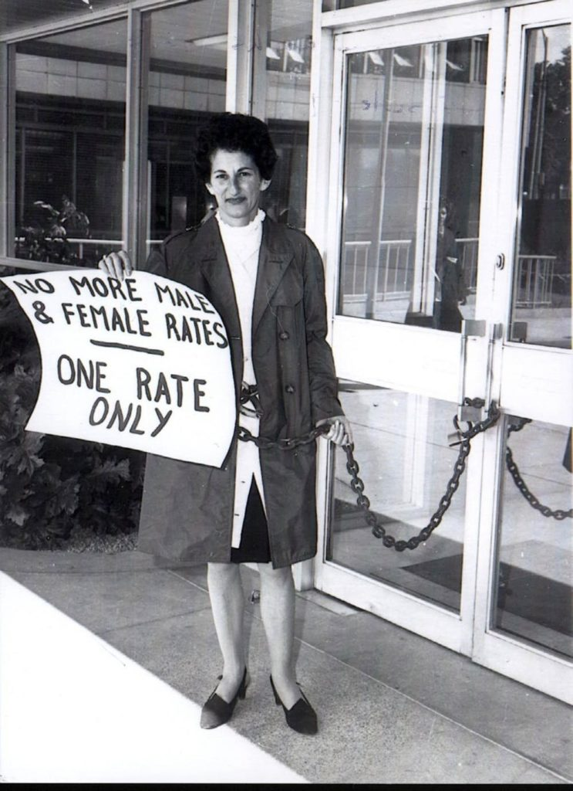

```


## She's Price(d)less  (@KPMG.2022)

"She's Price(d)less" is a report prepared by KPMG in collaboration with Diversity Council Australia (DCA) and the Workplace Gender Equality Agency (WGEA). This
is the fourth edition of the report, building on previous work from 2009, 2016, and 2019. The report uses decomposition analysis to identify the key drivers of
Australia's gender pay gap.

The report identifies three main categories of drivers contributing to the pay gap:

- gender discrimination (36% of the gap, down from 39% in 2017)

    -  this refers to systemic or overt discrimination that cannot be explained by factors such as education, experience, etc.

- care, family responsibilities and workforce participation (33% of the gap, down from 39% in 2017)

    - years not working due to interruptions (20%)
    - part-time employment (11%)
    - unpaid care and work (2%)

- Gender segregation in job type (24% of the gap, up from 17% in 2017)

     - industrial segregation (20%, up significantly from 9% in 2017)
     - occupational segregation (4%, down from 8% in 2017)

The report examines five key industries in detail:

- Healthcare and Social Assistance (hourly wage gap: 11.3%)
- Education and Training (hourly wage gap: 13.8%)
- Retail Trade (hourly wage gap: 9.2%)
- Manufacturing (hourly wage gap: 2.2%)
- Accommodation and Food Services (hourly wage gap: 7.4%)

The analysis found that women in female-dominated industries continue to face barriers to achieving wage parity, with gender pay gaps often above the national
average and underrepresentation in promotions and management positions.


They use approximately 40 variables including parental status, industry, and educational attainment from the Household, Income and Labour Dynamics in Australia (HILDA) Survey, Wave
20 (2020). The approach involves:

- modeling the probability of selection into the labor force
- estimating factors affecting hourly wages, applying the Walby and Olsen decomposition
- decomposing the gender pay gap to isolate the impact of gender discrimination

# Current State of the Gender Wage Gap in Australia

The gender pay gap in Australia has fluctuated between 14-19% over the last two decades. See Figure \@ref(fig:WGEA) from the WGEA website.  The WGEA
gender pay gap calculation uses total remuneration, including superannuation, overtime, bonuses, and other additional payments. They uses full-time
equivalent remuneration, so convert part-time and casual employee remuneration into annualised full time equivalent earnings. Alternatively, the ABS
data is base salary, for full-time workers. This means it excludes overtime, bonuses and additional payments. It also excludes the salaries of
part-time and casual workers.  

- the gap is largest in Western Australia at 21.9% (as of 2021)
- industry segregation remains a significant factor, with finance showing the largest gap at 32.2\%


```{r WGEA, fig.cap=caption, echo=FALSE, fig.align = 'center', fig.show="hold",out.width = '100%'}
caption <- "Australia's Gender Pay Gap"
knitr::include_graphics("./report_figs/WGEA.png")

```


# Traditional Analysis Methods and Causal Inference

Current approaches rely primarily on:

- Linear regression models
- Oaxaca-Blinder decomposition
- Summary statistics of labor market experience

While useful, these methods may not capture complex interactions between variables or identify heterogeneous effects
across different sub-populations.

## Notation and definitions {#notation}

Let's set some notation. Each data point can be defined by a triple $\{X_i, W_i, Y_i\}$. 

- The vector $X_i$ represents covariates that are observed for individual $i$ 
- $W_i \in \{0, 1\}$ where 0 represents women and 1 represents men. Because of the way that these methodologies were developed it is common to find
  software, tutorials and articles that use the terms "treatment" and "control"
- The scalar $Y_i$ is the observed outcome, and in this case it will generally be the log of the wages


## Analysis of the Gender Wage Gap

We begin by considering the simplest estimator that is available in experimental settings. The **difference-in-means** estimator is the sample average
of outcomes in the treatment group minus the sample average of outcomes in the control group.  

\begin{equation} 
\widehat{\tau}^{DIFF} = \frac{1}{n_1} \sum_{i:W_i = 1} Y_i - \frac{1}{n_0} \sum_{i:W_i = 0} Y_i \qquad \text{where} \qquad n_w := |\{i : W_i = w \}| 
\end{equation}

The difference-in-means estimator is a simple, easily computable, "model-free" estimator. In a randomised experiment it is unbiased for the treatment effect;
here sex is not randomised and it is just the raw gap. It is what the WGEA reports in
Figure \@ref(fig:WGEA). In one sense we could leave it at that. There is the question of the different methodologies of the ABS and the WGEA but given that one has access to the total
remuneration data for all employees in Australia (i.e. the tax receipts), the gender wage difference is easily calculated.

On the PUMS data (ages 26 to 53) the difference in means is `r f3(dim_age)`, using the Census person weights capped at their 95th percentile (`r s2$weight_cap`);
without weights it is `r f3(dim_age_unw)`. The capping, and why the weights matter little for the conclusions, are discussed in the Supplementary
file `weights.Rmd`: the capped weights have a design effect of `r f3(sw$design_effect[["capped"]])`.

```{r estimators, results='asis'}
comparison_df <- data.frame(
  Method = c("Difference-in-means",
             "Pooled forest ($Y \\sim X + W$)", "Separate forests",
             "Inverse propensity weighted (normalised)",
             "AIPW causal forest, all sample", "AIPW causal forest, control group", "AIPW causal forest, overlap population"),
  Estimate = f4(c(s3$dim_results[["estimate"]], s3$results_rf1[["estimate"]], s3$results_rf2[["estimate"]], s3$ipw.results[["estimate"]],
                  s3$ate.all[["estimate"]], s3$ate.control[["estimate"]], s3$ate.overlap[["estimate"]])),
  SE = c(f4(s3$dim_results[["std.error"]]), "--", "--", f4(s3$ipw.results[["std.error"]]),
         f4(s3$ate.all[["std.err"]]), f4(s3$ate.control[["std.err"]]), f4(s3$ate.overlap[["std.err"]])),
  stringsAsFactors = FALSE)
kable(comparison_df, format = "latex", booktabs = TRUE, escape = FALSE, label = "estimators",
      caption = paste0("Several different estimators for the gender wage gap (log wage), for the middle propensity segment (",
                       big(n_mid), " people). The direct estimates have no valid standard error; the IPW standard error ignores the estimation of the propensities."),
      col.names = c("Method", "Estimate", "Std. Error"), align = c("l", "c", "c")) %>%
  kable_styling(latex_options = "hold_position")
```

Table \@ref(tab:estimators) shows a number of estimators of the gender wage gap. Difference-in-means is offered by the WGEA
and is used to calculate the differences in Figure \@ref(fig:WGEA).
A number of other estimators are discussed in the Supplementary Information (Supplementary 3). We concentrate here on the "augmented inverse propensity-weighted (AIPW) estimator",
\begin{equation}
  (\#eq:aipw)
  \htau^{AIPW} := \frac{1}{n} \sum_{i=1}^{n} \left[ \hmu^{-i}(X_i, 1) - \hmu^{-i}(X_i, 0)
      + \frac{W_i}{\he^{-i}(X_i)} \bigl( Y_i - \hmu^{-i}(X_i, 1) \bigr) - \frac{1-W_i}{1-\he^{-i}(X_i)} \bigl( Y_i - \hmu^{-i}(X_i, 0) \bigr) \right]
\end{equation}
where $\hmu^{-i}$ and $\he^{-i}$ are the outcome and propensity models fitted without observation $i$ (out-of-bag predictions from the forests).
The details of calculating it are in the Supplementary Information. 

We note several features here:

- this (and some other estimators) depend on the estimating the Average Treatment Effect. 
\begin{equation}
  (\#eq:ate)
  \tau := \E[Y_i(1) - Y_i(0)].
\end{equation}
- these methods derive their strength from this. It is an attempt to estimate the outcome $Y_i$ if $i$ was a man and also if $i$ was a woman. Given that only
one of these outcomes is observed, a number of assumptions will need to made to estimate what is in effect a counter-factual
- these assumptions are unconfoundedness and overlap
 
    - unconfoundedness: given the covariates, sex is unrelated to the potential wages;
    - overlap, which depends strongly on the propensity score $e(X_i) := \PP[W_i = 1 | X_i]$.

- we can fit the AIPW using any regression method (see Supplementary) including Random Forests but the Generalized Random Forest algorithm
  introduced by @atheyGeneralizedRandomForests2019 has a number of advantages.

   1. Non-parametric estimation of heterogeneous effects
   2. Ability to capture complex interactions
   3. Data-driven discovery of relevant subgroups
   4. Robust uncertainty quantification and variable importance measures
   5. Treatment Effect Heterogeneity 
   6. Counterfactual Analysis, estimates wages under different scenarios

Apart from the separate forests, the estimates in Table \@ref(tab:estimators) are lower than the difference in means (`r f3(s3$dim_results[["estimate"]])` for this segment), as one
would expect if some of the raw gap is associated with differences in the covariates between men and women. The pooled forest (`r f3(s3$results_rf1[["estimate"]])`),
the normalised IPW estimate (`r f3(s3$ipw.results[["estimate"]])`) and the causal forest for the overlap population (`r f3(s3$ate.overlap[["estimate"]])`) agree to within
about 0.005. The separate forests (`r f3(s3$results_rf2[["estimate"]])`) each predict their own group, so they just reproduce the raw gap and do not adjust for anything.
The standard errors of the direct estimates are not valid (see Supplementary 3), so they are not shown.

# Random Forests and categorical variables

The best approach for unordered categorical variables nominal predictors is to consider all $2^{k - 1} - 1$ 2-partitions of the $k$
predictor categories (@Breiman.2001). However, this produces a large number of potential splits to be evaluated,
increasing computational complexity and restricting the possible number of categories in most implementations.  In fact the problem is NP-hard. 

For binary classification and regression, it was shown that ordering the predictor categories in each split, according to the mean of the $Y$
variable, leads to exactly the same splits as the best partitioning  approach. This reduces computational complexity because only $k - 1$ splits have to
be considered for a nominal predictor with $k$ categories.

For multiclass classification and survival prediction no ordering method producing equivalent splits exists.
@wrightSplittingCategoricalPredictors2019 propose a heuristic which orders the categories according to the first principal component of
the weighted covariance matrix in multiclass classification and by log-rank scores in survival prediction.

As we have a several categorical variables with a large number of levels (in the full sample **occupation** has 529 and **industry** has 269), we have opted for 
ordering the  predictor categories. However, the generalized random forest algorithm 
fits 3 random forests

1. the prop_model estimating propensity 
2. the outcome_model estimating $Y$ 
3. a generalized random forest estimating $\tau$.

The default treatment of an unordered factor in random forests (the levels are treated as if they were ordered by their codes) is poor, and one-hot encoding is
impractical for hundreds of levels. We order the levels by the mean of $Y$, which is justified by the result above. The comparison of the encodings on simulated
and on the wage data is in the Supplementary file `handling_categorical_variables.Rmd`.

# A first look at the data (preliminary diagnostics)

We start with some diagnostic tests. It's important to check the estimated propensity scores, shown in Figure \@ref(fig:propensities). To do
a causal analysis we assume that

\begin{equation}
  (\#eq:overlap)
  \eta < e(x) < 1 - \eta  \qquad \text{for all }x.
\end{equation}

This assumption is known as **overlap**, and it means that for all types of people in the population (i.e., for all values of the observable
variables) we can find some portion of individuals in treatment and some in control. Intuitively, this is necessary because we'd like to be
comparing treatment and control at each level of the covariates and then aggregate those results. For example, in a profession that is all
male, it is impossible to estimate the gender pay gap. If there are a significant number of propensity scores near zero or near one, so we
should expect IPW and AIPW estimators to behave poorly.  Even when overlap holds, when the propensity score is small AIPW can have unstable
performance.

Figure \@ref(fig:propensities) shows that we have an issue with this data set. There are a large number of people in parts of our sample
space that are largely male or largely female.

In order to correct for this we divide the data into 3 groups

- those with a propensity score $\leq 0.1$,   (low propensity: `r big(seg$n[1])` people, `r pct(seg$pct_men[1]/100, 0)` men)
- those with a propensity score in the range ($0.1 < e < 0.9)$ (mid propensity: `r big(seg$n[2])` people, `r pct(seg$pct_men[2]/100, 0)` men)
- and those with a propensity score $\geq 0.9$,    (high propensity: `r big(seg$n[3])` people, `r pct(seg$pct_men[3]/100, 0)` men).

The low group is a female dominated part of the workforce and the high group a male dominated part. In those groups there are too few people of
the other sex to estimate the gap by causal methods. The segments therefore describe parts of the workforce, not the whole population: the causal
estimates below apply to the middle group, which is `r pct(frac_mid, 0)` of the sample. The other two groups are compared in the section on segregation.

```{r propensities, fig.cap=caption, echo=FALSE, fig.align = 'center', fig.show="hold",out.width = '50%'}
caption <- "A histogram of the estimated propensity scores (ages 26 to 53, capped weights). Vertical lines are at propensity values of 0.1 and 0.9."
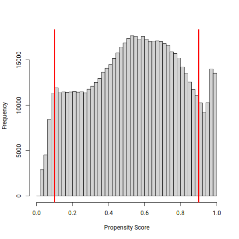

```
We can plot and tabulate the observed variables and also the $\htau$ to better understand the data.
This leads to a number of observations:

1. there is a correlation between children and sex. That is to say, while every child has a mother and a father, we have induced a
correlation by considering the paid workforce. Compared to men, women with 4 or more children are less likely to be in paid employment;
2. there is a non-linear age effect on the $\hat{\tau}$ as shown in figure \@ref(fig:tauhatversusage). A random forest model will be able to fit a
non-linear response surface. If we were using a linear model, we might consider introducing a quadratic term or a smoother at this point;
3. **children** means dependent children as defined by the American Community Survey (ACS), that is:

   - children under 15 years of age 
   - dependent students aged 15-24 years
   - people aged 16 to 18 years who are in full-time education and live with their parent(s) or grandparent(s)

Because of this, we see the number of children drop off rapidly after a certain age. This would appear to be a violation of the
unconfoundedness assumption.  It is a potential hypothesis that having children leads to a wage gap, but for this group of people we are not able to
observe that variable. People who have had dependant children in their household for 20 years, and those who have not, are
indistinguishable. 

Because of these issues, we truncate the data to ages 26 to 53. This is based on the current age of childbearing and an estimate of the age at which
children leave home. The proportion of people with dependent children by age is in Supplementary 2, and the sensitivity of the estimated gap to the
trimming of the propensities is tabulated there (the average gap is between `r f3(min(s2$trimming$ate))` and `r f3(max(s2$trimming$ate))` for trimming levels from
`r min(s2$trimming$alpha)` to `r max(s2$trimming$alpha)`).

```{r tauhatversusage, echo=FALSE, fig.cap='$\\hat{\\tau}$ versus age. The effect increases with age and flattens a little.',  fig.align = 'center', out.width = '50%'}
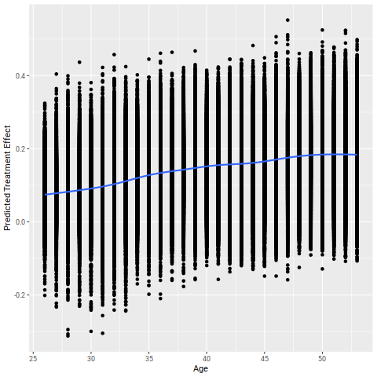
```

\FloatBarrier

# Causal analysis for the mid propensity segment

Due to the issue with the children variable, we reduce the data set to those individuals aged 26 to 53 (`r big(n_age)` people).
In addition, our analysis data set has been partitioned

- the female dominated workforce ($e \leq 0.1$)
- the part of the workforce amenable to causal analysis ($0.1 < e < 0.9$)
- the male dominated part of the workforce  ($e \geq 0.9$)

The full details of the analysis are in the Supplementary Material (Supplementary 3).
We start by fitting the causal forest model to estimate $\tau$ and running some diagnostic tests. 


### propensities
We start with a test of the propensities, as shown in Figure \@ref(fig:propensityplot). These are now bounded away from 0 and 1. 

```{r  propensityplot, echo=FALSE, eval=TRUE, fig.cap="Propensity scores of the middle segment", out.width = '50%',fig.align = 'center'}
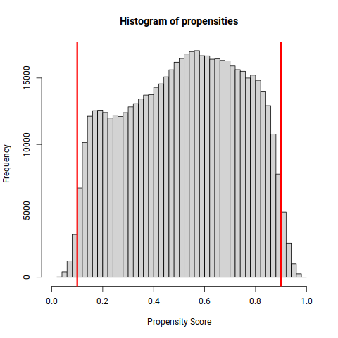

```
### calibration

In addition we can do a calibration test. We fit the linear model:

\[
Y_i - \hat{m}(X_i) = \alpha\bar{\tau}(W_i - \hat{e}(X_i)) + \beta(\hat{\tau}(X_i) - \bar{\tau})(W_i - \hat{e}(X_i)) + \epsilon_i
\]

where:

- $\bar{\tau}$ is the average predicted treatment effect
- $\hat{\tau}(X_i)$ is the predicted treatment effect for observation $i$
- $\hat{m}(X_i)$ is the predicted outcome
- as before, $\hat{e}(X_i)$ is the propensity score and $W_i$ is the treatment indicator

The coefficients have the following interpretations:

-  $\alpha$ (mean forest prediction): should be close to 1 if the average prediction is correct
-  $\beta$ (differential forest prediction): should be close to 1 if the forest is capturing the true effect heterogeneity (0 means no heterogeneity)

The estimates are $\alpha = `r f3(cal[1, 1])`$ (standard error `r f3(cal[1, 2])`) and $\beta = `r f3(cal[2, 1])`$ (standard error `r f3(cal[2, 2])`).
The $p$-values printed with them test that a coefficient is 0, not that it is 1. The differences from 1, in standard errors, are
`r f2((cal[1, 1] - 1) / cal[1, 2])` and `r f2((cal[2, 1] - 1) / cal[2, 2])` (a value below 1.96 in absolute size means no significant difference from 1 at the 5 percent level). The forest
is well calibrated if both are small: the average effect is right and there is real heterogeneity in the gap, which the forest captures.

\FloatBarrier

## balance  before and after propensity adjustment

Figure \@ref(fig:adjustedbalance) shows the absolute standardized mean difference (ASMD) of the covariates between men and women, for the raw
data and for the propensity weighted data. A common rule of thumb is that a difference below 0.1 indicates adequate balance.

```{R adjustedbalance, echo=FALSE, eval=TRUE, fig.cap='Covariate balance before and after propensity adjustment', out.width = '50%',fig.align = 'center'}
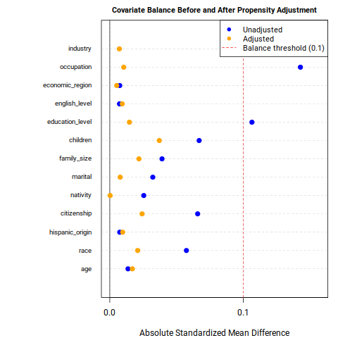
```

\FloatBarrier

### unconfoundedness
Unlike balance and overlap, which can be tested using observed data, unconfoundedness (conditional independence) is
fundamentally untestable because it involves potential outcomes that are not observed. The unconfoundedness assumption states that:

$$Y(1), Y(0) \perp W | X$$

In words, the potential outcomes are independent of the treatment assignment conditional on observed covariates $X$. This means that after controlling for
observed characteristics $X$, there are no unobserved factors that affect both treatment assignment and outcomes.

For the gender wage gap analysis, unconfoundedness would require that:

1. All variables that jointly influence:
   - Being male/female ($W$)
   - Wages earned ($Y$)
are included in our set of controls ($X$)

2. There are no unmeasured confounders like:

   - Individual ability/talent
   - Negotiation skills
   - Career ambitions/preferences
   - Discrimination (both overt and subtle)
   - Workplace culture and practices
   - Family background and connections

Given this, we should acknowledge some limitations:

1. The assumption is likely violated since we cannot observe many relevant factors mentioned above

2. We are using survey data from the American Community Survey, which has limited variables:

- Demographics (age, race, etc.)
- Basic human capital measures (education)
- Job characteristics (industry, occupation)
- But missing many "soft" factors, and also hours worked and work experience

The estimates should therefore be interpreted with caution.

\FloatBarrier
## Best linear projection

See table \@ref(tab:bestlinear). With this many observations nearly every variable is statistically significant, so we need to consider effect size.

- The `best_linear_projection` function in the Generalized Random Forest (GRF) package is a tool for interpreting the heterogeneity in treatment
  effects estimated by a causal forest. It works as follows:

    - it projects the doubly robust (AIPW) scores onto a small number of specified covariates to identify which variables are most associated with
         treatment effect heterogeneity;
    - the function fits a linear regression where the dependent variable is the AIPW score of each observation and the independent variables are the covariates of interest.

- the coefficients represent how much the treatment effect changes, on average, with a one-unit change in each covariate, holding other variables constant.
- it provides a simple, interpretable summary of which variables drive variations in treatment effects, without requiring the assumption that the true
  treatment effect is actually linear in these covariates.

```{r bestlinear, results='asis'}
b <- blp
rn <- gsub("_", "\\\\_", rownames(b))
bt <- data.frame(Variable = rn, Estimate = formatC(b[, 1], format = "f", digits = 5), SE = formatC(b[, 2], format = "f", digits = 5),
                 t = formatC(b[, 3], format = "f", digits = 1), p = formatC(b[, 4], format = "g", digits = 2),
                 sig = ifelse(b[, 4] < 0.05, "*", ""), stringsAsFactors = FALSE)
kable(bt, format = "latex", booktabs = TRUE, escape = FALSE, label = "bestlinear", row.names = FALSE,
      caption = "Best linear projection of the treatment effect on the covariates (* means p < 0.05).",
      col.names = c("", "Estimate", "Std. Error", "t value", "Pr(>|t|)", ""), align = c("l", "r", "r", "r", "r", "c")) %>%
  kable_styling(latex_options = "hold_position")
```

The main results (the coefficient is the change in the gap, in log wage, for a one-unit increase of the covariate):

- **age**: `r f4(blp["age", 1])`, so each year of age adds about `r f2(100 * blp["age", 1])` percentage points to the gap;
- **children**: `r f4(blp["children", 1])`, about `r f2(100 * blp["children", 1])` percentage points per child, the largest coefficient (but see the by-children results below, where the effect is not linear);
- **marital status**: `r f4(blp["marital", 1])` per step of the (ordered) marital code, in the direction of married;
- **education level**: `r f4(blp["education_level", 1])`: each additional year of education is associated with a smaller gap, by about `r f2(-100 * blp["education_level", 1])` percentage points;
- **race**: `r f4(blp["race", 1])` and **hispanic origin**: `r f4(blp["hispanic_origin", 1])`, which depend on how these codes are ordered, so only the significance is informative.

Not statistically significant at the 5\% level: `r paste(rownames(blp)[blp[, 4] >= 0.05 & rownames(blp) != "(Intercept)"], collapse = ", ")` (the last of which is the code
ordering of 269 industries, so the result is not informative about industry; see the variable importance below).
The **occupation** and **industry** coefficients are tiny, because they are per step of a code with several hundred values ordered by mean wage.

## Variable Importance 

The *grf* algorithm (like other random forest methods) produces a variable importance measure. See figure \@ref(fig:varimp).
We can compare this figure with the "best_linear_projection" results.

```{r varimp, echo=FALSE, eval=TRUE, fig.cap='Variable importance of the causal forest', out.width = '50%',fig.align = 'center'}
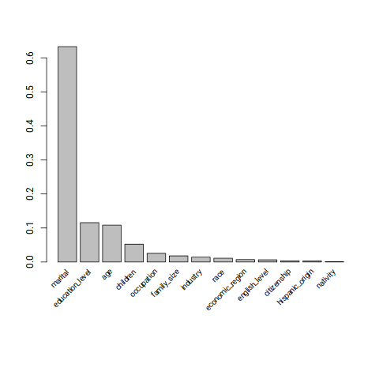

```

Marital status has the highest importance by a large margin, followed by education level and then age. Children is 4th and occupation 5th, with
industry near the bottom. The importance and the linear projection are different measures:

- variable importance measures how much a variable is used for splitting in the forest, capturing:

   - linear and non-linear relationships
   - main effects and interactions with other variables
   - overall predictive power without specifying direction

- the best linear projection measures:

   - linear relationships only
   - direction and magnitude of effects (positive or negative)
   - statistical significance after controlling for other variables
   - main effects without interactions (RF methods are all interaction and no main effect)

Children has the largest linear coefficient but only moderate importance, so the relationship is probably concentrated in subgroups. Occupation has a
small coefficient but moderate importance, so its effect works through non-linear patterns or interactions.

\FloatBarrier

## Conditional Average Treatment Effect

We consider how to estimate the **conditional average treatment effect (CATE)**,

\begin{equation}
  (\#eq:cate)
  \tau(x) := \E[Y_i(1) - Y_i(0) | X_i = x],
\end{equation}

which is a "localised" version of the average treatment effect conditional on a vector of observable characteristics.

It's often the case that \@ref(eq:cate) is too general to be immediately useful, especially when the observable covariates are high-dimensional. It can be hard
to estimate reliably without making strong modeling assumptions, and hard to summarize in a useful manner after estimation. In such situations, we will instead
try to estimate treatment effect averages for simpler groups

\begin{equation}
  (\#eq:cate-g)
  \E[Y_i(1) - Y_i(0) | G_i = g],
\end{equation}

where $G_i$ indexes subgroups of interest. The group means below are means of the predicted $\hat\tau_i$ in each group. The
intervals in the Supplementary figures treat $\hat\tau_i$ as data and ignore the error of the forest, so they are too narrow and should not be used for inference.

### by marital status

Figure \@ref(fig:maritalstatuseffect) shows the mean predicted gap for each marital status.
Note that while "never married" has the lowest gender wage gap, they also have the lowest income. The gap is not the same thing as the wage.

```{r  maritalstatuseffect, echo=FALSE, eval=TRUE, fig.cap="The effect of marital status on $\\hat{\\tau}$", out.width = '50%',fig.align = 'center'}
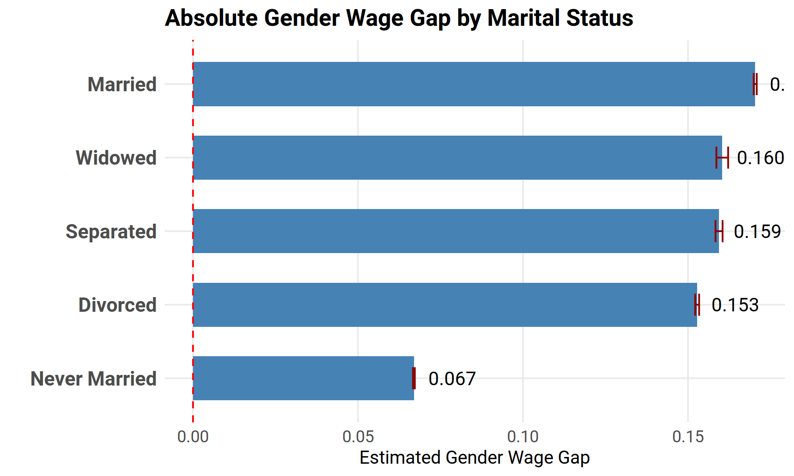
```

### marital status and age

Figure \@ref(fig:agemartialinterctions) shows the mean predicted gap by marital status and three-year age group, for the groups with at least
0.09\% of the sample. Reading the figure:

- the gap of the never married is the lowest at every age (about 6--8\%) and nearly flat;
- the gap of the married is among the lowest at 26--29 (about 11\%) but climbs steadily to about 21\% at 50--53, and it is the highest from about age 40;
- the gap of the separated and divorced rises to about age 38 and is then nearly flat at about 16\%.

In Supplementary 3 a model for $\hat\tau$ with marital status, age and the interaction, with education and children as controls, explains about half of
the variation of $\hat\tau$, and the marital $\times$ age interaction adds about 2.6 percentage points of $R^2$. The sample starts at age 26, so
the very young married, who were a noisy subgroup in earlier versions of this report, are not in it. The estimates are associations in a model of $\hat\tau$; whether marriage
causes the widening of the gap, or whether people who marry and stay married differ in other ways, cannot be settled with these data.

```{r  agemartialinterctions, echo=FALSE, eval=TRUE, fig.cap="The interaction of age and marital status", out.width = '50%',fig.align = 'center'}
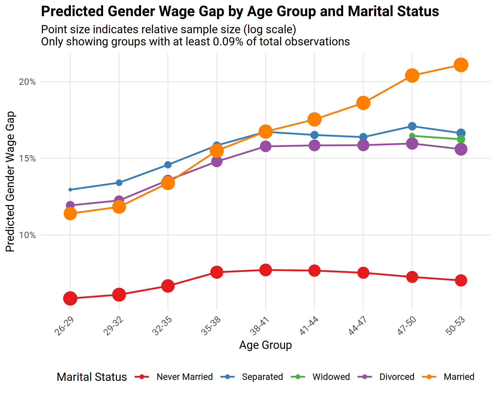
```

\FloatBarrier
### by industry 

Figure \@ref(fig:industryeffects) shows the gender wage gap by industry (a sample of industries; the full list is in Supplementary 3).
There is wide variation in the gap between industries, but the best linear projection finds no linear relationship with the ordered industry code.

```{R industryeffects, echo=FALSE, eval=TRUE, fig.cap="Absolute Gender Wage Gap by Industry ($\\hat{\\tau}$ estimates)", out.width = '100%', fig.align = 'center'}
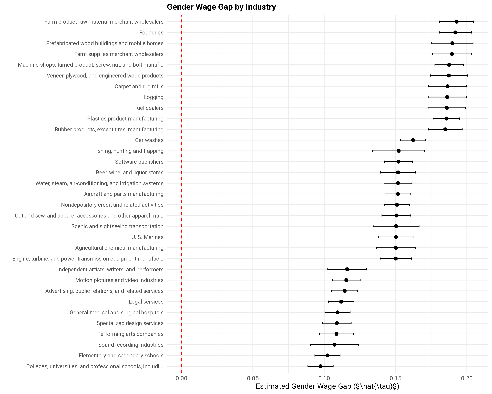

```

### by education

Figure \@ref(fig:educationeffects) shows that the gap is present at every education level. It is about 0.17 to 0.19 for up to 12 years of schooling, falls
to about 0.12 at 21 years and about 0.10 at the doctoral and professional levels. More education reduces the gap only at the top of the distribution, and a
gap of about 10\% persists even there.

```{R educationeffects, echo=FALSE, eval=TRUE, fig.cap="Gender Wage Gap by Education Level", out.width = '50%',fig.align = 'center'}
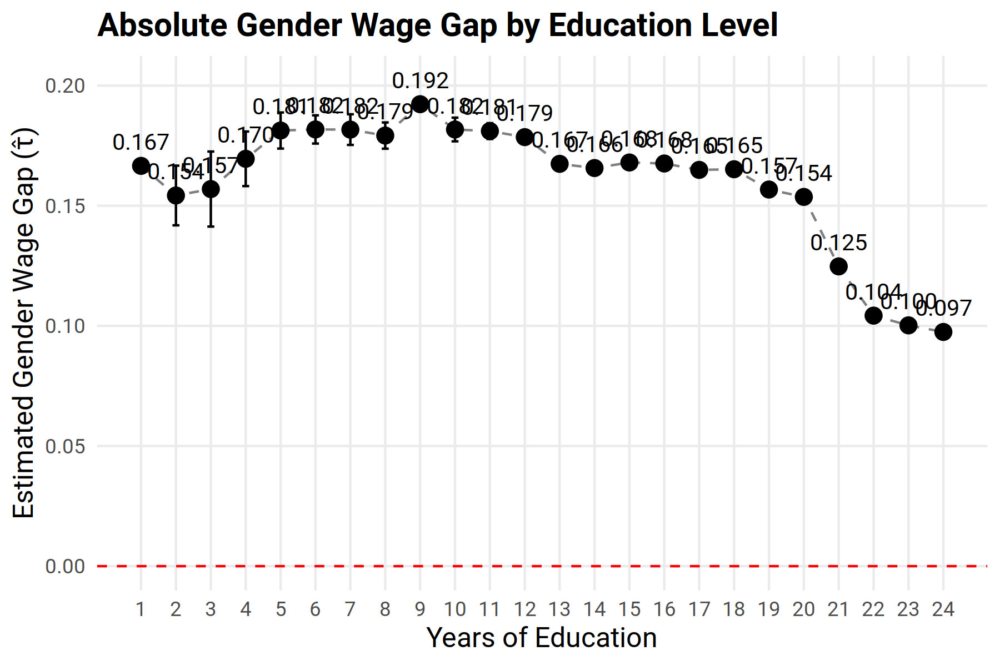
```


\FloatBarrier
### by children

Table \@ref(tab:subgroupChildren) shows the regression of $\hat\tau$ on the number of children (a factor, with no children as the reference).

```{r subgroupChildren, results='asis'}
ct <- s3$children_table
ct$Children <- gsub("^No children$", "No children (reference)", ct$Children)
kable(ct[, c("Children", "Group.mean", "Estimate", "Std.Error", "sig")], format = "latex", booktabs = TRUE, escape = FALSE,
      label = "subgroupChildren", row.names = FALSE,
      caption = "Effect of the number of children on the gender wage gap: mean predicted gap in each group, and the coefficient relative to no children (the standard errors treat the predictions as data and are too small).",
      col.names = c("Number of children", "Mean gap", "Coefficient", "Std. Error", ""), align = c("l", "r", "r", "r", "c")) %>%
  kable_styling(latex_options = "hold_position")
gm <- as.numeric(ct$Group.mean)
```

The gap with no children is `r pct(gm[1])`. It rises sharply to `r pct(gm[2])` with one child, `r pct(gm[3])` with two and `r pct(gm[4])` with three, and
then plateaus at about `r pct(mean(gm[5:9]), 0)` for four to eight children, so the marginal effect of a further child is small after the third.
There is a substantial gap even without children. The estimates for 9 or more children are based on few people and should not be interpreted.
Note that `children` counts *dependent* children and that these are associations in a model for $\hat\tau$, not the causal effect of having a child.

```{r plotchildren, echo=FALSE, eval=TRUE, fig.cap="Gender Wage Gap by Number of Children", out.width = '50%',fig.align = 'center'}
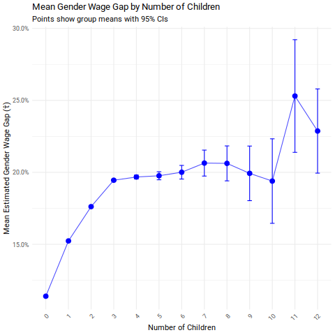

```

\FloatBarrier

# Segregation and the other segments

The causal analysis covers the middle segment only. The female dominated (low propensity) segment has `r big(s4$summary$n[1])` people (`r pct(s4$summary$n[1]/n_age, 0)` of the sample)
and the male dominated (high propensity) segment `r big(s4$summary$n[3])` (`r pct(s4$summary$n[3]/n_age, 0)`). They are analysed in Supplementary 4.
Figure \@ref(fig:genderplot) shows the segments.

```{r genderplot, echo=FALSE, eval=TRUE, fig.cap="The three propensity segments", out.width = '100%', fig.align = 'center'}
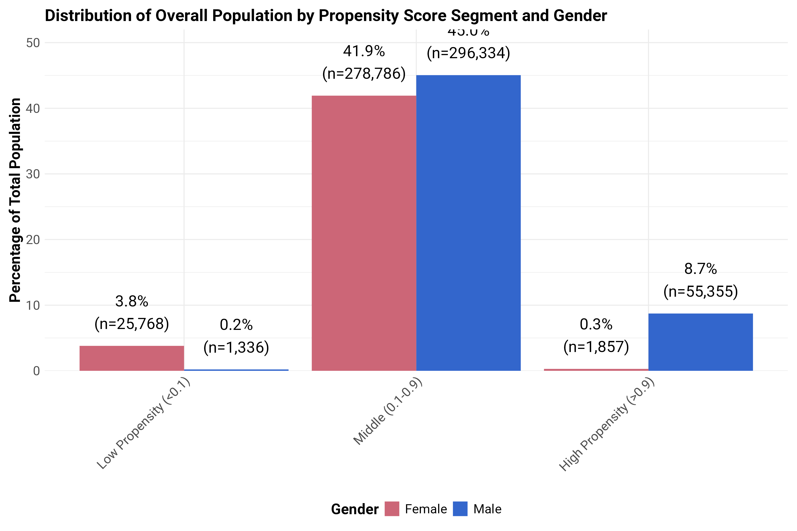
```

# Decomposition

Supplementary 5 gives an Oaxaca-Blinder decomposition of the raw gap, which is a linear model and can use all the people (including the segments without overlap).
For the whole sample the gap is `r f3(s5$whole$gap[5])`; with the full covariate set (model M5, including occupation and industry) the explained part is
`r f3(s5$whole$explained[5])` (`r pct(s5$whole$pct_explained[5]/100, 0)`) and the unexplained part `r f3(s5$whole$unexplained[5])`. The doubly robust estimate for the overlap population
(`r f3(s3$ate.overlap[["estimate"]])`) is a little smaller than the unexplained part of the decomposition (`r f3(s5$whole$unexplained[5])`). It compares like with like, excludes the segments without overlap and does not rely on a linear model, so the two are not
expected to agree exactly. The explained share
depends heavily on which covariates are included: it ranges from `r pct(min(s5$whole$pct_explained)/100, 0)` to `r pct(max(s5$whole$pct_explained)/100, 0)` over the five models M1 to M5 (M3, with no occupation or industry, is the lowest). By segment, the unexplained gap is
`r f3(s5$segments$unexplained[1])` in the low, `r f3(s5$segments$unexplained[2])` in the middle and `r f3(s5$segments$unexplained[3])` in the high segment, so the smaller raw gap of the high
segment (`r f3(s5$segments$gap[3])`) is not a smaller adjusted gap.

\clearpage

# Conclusions

1. **Key Findings**
   - the raw gap is `r f3(dim_age)` in log wage; the adjusted gap for the middle segment is `r f3(s3$ate.overlap[["estimate"]])`;
   - the gap varies greatly: from about 6--8\% for the never married to more than 20\% for married people in their early fifties;
   - the gap is present at every education level, and it is about 10\% even at the highest levels;
   - a substantial gap remains after adjusting for the observable factors, and the observable factors explain only a minority of the raw gap when occupation and industry are included in a linear decomposition.

2. **Methodological Insights**
   - importance of conditioning on specific characteristics;
   - the overlap problem: a large part of the workforce is strongly segregated, and the method can only be applied to the middle part;
   - value of uncertainty quantification (and care with standard errors that ignore the forest or the survey design).

3. **Limitations**: the data are cross-sectional (no work history or hours), unconfoundedness cannot be tested, and the results are for the United States in 2018.

Machine learning methods like GRF offer powerful new tools for analyzing the gender wage gap. These methods can:

- provide a more nuanced understanding of wage disparities
- identify where interventions are most needed
- better track policy effectiveness

While implementation challenges exist, the potential benefits make investment in these methods worthwhile for advancing our understanding and addressing gender wage disparities in Australia.


## The background story

The background to this work is:

- low wage growth over many decades "The crisis really is in real wage growth". Phillip Lowe, Governor of the Reserve Bank, 2017. @bellLowWageGrowth2019 @Work_of_the_Future_Autor.et.al.2022 
- an increase in inequality i.e  hollowing out of the middle as well as trends towards upskilling  @coelli2016job
- low productivity growth


- there are more insightful analyses than the comparison by employer 
- the wage discrepancy is clearly shown in the data but it is not uniform across different work categories
- there could be different drivers in different sections of the workforce. 


```{r p, echo=FALSE, fig.cap='Australian real weekly wage growth by earnings percentile, Full-Time Female Employees Aged 15-64. Plot (A) Female, Plot  (B) Male  \\cite{bellLowWageGrowth2019} .',  fig.align = 'center', out.width = '50%'}
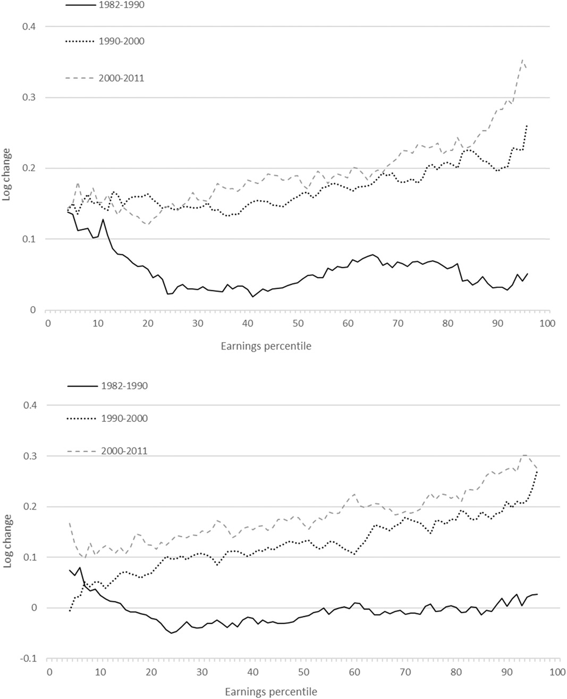
```

```{r c, echo=FALSE, fig.cap='Change in Real Wages since 1980. Real wages have risen for college graduates and fallen for workers with a high school degree or less',  fig.align = 'center', out.width = '100%'}
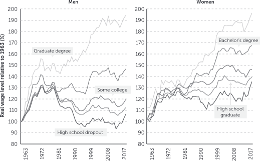
```


\FloatBarrier

# Further work

- the relationship between the gender wage gap and wages: "never married" have a smaller gender wage gap but also the lowest wages;
- the gap of the married widens with age. To understand why:

   1. Control for additional covariates: examine whether hours worked, work experience or occupation explain it (these are not in the data);
   2. Examine interactions with other variables: is the marriage effect stronger for certain education levels or industries?
   3. Longitudinal analysis: track individuals before and after marriage to see if the gap emerges after marriage or if it pre-exists.
- the low and high propensity segments cannot be analysed with the causal forest and need a different approach;
- the Walby and Olsen decomposition on this data, to compare directly with @KPMG.2022.

This is consistent with Claudia Goldin's research, which suggests that family formation decisions are strongly linked to gender wage differences.

## Application to Australia

### Data Requirements

1. **Key Variables Needed**
   - Detailed occupational codes
   - Industry classification
   - Educational attainment
   - Work experience measures
   - Geographic location
   - Family status

2. **Potential Data Sources**
   - Panel Study of Income Dynamics (PSID)
   - Australian Bureau of Statistics (ABS) surveys
   - Administrative data where available


## Policy Implications


1. **Short-term Steps**
   - Pilot studies using existing survey data
   - Development of data collection protocols
   - Training for analysts in ML methods

2. **Long-term Goals**
   - Integration with regular reporting
   - Development of automated analysis pipelines
   - Creation of interactive tools for policymakers

1. **Targeted Interventions**
   - Identification of high-risk sectors/occupations
   - Evidence-based policy design
   - More precise evaluation of intervention effects

2. **Monitoring and Evaluation**
   - Better measurement of policy impacts
   - More nuanced understanding of what works where
   - Improved ability to track progress


<!-- ##  Distributional Random Forests: -->
<!-- @cevidDistributionalRandomForests2022  -->
<!-- @nafDRFRandomForest2022a -->
<!-- @nafRandomForests2023 -->
<!-- @nafVariableImportanceRandom2023 -->
<!-- @amayaAnswerHowDoes2023 -->
<!-- @nafInferenceDistributionalRandom2023 -->
<!-- @nafStudyingGenderWage2023 -->


\FloatBarrier
# intergenerational mobility

@chettyRaceEconomicOpportunity2020 found that

- gender-specific intergenerational gaps: black-white gaps in intergenerational mobility (not just absolute earnings) are substantially larger for men than women.
 
  - Black men from poor backgrounds are the most disadvantaged group in terms of economic mobility
  - White men have strong upward mobility regardless of background
  - Black women have similar or slightly better mobility than white women from the same parental income level
  - White women have better outcomes than black men but worse than white men
- Persistence of Disadvantage: The disadvantage for black men persists even at the highest levels of parental
  income. Black men born to parents in the top income quintile have nearly the same chances of falling to the bottom
  quintile (16.7%) as staying in the top quintile (18.0%), while white men in this category are five times more likely
  to stay at the top than fall to the bottom.
- The "Stickiness" of Background: The paper shows that poor background is more "sticky" for black men - they have much
  more difficulty escaping it. Even black men from wealthy families have downward mobility rates that resemble those of
  poor white men rather than wealthy white men.


- individual income findings: The paper states on page 740: "Black women have 1 percentile higher individual income ranks than white women conditional on parental income." 
            This finding is about relative position (income ranks) conditional on parent income, not absolute wage levels.
-  conditional vs. unconditional Gaps: The key insight is that when controlling for parental income, black women have similar or slightly better outcomes than white women with comparable backgrounds, 
            while black men have significantly worse outcomes than white men from similar backgrounds.


```{r racegendergroup, echo=FALSE, eval=TRUE, fig.cap='plot of mean wages by age for each race-gender group',  fig.align = 'center', out.width = '100%'}
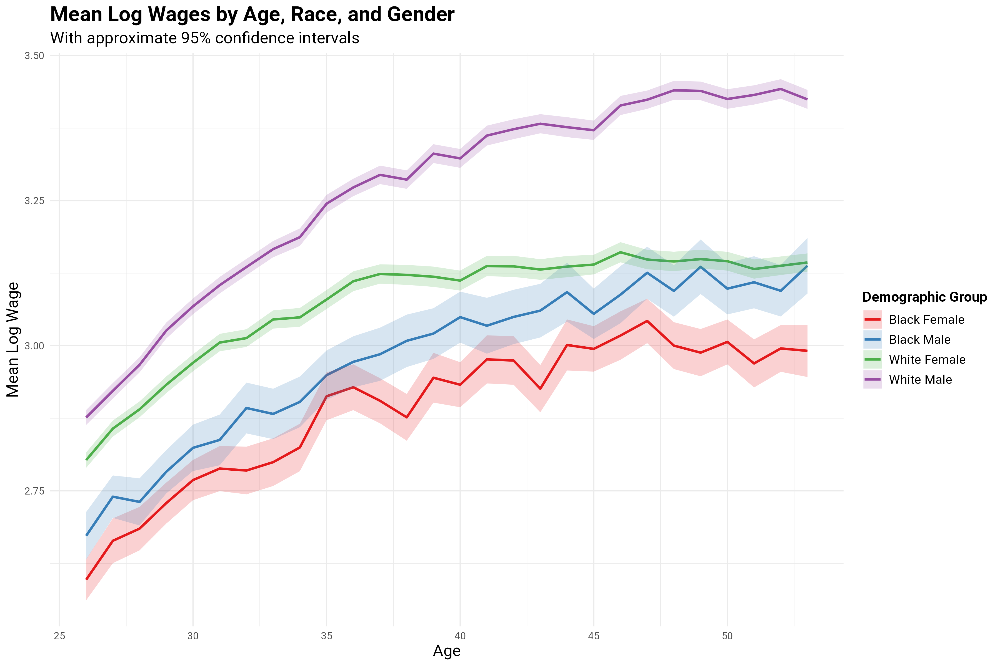
```

\clearpage
