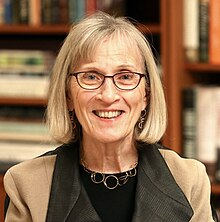
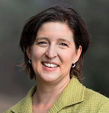

```{r setup, include=FALSE}
knitr::opts_chunk$set(fig.width=6, fig.height=6, dpi=300,echo = FALSE)
knitr::opts_chunk$set(fig.pos = "H", out.extra = "")
# Numbers come from the results files of Supplementary 2, 3 and 4 (run those first; see cleanup.Rmd).
load_res <- function(file) { e <- new.env(); load(file, envir = e); e }
s2 <- load_res("Supplementary_2_results.Rdata")$res
s3 <- load_res("Supplementary_3_results.Rdata")
s4 <- load_res("Supplementary_4_results.Rdata")$res
f3 <- function(x) formatC(x, format = "f", digits = 3)
pct <- function(x, d = 0) paste0(formatC(x, format = "f", digits = d), "\\%")
```
# Introduction

As is appropriate for a discussion on the gender wage gap, this is built on the work of two women who have made large contributions in their areas. 


```{r biopics, echo=FALSE, fig.cap='Claudia Goldin (left) won the 2023 Nobel Prize in Economics for her work on understanding the gender pay gap. Susan Athey (right) pioneered the use of Machine Learning methods in economics and also made significant contributions to ML in the Generalized Random Forest',  fig.show='hold' ,fig.align = 'center', out.width = '40%'}


``` 


# "Career and Family"  -- Claudia Goldin

- little overt discrimination against women by  policy, managers or fellow workers 
- employers pay a large premium for working longer hours and being on call at any time. Conversely there is a  career penalty for any time take off work

    - Goldin suggests that couples may be making a rational choice here, conditioned by a little
subtle cultural expectation. One partner commits to the greedy work career path and the other maintains the freedom to
devote time to children, home and elder care.

- increasing time needed to gain qualifications and credentials. This works against women hoping to get established in a career before starting a family
- that occupations with the greatest income gaps between men also have the greatest gender gaps
  
    - the rising income inequality since that 1970's has slowed progress in closing the gender wage gap

- she considers a set of criteria that lead to high gender wage gaps and the looks at professions that score

   -  higher on these criteria -   legal litigation, finance  have high gender wage gaps
   -  lower on these criteria - anaesthesiology, veterinary practice  have lower gender wage gaps


# The gender wage gap 

- WGEA (Workplace Gender Equality Agency) Data Explorer that allows people to see gender wage gaps by employer. 
		
    - uses full-time equivalent total remuneration, (superannuation, overtime, bonuses, etc) and other additional payments.

- the ABS data is base salary, for full-time workers only


```{r WGEA, echo=FALSE, fig.cap="Australia's Gender Pay Gap and Zelda D’Aprano of the Australasian Meat Industry Employees’ Union chained herself to the doors of the  Commonwealth Building 21 October 1969",  fig.align = 'center', fig.show="hold" , out.height='40%'}
knitr::include_graphics("./report_figs/WGEA.png")
knitr::include_graphics("./report_figs/Zelda-4-743x1024.jpeg")
``` 

# Causal Analysis

-  each data point can be defined by a triple $\{X_i, W_i, Y_i\}$. 

    - the vector $X_i$ represents covariates that are observed for individual $i$ 
    - $W_i \in \{0, 1\}$ where 0 "control" represents women and 1 "treatment" represents men. 
   -  the scalar $Y_i$ is the observed outcome, and in this case it will be the log of the wages

- WGEA gives the "difference in means" estimator
\begin{equation} 
\widehat{\tau}^{DIFF} = \frac{1}{n_1} \sum_{i:W_i = 1} Y_i - \frac{1}{n_0} \sum_{i:W_i = 0} Y_i \qquad \text{where} \qquad n_w := |\{i : W_i = w \}| 
\end{equation}

   - well suited to designed experiments, $\widehat{\tau}^{DIFF} =`r f3(s2$dim[["estimate"]])`$ on the Public Use Microdata Sample (PUMS) data (ages 26 to 53)
   
- causal analysis  **average treatment effect (ATE)**
\[
\E [\tau_i]  = \E[ Y_i(W=1) - Y_i(W=0)]
\]

   - need additional assumptions, calculations


# Causal Analysis  and Generalized Random Forests 
- use Generalized Random Forests  to estimate the quantities (more flexible than linear regression, gives a variable importance measure)

- the **propensity score** $e(X_i) := \PP[W_i = 1 | X_i]$
- assumptions

    - **unconfoundeness**
	  \[   Y_i(1), Y_i(0) \perp W_i \ | \ X_i.        \]
    - **overlap**
    \[
        \eta < e(x) < 1 - \eta  \qquad \text{for all }x.
     \]
- Augmented inverse propensity-weighted (AIPW) estimator 
\begin{align*}
  \htau^{AIPW} &:= \frac{1}{n} \sum_{i=1}^{n}\hmu^{-i}(X_i, 1) - \hmu^{-i}(X_i, 0) \\
      & +\frac{W_i}{\he^{-i}(X_i)}  \left( Y_i - \hmu^{-i}(X_i, 1)\right) -\frac{1-W_i}{1-\he^{-i}(X_i)}  \left( Y_i - \hmu^{-i}(X_i, 0)\right)
\end{align*}
   
     -   $\htau^{AIPW}= `r f3(s3$ate.overlap[["estimate"]])`$ on the PUMS data (middle propensity segment)
	 
# conditional average treatment effect 

- 
\[
  \E[Y_i(1) - Y_i(0) | G_i = g]
\]

- Distributional Random Forests


```{r b, echo=FALSE, eval=FALSE, fig.cap='The counterfactual distribution of two example female subjects, that is, the distribution of wages for subject with the same characteristics and then for male subjects with the same characteristics. ',  fig.show='hold' ,fig.align = 'center', out.width = '45%'}
knitr::include_graphics("./script2/Legal_Occupations_Conditional_Density_Plot.png")
knitr::include_graphics("./script2/Personal_Care_and_Service_Occupations_Conditional_Density_Plot.png")
``` 
