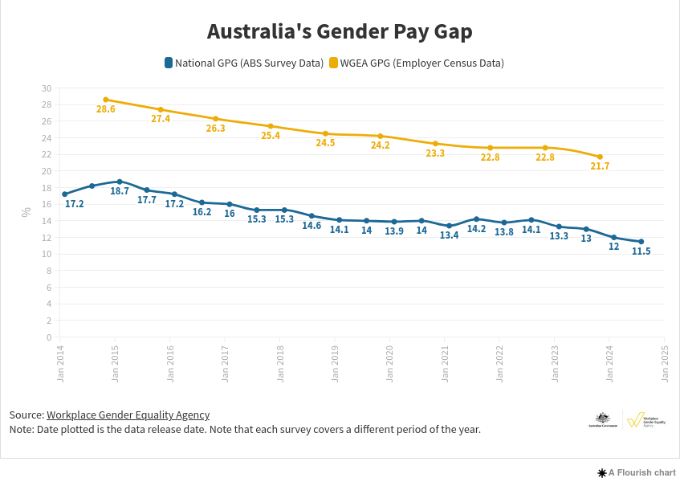
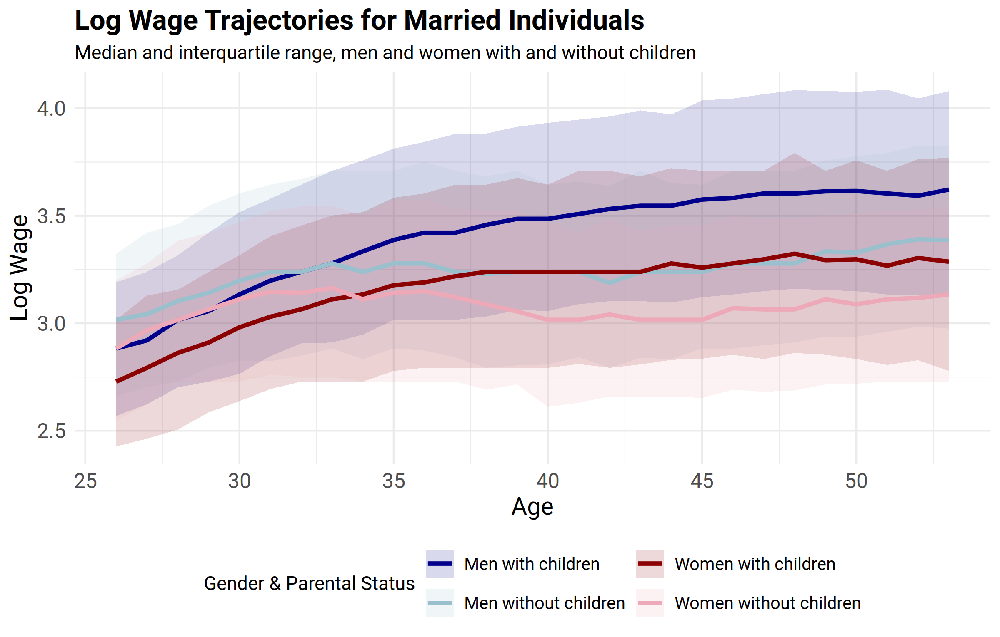

```{r setup, include=FALSE}
knitr::opts_chunk$set(fig.width=6, fig.height=6, dpi=300,echo = FALSE)
knitr::opts_chunk$set(fig.pos = "H", out.extra = "")
# Numbers come from the results files of Supplementary 2, 3 and 4 (run those first; see cleanup.Rmd).
load_res <- function(file) { e <- new.env(); load(file, envir = e); e }
s2 <- load_res("Supplementary_2_results.Rdata")$res
s3 <- load_res("Supplementary_3_results.Rdata")
s4 <- load_res("Supplementary_4_results.Rdata")$res
f3 <- function(x) formatC(x, format = "f", digits = 3)
pct <- function(x, d = 0) paste0(formatC(x, format = "f", digits = d), "\\%")
```

# summary


The issue of the gender wage gap (figure \@ref(fig:WGEA)) quickly became topical with the release of the WGEA (Workplace Gender Equality Agency,
@agencywgea2023WGEAData) Data Explorer that allows people to see gender wage gaps by employer. The CSIRO is
unfortunately not listed.


This report examines how modern machine learning methods, particularly Generalized Random Forests (@atheyGeneralizedRandomForests2019), can enhance our
understanding of economic and social data. 


The results seem at first sight to differ from the WGEA Data Explore and from their commissioned report "She's Price(d)less"  (@KPMG.2022).
There could be several reasons for this:

- we are using a US data set (@PUMS.2018). The United States might just be different to Australia;
- the variables collected might differ. We don't have information by employer, but we do have an occupational and industry classification;
- we are trying to estimate a very different thing! 

If $Y$ is the wages and females are coded as 0 and males as 1, we are trying to estimate the  Average Treatment Effect (ATE)
  \begin{equation*}
  \tau := \E[Y_i(1) - Y_i(0)],
   \end{equation*}
that is, what would be a persons wages if they were a different sex, but with the same marital status, education, number of children etc.

So this is very different to what the WGEA is estimating. Lets consider an  example to understand this. Say hypothetically there was an employer "Employer 1," where
all the males were married with 2 children and all the females were single. 
You could look "Employer 1" on the WGEA website, and see what the gender wage gap was. 

With our method, you could not make any comparison of males and females working at "Employer 1".
What you could do is compare each male to a hypothetically female, with the same variable values (marital status, education, number of children, occupation) etc.
and likewise for each female working at Employer 1. So clearly this is a very different thing and perhaps it is not surprising that the results differ somewhat.


```{r WGEA, fig.cap=caption, echo=FALSE, fig.align = 'center', fig.show="hold",out.width = '100%'}
caption <- "Australia's Gender Pay Gap"


```

# propensity

The fist thing we need to do is to estimate the propensity. The name seems odd and comes from the origins of this type of analysis in medicine, where it would be the "propensity to be treated".
Here it means the propensity to be male, but the oddness in terminology does not affect the computation at all. 
We use this to divide the population into 3 groups (figure \@ref(fig:genderplot)), as we can only apply our method to the middle group.
Where you have a part of the sample space where there are only males or females, then you simply can not estimate the ATE.


```{r  genderplot, echo=FALSE, eval=TRUE, fig.cap="We use the propensity to divide the sample into 3 groups. Our method will only work with the middle segment.", out.width = '100%',fig.align = 'center'}
knitr::include_graphics("./Supplementary_4_figs/gender_plot.png")

```

# causal\_forest


We use a causal\_forest (@atheyGeneralizedRandomForests2019) to estimate the gender wage gap for the middle segment.
The estimate is for each person in the sample so we will have to summarize it to make the data useful.  One way to
summarize it is to consider which variables are important and the causal_forest algorithm gives a measure of the
importance of each variable in contribution to the gender wage gap. See figure \@ref(fig:variableimportance).


There are already a few surprises here:

- marital status is the most important variable by far!
- even more important than the number of children;
- occupation and industry are well down the list.
                        
```{r variableimportance, echo=FALSE, fig.cap='Variable Importance.',  fig.align = 'center', out.width = '50%'}
knitr::include_graphics("./Supplementary_3_figs/variable_importance.png")
```


Now age is an important variable as well (the gender wage gap climbs with age up to 53, the end of the sample). There will be an interaction between age and marital status 
as the median age  at marriage for women in the US is 28.6 years.
We look at the interaction  of age and marital status and their effect on the gender wage gap. See figure \@ref(fig:agemartialinterctions). 
The gender wage gap climbs throughout the life of married women. 

```{r  agemartialinterctions, echo=FALSE, eval=TRUE, fig.cap="The interaction of age and marital status", out.width = '50%',fig.align = 'center'}
knitr::include_graphics("./Supplementary_3_figs/age_martial_interactions_filtered.png")
```


While we are at it, lets look at the effect of the number of children (figure \@ref(fig:plotchildren)). This looks much as expected:

- there is a gender wage gap even for 0 children;
- the effect goes up with each additional child until it starts to flatten out. The estimates for large numbers of children will suffer from smaller sample sizes.

So the number of children has an effect, just not as large as martial status.


```{r plotchildren, echo=FALSE, eval=TRUE, fig.cap="Gender Wage Gap by Number of Children", out.width = '50%',fig.align = 'center'}
knitr::include_graphics("./Supplementary_3_figs/children.png")

```


Lets look at the wages for these groups (not the wage gap). See figure \@ref(fig:marriedwagebyparenthood) where we see that 

- both married men and women earn more if they have children.
- the never-married earn least (not shown on this plot). 

So the gender wage gap is very different to the wages.


```{R marriedwagebyparenthood, echo=FALSE, eval=TRUE, fig.cap="Married wage by parenthood", out.width = '80%',fig.align = 'center'}


```


# occupation segregation

The "She's Price(d)less"  (@KPMG.2022) report mentions occupation segregation. Lets look at the two groups we have so far not considered,
that is the low and high propensity groups from figure \@ref(fig:genderplot).
Here we see definite indications of occupation segregation:

- for the female dominated (low propensity) we see `r s4$industry_dist$low$Description[1]` (`r pct(s4$industry_dist$low$Percentage[1])`) and `r s4$industry_dist$low$Description[2]` (`r pct(s4$industry_dist$low$Percentage[2])`) as the largest industries,
 `r pct(sum(s4$industry_dist$low$Percentage[1:2]))` of the group together;
- for the male dominated segment (high propensity), "Construction" accounts for `r pct(s4$industry_dist$high$Percentage[1])` of the group.

However, it seems fair to say that the segregated segments of the workforce are not in general highly paid. This casts some doubt on occupational segregation being a major cause of the gender pay gap.


# conclusions

The results are somewhat surprising:

- the gap is largest for married people with children, but so are the wages;
- wages are not the same as lifetime income. If a woman leaves the workforce for a period to bring up children then she vanished for the employment data set for that period;
- education reduces the gap;
- occupation and industry have less effect than expected.

# further work

The is a lot of further work that could be done including:

- a similar analysis using Australian data;
- Walby and Olsen decomposition on this data to compare directly to the results in @KPMG.2022;
- exploration and testing to see if we can find evidence of the "greedy work" thesis of @Goldin.2021 (the 2023 Nobel Prize in Economic Sciences was awarded for this work);
- and last but not least, the development of generalized random forests as a policy evaluation tool.
