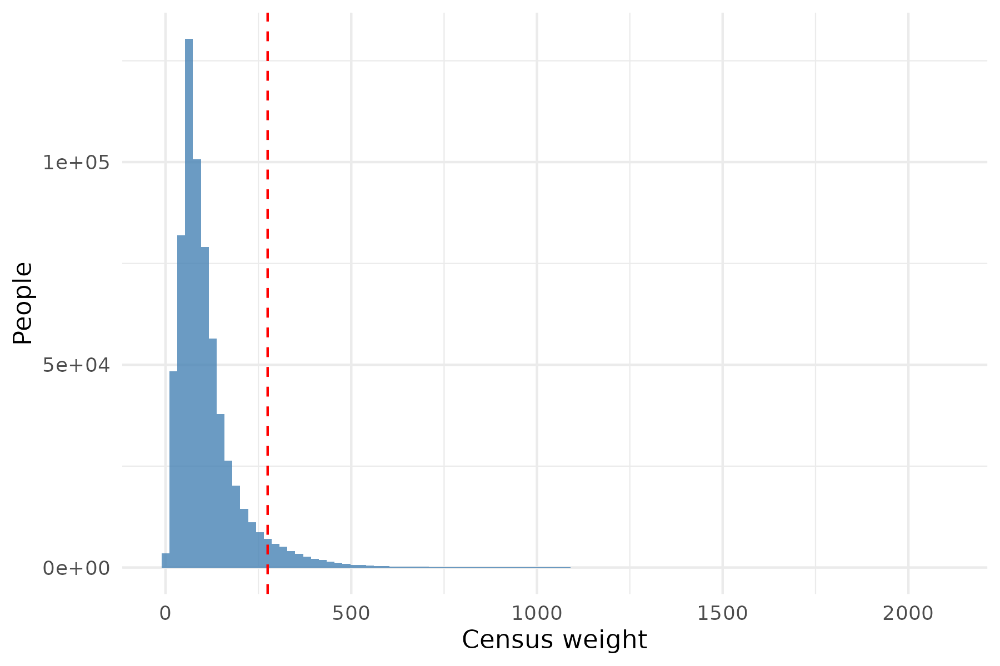

<!--
PURPOSE: the diagnostics that justify using the Census person weights (PWGTP) in Supplementary 2 to 5. Earlier versions of this file
  also repeated the data preparation of Supplementary 1 and the investigation of the NaN estimates; both were removed (Supplementary 1 is the
  only place where the raw data is read, and the cap on the weights is described in Supplementary 2 and in Discussion.Rmd).

INPUT FILES (paths relative to the project directory):
  processing_files/X_ordered_numeric_1061763_industry_269.Rdata   made by Supplementary_1
        objects used: X_ordered_numeric (13 numeric covariates), Y (log hourly wage), W (1 for male), weights_supplied

OUTPUT FILES:
  weights_results.Rdata            the list res: every number in the text and tables
  weights_tests.txt, weights_session.txt
  weights_figs/weights_distribution.png, weights_figs/weights_by_age.png

FLAGS (set in the setup chunk):
  eval_flag      TRUE runs the analysis chunks (a few regressions on 659,436 rows; minutes, not hours).
                 FALSE knits the text and tables from weights_results.Rdata and the saved figures.
  fig_eval_flag  TRUE runs the figure chunks.

The weight is NOT one of the covariates in any of the models below. (The first version of this file left it in the covariates, which made the
"correlation between the weight and the residuals" exactly 0 with p = 1: OLS residuals are orthogonal to every regressor.)

UNIT TESTS: chunks named tests_* call run_test("description", { testthat::expect_...() }); the last chunk writes weights_tests.txt.
-->

```{r setup, include=FALSE}
knitr::opts_chunk$set(fig.width=6, fig.height=4, dpi=300, echo = FALSE)
knitr::opts_chunk$set(fig.pos = "H", out.extra = "")

eval_flag <- TRUE
fig_eval_flag <- TRUE
if (!eval_flag) fig_eval_flag <- FALSE

knitr::opts_chunk$set(eval = eval_flag, results = 'hide', fig.show = 'hide', warning = FALSE, message = FALSE)

test_log <- "weights_tests.txt"
results_file <- "weights_results.Rdata"
test_results <- data.frame(test = character(), result = character(), detail = character(), stringsAsFactors = FALSE)
run_test <- function(description, code) {
  detail <- tryCatch({ force(code); "" }, error = function(e) conditionMessage(e))
  result <- if (identical(detail, "")) "PASS" else "FAIL"
  test_results[nrow(test_results) + 1, ] <<- c(description, result, detail)
  cat(sprintf("[%s] %s\n", result, description))
  if (result == "FAIL") cat("       ", detail, "\n")
  invisible(result == "PASS")
}

```

```{r libraries, echo=FALSE, eval=TRUE, include=FALSE}
options(width=160)
library(ggplot2)
library(dplyr)
library(testthat)
library(knitr)
library(kableExtra)

f <- function(x, d = 3) formatC(x, format = "f", digits = d, big.mark = ",")
pct <- function(x, d = 1) formatC(100 * x, format = "f", digits = d)
if (!eval_flag) load(results_file)

```

```{r paths}
# PATHS (must be set): run this file from the project directory. wage_file_outputs is where the intermediate .Rdata files are
# read from and written to; change it here if they are somewhere else.
wage_file_outputs <- "./processing_files/"
res <- list()

```

# Why look at the weights

Each person in the PUMS file carries a Census person weight (`PWGTP`): the number of people in the population that the person stands for. The weights
are not constant, so an estimate that ignores them describes the sample, which over-represents some groups, rather than the population.
Two things decide whether this matters here. First, the weights vary a lot, so a weighted estimate has a larger variance (the design effect).
Second, if the gender gap differs between groups that have different weights, then the weighted and unweighted estimates differ.
This file measures both, on the sample used in Supplementary 2 to 5 (people aged 26 to 53), and also compares the raw weights with the weights capped at their 95th
percentile, which is what the forests use (the forests misbehave with the largest raw weights; see Discussion.Rmd).

# Data

```{r data}
load(paste(wage_file_outputs, "X_ordered_numeric_1061763_industry_269.Rdata", sep = ""))   # X_ordered_numeric, W, Y, weights_supplied, weights_dummy
weight_cap <- quantile(weights_supplied, 0.95, na.rm = TRUE)      # as in Supplementary 2: the cap is computed on the full sample
keep <- (X_ordered_numeric$age > 25) & (X_ordered_numeric$age < 54)
X  <- X_ordered_numeric[keep, ]
Y  <- Y[keep]
W  <- W[keep]
w_raw <- weights_supplied[keep]
w_cap <- pmin(w_raw, weight_cap)
rm(X_ordered_numeric, weights_supplied, weights_dummy, keep)

res$n_all  <- length(Y)
res$n_women <- sum(W == 0)
res$n_men   <- sum(W == 1)
res$weight_cap <- unname(weight_cap)

```

```{r tests_data, echo=FALSE, eval=eval_flag, include=FALSE}
run_test("data: 659,436 people aged 26 to 53, 13 covariates, and the weight is not a covariate", {
  expect_equal(nrow(X), 659436)
  expect_equal(ncol(X), 13)
  expect_false("weight" %in% tolower(names(X)))
  expect_true(all(w_raw >= 1))
  expect_true(all(w_cap <= weight_cap))
})

```

# The distribution of the weights

```{r distribution}
wsum <- function(w) {
  c(mean = mean(w), median = median(w), sd = sd(w), cv = sd(w) / mean(w),
    min = min(w), max = max(w), p01 = unname(quantile(w, 0.01)), p99 = unname(quantile(w, 0.99)),
    ess = sum(w)^2 / sum(w^2))
}
res$wsum <- rbind(raw = wsum(w_raw), capped = wsum(w_cap))
res$design_effect <- res$n_all / res$wsum[, "ess"]          # Kish: n / effective sample size = 1 + cv^2
res$n_at_cap <- sum(w_raw > weight_cap)

by_gender <- data.frame(gender = c("Women", "Men"),
                        n = c(res$n_women, res$n_men),
                        mean = c(mean(w_raw[W == 0]), mean(w_raw[W == 1])),
                        median = c(median(w_raw[W == 0]), median(w_raw[W == 1])),
                        sd = c(sd(w_raw[W == 0]), sd(w_raw[W == 1])))
res$by_gender <- by_gender
res$cor_wy <- cor(w_raw, Y)
res$cor_wage <- c(age = cor(w_raw, X$age), family_size = cor(w_raw, X$family_size), children = cor(w_raw, X$children))

```

```{r tests_distribution, echo=FALSE, eval=eval_flag, include=FALSE}
run_test("distribution: the design effect equals 1 + cv^2, and capping lowers it", {
  expect_equal(unname(res$design_effect["raw"]), 1 + res$wsum["raw", "cv"]^2, tolerance = 1e-4)
  expect_lt(res$design_effect["capped"], res$design_effect["raw"])
  expect_gte(res$design_effect["capped"], 1)
})
run_test("distribution: about 5% of the people are above the cap", {
  expect_equal(res$n_at_cap / res$n_all, 0.05, tolerance = 0.2)
})

```

```{r table_weights, echo=FALSE, eval=TRUE, results='asis'}
tab <- data.frame(Weights = c("Raw", "Capped at the 95th percentile"),
                  Mean = unname(res$wsum[, "mean"]), Median = unname(res$wsum[, "median"]), SD = unname(res$wsum[, "sd"]),
                  CV = unname(res$wsum[, "cv"]), Max = unname(res$wsum[, "max"]),
                  ESS = unname(res$wsum[, "ess"]), DE = unname(res$design_effect))
kbl(tab, format = "latex", booktabs = TRUE, digits = c(0, 1, 1, 1, 2, 0, 0, 2), format.args = list(big.mark = ","),
    col.names = c("Weights", "Mean", "Median", "SD", "CV", "Max", "Effective n", "Design effect"),
    caption = "The Census weights in the sample used in Supplementary 2 to 5. CV is the coefficient of variation, the effective n is $(\\sum w)^2/\\sum w^2$ and the design effect is $n$ divided by the effective $n$.",
    label = "weightsummary", escape = FALSE) %>% kable_styling(latex_options = "HOLD_position")

```

The raw weights run from `r f(res$wsum["raw","min"], 0)` to `r f(res$wsum["raw","max"], 0)`, with a mean of `r f(res$wsum["raw","mean"], 1)` and a median of `r f(res$wsum["raw","median"], 1)`
(Table \@ref(tab:weightsummary)). The coefficient of variation is `r f(res$wsum["raw","cv"], 2)`, so the design effect is `r f(res$design_effect["raw"], 2)`: weighting
the `r f(res$n_all, 0)` people is worth as much, as far as the variance goes, as an unweighted sample of `r f(res$wsum["raw","ess"], 0)`. Capping the weights at `r f(res$weight_cap, 0)`
(`r f(res$n_at_cap, 0)` people) lowers the design effect to `r f(res$design_effect["capped"], 2)`.
The weights are almost the same for women and men (mean `r f(res$by_gender$mean[1], 1)` and `r f(res$by_gender$mean[2], 1)`), so weighting does not change the balance of the two groups much.
The correlation of the weight with the log wage is `r f(res$cor_wy, 3)`.

```{r figure_distribution, echo=FALSE, eval=fig_eval_flag}
dir.create("weights_figs", showWarnings = FALSE)
df <- data.frame(weight = w_raw)
p <- ggplot(df, aes(x = weight)) +
  geom_histogram(bins = 100, fill = "steelblue", alpha = 0.8) +
  geom_vline(xintercept = weight_cap, colour = "red", linetype = "dashed") +
  labs(x = "Census weight", y = "People") + theme_minimal()
ggsave("weights_figs/weights_distribution.png", p, width = 6, height = 4, dpi = 300)

age_means <- X %>% mutate(w = w_raw) %>% group_by(age) %>% summarise(mean = mean(w), .groups = "drop")
p <- ggplot(age_means, aes(x = age, y = mean)) + geom_line() + geom_point() +
  labs(x = "Age", y = "Mean Census weight") + theme_minimal()
ggsave("weights_figs/weights_by_age.png", p, width = 6, height = 4, dpi = 300)

```

```{r includedistribution, echo=FALSE, eval=TRUE, results='markup', fig.show='asis', fig.cap="The Census weights. The dashed line is the 95th percentile, the cap used in the forests.", out.width="80%", fig.align="center"}


```

# The effect of the weights on the estimates

Three simple estimators of the gender gap are computed without weights, with the raw weights and with the capped weights. They are the difference in means, the coefficient of $W$ in a
linear regression on the 13 covariates, and the inverse probability weighted (IPW) estimator, with the propensity score from a logistic regression on the covariates and clipped to $[0.01, 0.99]$
(the earlier version used a random forest, whose estimated propensities of exactly 0 or 1 made the IPW estimate infinite). The survey weight multiplies the inverse probability weight in each group, and the two weighted means are normalised by the sum of their weights.
These are not the estimators of Supplementary 3 (causal forests, AIPW). They are chosen to be cheap and to isolate the effect of the weights.

```{r impact}
dim_est <- function(w) weighted.mean(Y[W == 1], w[W == 1]) - weighted.mean(Y[W == 0], w[W == 0])

reg_data <- data.frame(Y = Y, W = W, X)
reg_est <- function(w) unname(coef(lm(Y ~ ., data = reg_data, weights = w))["W"])

ps_model <- glm(W ~ ., data = data.frame(W = W, X), family = binomial())
e_raw <- unname(predict(ps_model, type = "response"))
res$ps_range <- range(e_raw)
res$n_clipped <- sum(e_raw < 0.01 | e_raw > 0.99)
e_hat <- pmin(pmax(e_raw, 0.01), 0.99)
ipw_est <- function(w) {   # normalised (Hajek) IPW: a weighted mean in each group, with weights w / e
  w1 <- w * W / e_hat
  w0 <- w * (1 - W) / (1 - e_hat)
  sum(w1 * Y) / sum(w1) - sum(w0 * Y) / sum(w0)
}

ones <- rep(1, length(Y))
est <- rbind(`Difference in means` = c(dim_est(ones), dim_est(w_raw), dim_est(w_cap)),
             `Regression`          = c(reg_est(ones), reg_est(w_raw), reg_est(w_cap)),
             `IPW`                 = c(ipw_est(ones), ipw_est(w_raw), ipw_est(w_cap)))
colnames(est) <- c("unweighted", "raw", "capped")
res$est <- est
res$est_change <- cbind(raw = est[, "raw"] / est[, "unweighted"] - 1, capped = est[, "capped"] / est[, "unweighted"] - 1)

# the difference in means within the people with low, middle and high weights
q <- quantile(w_raw, c(0.1, 0.9))
grp <- list(`Lowest 10\\% of the weights` = w_raw <= q[1], `Middle 80\\%` = w_raw > q[1] & w_raw < q[2], `Highest 10\\% of the weights` = w_raw >= q[2])
res$by_weight <- data.frame(group = names(grp),
                            n = sapply(grp, sum),
                            gap = sapply(grp, function(i) mean(Y[i & W == 1]) - mean(Y[i & W == 0])),
                            row.names = NULL)

```

```{r tests_impact, echo=FALSE, eval=eval_flag, include=FALSE}
run_test("impact: the difference in means with all weights equal matches the raw mean difference, and the estimates are finite", {
  expect_equal(unname(res$est["Difference in means", "unweighted"]), mean(Y[W == 1]) - mean(Y[W == 0]), tolerance = 1e-10)
  expect_true(all(is.finite(res$est)))
  expect_true(all(res$est > 0 & res$est < 0.5))
})
run_test("impact: the three groups of weights partition the sample", {
  expect_equal(sum(res$by_weight$n), res$n_all)
})

```

```{r table_impact, echo=FALSE, eval=TRUE, results='asis'}
tab <- data.frame(Estimator = rownames(res$est),
                  unname(res$est[, "unweighted"]), unname(res$est[, "raw"]), unname(res$est_change[, "raw"]) * 100,
                  unname(res$est[, "capped"]), unname(res$est_change[, "capped"]) * 100)
kbl(tab, format = "latex", booktabs = TRUE, digits = c(0, 3, 3, 1, 3, 1), row.names = FALSE,
    col.names = c("Estimator", "Unweighted", "Raw weights", "Change (\\%)", "Capped weights", "Change (\\%)"),
    caption = "The estimated gap in log wage, unweighted and with the raw and capped Census weights. The change is relative to the unweighted estimate.",
    label = "weightimpact", escape = FALSE) %>% kable_styling(latex_options = "HOLD_position")

```

Weighting lowers the estimated gap (Table \@ref(tab:weightimpact)). The difference in means falls from `r f(res$est["Difference in means","unweighted"])` to
`r f(res$est["Difference in means","raw"])` with the raw weights (`r pct(-res$est_change["Difference in means","raw"])`%), the regression coefficient by
`r pct(-res$est_change["Regression","raw"])`% and the IPW estimate by `r pct(-res$est_change["IPW","raw"])`%. The changes are of the same size with the capped weights, which
`r if (max(abs(res$est_change[, "capped"] - res$est_change[, "raw"])) < 0.02) "shows that capping gives up little" else "differ from the raw weights, so capping does matter"`. The size of the change is the answer to the question of this file: the weights
are not ignorable here, and the unweighted gap is too large as a description of the population.

The reason is visible when the difference in means is computed separately for the people with low, middle and high weights (Table \@ref(tab:weightgroups)): the gap
`r if (res$by_weight$gap[3] < res$by_weight$gap[1]) "is smaller" else "is larger"` where the weights are high. Weighted and unweighted estimates differ because the gap is not the same in all parts of the population.

```{r table_groups, echo=FALSE, eval=TRUE, results='asis'}
tab <- data.frame(Group = res$by_weight$group, n = res$by_weight$n, Gap = res$by_weight$gap)
kbl(tab, format = "latex", booktabs = TRUE, digits = c(0, 0, 3), format.args = list(big.mark = ","),
    caption = "The unweighted difference in mean log wage between men and women, by size of the Census weight.",
    label = "weightgroups", escape = FALSE) %>% kable_styling(latex_options = "HOLD_position")

```

# Do the weights carry information that the covariates do not?

```{r necessity}
# 1. Is the weight correlated with the part of the log wage that the covariates do not explain?  (The weight is not one of the covariates.)
resid_y <- residuals(lm(Y ~ ., data = data.frame(Y = Y, X)))
ct <- cor.test(w_raw, resid_y)
res$resid_cor <- c(estimate = unname(ct$estimate), p = ct$p.value, lower = ct$conf.int[1], upper = ct$conf.int[2])

# 2. Is the weight associated with gender once the covariates are in the model?
tm <- summary(glm(W ~ ., data = data.frame(W = W, weight = w_raw / 100, X), family = binomial()))$coefficients["weight", ]
res$weight_in_W <- c(estimate = unname(tm[1]), se = unname(tm[2]), p = unname(tm[4]))

# 3. Does the weight change the regression coefficient of the covariates?  A Hausman-type comparison of the weighted and unweighted
#    regressions (DuMouchel and Duncan, 1983) is an F test that the weight-by-covariate interactions are zero.
reg_aug <- data.frame(Y = Y, W = W, X)
Xc <- scale(as.matrix(cbind(W = W, X)), scale = FALSE)
w_std <- as.numeric(scale(w_raw))
inter <- Xc * w_std
colnames(inter) <- paste0("wx_", colnames(Xc))
full <- lm(Y ~ ., data = data.frame(Y = Y, w = w_std, Xc, inter))
base <- lm(Y ~ ., data = data.frame(Y = Y, w = w_std, Xc))
an <- anova(base, full)
res$dd_test <- c(F = an$F[2], df = an$Df[2], p = an$`Pr(>F)`[2])
res$dd_gap_interaction <- unname(coef(full)["wx_W"])
res$dd_gap_interaction_p <- summary(full)$coefficients["wx_W", 4]

```

```{r tests_necessity, echo=FALSE, eval=eval_flag, include=FALSE}
run_test("necessity: the weight is not a regressor, so the residual correlation is not forced to 0", {
  expect_false(isTRUE(all.equal(unname(res$resid_cor["estimate"]), 0, tolerance = 1e-10)) && res$resid_cor["p"] > 0.999)
})
run_test("necessity: the Hausman-type test has the expected degrees of freedom (14 covariates)", {
  expect_equal(unname(res$dd_test["df"]), 14)
})

```

Three checks follow. They ask whether the weight tells us anything about the wage, or about gender, that the covariates do not. None of them has the weight among the covariates.

1. *The weight and the unexplained part of the log wage.* The correlation between the weight and the residuals of the log wage on the 13 covariates is
   `r f(res$resid_cor["estimate"], 4)` (95% interval `r f(res$resid_cor["lower"], 4)` to `r f(res$resid_cor["upper"], 4)`).
2. *The weight and gender.* In a logistic regression of gender on the covariates the coefficient of the weight (per 100) is `r f(res$weight_in_W["estimate"], 4)` (standard error `r f(res$weight_in_W["se"], 4)`).
3. *A Hausman-type test (DuMouchel and Duncan, 1983).* Interacting the weight with the covariates and testing that all `r res$dd_test["df"]` interactions are zero gives
   $F = `r f(res$dd_test["F"], 1)`$ ($p = `r formatC(res$dd_test["p"], format = "e", digits = 1)`$). The interaction with gender, which is the one that bears on the gap, is
   `r f(res$dd_gap_interaction, 4)` (p = `r formatC(res$dd_gap_interaction_p, format = "e", digits = 1)`).

# Conclusion

```{r conclusion_text, echo=FALSE, eval=TRUE}
max_change <- max(abs(res$est_change[, "raw"]))
res$conclusion <- sprintf("%.1f%%", 100 * max_change)

```

Weighting changes the estimates by up to `r res$conclusion`, and `r if (res$dd_test["p"] < 0.05) "the test of the weight-by-covariate interactions rejects the hypothesis that the weights can be ignored" else "the test of the weight-by-covariate interactions does not reject the hypothesis that the weights can be ignored"`.
`r if (max_change > 0.05 && res$dd_test["p"] < 0.05) "The Census weights are therefore used throughout Supplementary 2 to 5, capped at the 95th percentile to keep the forests stable. The unweighted gap is not reported as a population quantity."  else "The weights make little difference, and Supplementary 2 to 5 would give similar results without them."`
The price is a design effect of `r f(res$design_effect["capped"], 2)` with the capped weights, that is, standard errors about `r f(sqrt(res$design_effect["capped"]), 2)` times
larger than the unweighted sample would give. One caution: a causal forest, and ranger, treat weights as sampling probabilities rather than survey weights, so only
the *point* estimates in the later files are weighted in the survey sense; the standard errors do not take the sampling design into account (the replicate weights of the PUMS file would be needed for that).

# References {-}

DuMouchel, W. H. and Duncan, G. J. (1983). Using sample survey weights in multiple regression analyses of stratified samples. *Journal of the American Statistical Association*, 78, 535--543.

```{r save_results}
save(res, file = results_file)

```

```{r tests_summary, echo=FALSE, eval=eval_flag}
writeLines(c(sprintf("%s  %s", test_results$result, test_results$test),
             sprintf("\n%d passed, %d failed", sum(test_results$result == "PASS"), sum(test_results$result == "FAIL"))), test_log)
writeLines(capture.output(sessionInfo()), "weights_session.txt")
print(test_results[, c("result", "test")], right = FALSE)

```
